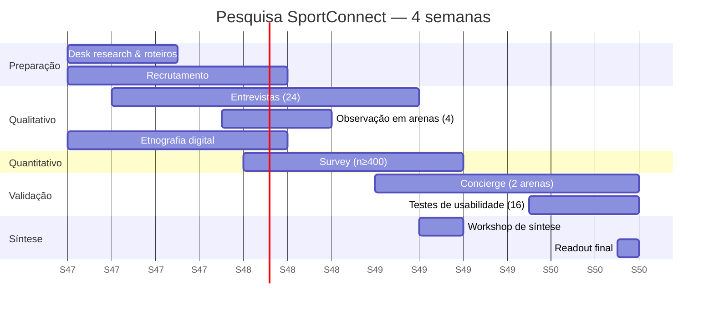
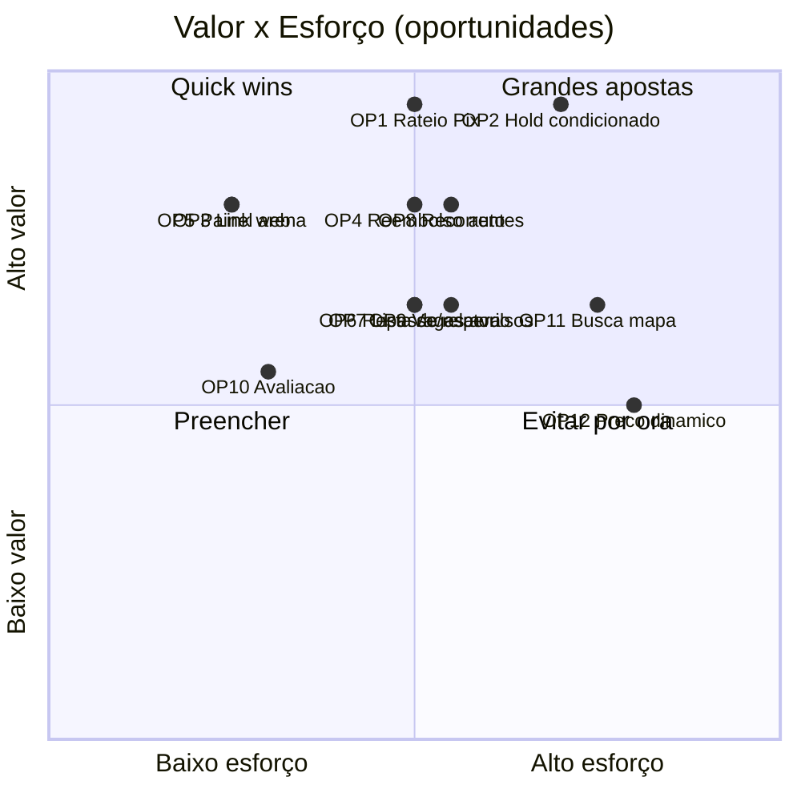

# 01 — UX Research · SportConnect

> **Status:** plano de pesquisa + artefatos proto (pré-campo). Tudo o que está marcado como **[HIPÓTESE]** ou **[HIPOTÉTICO]** ainda precisa ser validado em campo.
> **Responsável:** UX Research & Service Design · **Versão:** 1.0 · **Data:** nov/2026
> **Base:** [00-brief.md](./00-brief.md)

---

## Sumário

1. [Contexto e dados de mercado](#1-contexto-e-dados-de-mercado)
2. [Objetivos e perguntas de pesquisa](#2-objetivos-e-perguntas-de-pesquisa)
3. [Hipóteses (com risco e criticidade)](#3-hipóteses)
4. [Plano de pesquisa](#4-plano-de-pesquisa)
5. [Roteiros de entrevista](#5-roteiros-de-entrevista)
6. [Questionário de survey](#6-questionário-de-survey)
7. [Personas proto](#7-personas-proto)
8. [Jobs To Be Done](#8-jobs-to-be-done)
9. [Mapas de jornada as-is](#9-mapas-de-jornada-as-is)
10. [Panorama competitivo](#10-panorama-competitivo)
11. [Matriz de priorização de oportunidades](#11-matriz-de-priorização-de-oportunidades)
12. [Próximos passos e entregáveis de síntese](#12-próximos-passos)
13. [Fontes](#fontes)

---

## 1. Contexto e dados de mercado

| Indicador | Dado | Leitura para o SportConnect |
|---|---|---|
| Adoção do Pix | Em 2025, quase **80 bilhões** de transações e **> R$ 35 tri** movimentados; **148 mi de pessoas físicas** e **12,8 mi de empresas** usaram o Pix [1] | O atleta-alvo já paga por Pix; o atrito do pagamento é baixo. O atrito real é **cobrar e conferir**. |
| Pix vs. outros meios | No 1º semestre de 2025 o Pix respondeu por **50,9% das transações** de varejo; 45% P2P e 42,1% pessoa→empresa [2] | O padrão atual de "Pix para o organizador" (P2P) é o comportamento que vamos substituir por "Pix para a plataforma/arena". |
| Futebol amador (society) | Estimativa de mercado: **~5 mil complexos** de futebol amador e **~30 mi de praticantes**, movimentando **~R$ 25 bi/ano** (estimativa citada pela Appito, 2022) [3] | Mercado grande, fragmentado, dominado por arenas independentes. Número é estimativa de empresa — validar. |
| Modelo vigente de mensalista | Exemplo: **R$ 1,5 mil/mês por grupo** por 1 partida de 90 min/semana (Appito, SP, 2022) [3] | Confirma o modelo "grupo fixo + organizador responsável pelo pagamento" — exatamente a dor que o rateio ataca. |
| Beach tennis | Praticantes saltaram de **~400 mil (2021) para ~1,1 mi (2022)**, +175% (CBT via Máquina do Esporte) [4]; Brasil sediou **180 torneios internacionais em 2025**, mais que qualquer país [5] | Segmento com alto engajamento, jogos de 2–4 pessoas e muitas arenas novas sem software maduro. |
| Dados de beach tennis | O próprio mercado reconhece que estimativas de praticantes "variam numa faixa ampla" e faltam dados verificáveis [5] | Survey do SportConnect pode virar ativo de dados (e de marketing B2B). |
| Referência global (Playtomic) | **6.700+ clubes**, **25.000+ quadras**, **1,7 mi+ jogadores ativos/mês**, **63+ países**; reserva, partidas abertas, nível de jogador, pagamentos integrados [6][7] | Benchmark de raquete. Página pública **não menciona rateio** entre jogadores com confirmação condicionada [6] — possível diferencial (validar). |

> **Nota metodológica:** os números de mercado vêm de imprensa e de empresas do setor; servem para dimensionar, não para decisões finas. A survey (seção 6) inclui perguntas que permitem estimar frequência, ticket e meio de pagamento na nossa base.

---

## 2. Objetivos e perguntas de pesquisa

### 2.1 Objetivos

| # | Objetivo | Decisão que informa |
|---|---|---|
| O1 | Entender como jogos amadores são organizados e pagos hoje, por esporte | Escopo do MVP, defaults do fluxo de criação |
| O2 | Medir a dor de cobrança/inadimplência do organizador e da arena | Proposta de valor e precificação |
| O3 | Validar a aceitação do **hold + rateio + confirmação condicionada** | Viabilidade do fluxo central |
| O4 | Definir políticas aceitáveis (prazo do hold, regra de não pagamento, cancelamento, chuva) | Políticas de serviço (doc 02) |
| O5 | Entender a operação da arena (agenda, recepção, repasse, ferramentas atuais) | Painel da arena e onboarding B2B |
| O6 | Avaliar disposição a pagar (taxa de conveniência por cota; plano Pro) | Modelo de negócio |
| O7 | Mapear o comportamento do atleta avulso (busca de vaga, confiança) | Priorização da Fase 2 |

### 2.2 Perguntas de pesquisa

**Organizador**
- PQ1. Como o organizador forma a lista, reserva e cobra hoje? Quanto tempo gasta por semana?
- PQ2. Com que frequência ele "paga do bolso" por faltosos/inadimplentes? Quanto?
- PQ3. Ele aceitaria que o jogo só seja confirmado quando todos pagarem? Qual prazo considera justo?
- PQ4. Qual regra prefere quando faltam pagamentos (cobrir, cancelar, re-ratear)?
- PQ5. Como o grupo reage a uma taxa de R$ 1–2 por cota?

**Atleta (convidado/avulso)**
- PQ6. O atleta prefere pagar antes (garantia de vaga) ou depois (no dia)?
- PQ7. O que faz um atleta confiar num link de pagamento recebido no WhatsApp?
- PQ8. O que o atleta avulso usa para achar jogos? O que o impede de entrar num grupo desconhecido?

**Arena**
- PQ9. Como a arena gerencia agenda, sinal, cancelamentos e chuva hoje?
- PQ10. Qual a taxa de no-show/cancelamento tardio e o impacto financeiro?
- PQ11. A arena aceitaria receber **após o jogo** (repasse via split) em vez de na hora/antecipado?
- PQ12. Quem opera o dia a dia (dono, gerente, recepcionista) e com que ferramentas?

---

## 3. Hipóteses

Escala: **Risco** = probabilidade de estarmos errados (A/M/B). **Criticidade** = impacto no negócio se estivermos errados (A/M/B). Prioridade de validação = Risco × Criticidade.

| ID | Hipótese | Ator | Risco | Criticidade | Prioridade | Como validar | Critério de sucesso |
|---|---|---|---|---|---|---|---|
| H1 | Organizadores perdem dinheiro com frequência por inadimplência/faltas e isso é a maior dor | Org. | M | **A** | 🔴 1 | Entrevista + survey (Q7, Q8) | ≥ 60% relatam ter coberto valor de outro nos últimos 3 meses |
| H2 | Atletas aceitam pagar **antecipadamente** via link para garantir a vaga | Atleta | **A** | **A** | 🔴 1 | Survey (Q10) + teste de protótipo | ≥ 70% "aceitaria"/"preferiria" |
| H3 | Arenas aceitam receber **após o jogo** (D+1/D+2) se o pagamento for garantido | Arena | **A** | **A** | 🔴 1 | Entrevistas com 8+ arenas | ≥ 5 de 8 aceitam sem exigir sinal adicional |
| H4 | Um hold de 4h é suficiente para o grupo pagar | Org./Atleta | **A** | M | 🟠 2 | Teste em grupos reais (concierge) | ≥ 80% dos jogos com 100% pago em ≤ 4h |
| H5 | "Organizador cobre a diferença" é a regra padrão mais aceita | Org. | M | M | 🟠 2 | Survey (Q11) + entrevistas | É a 1ª escolha de ≥ 50% |
| H6 | Atletas toleram taxa de conveniência de R$ 1–2 por cota | Atleta | M | **A** | 🟠 2 | Survey (Q13) + teste A/B de preço | Abandono no checkout < 10% atribuível à taxa |
| H7 | Arenas pagam assinatura Pro se o app aumentar ocupação de horários vazios | Arena | **A** | M | 🟠 2 | Entrevistas + pré-venda | ≥ 3 cartas de intenção |
| H8 | O link no WhatsApp é suficiente como canal de convite (sem baixar app) | Atleta | B | **A** | 🟡 3 | Teste de usabilidade (web) | ≥ 85% concluem pagamento sem instalar app |
| H9 | Recepcionistas usam o painel se ele substituir o caderno/planilha sem trabalho extra | Arena | M | M | 🟡 3 | Observação em arena (shadowing) | Tempo por reserva ≤ ao atual |
| H10 | A dor é semelhante entre esportes (society vs. beach tennis/padel) | Todos | M | M | 🟡 3 | Segmentação da survey | Diferenças < 20 p.p. nas dores principais |
| H11 | Atletas avulsos querem achar vagas abertas e confiam em avaliações de presença | Avulso | M | B | 🟢 4 | Entrevistas + survey (Q14) | ≥ 40% buscaram vaga em grupo desconhecido no último mês |
| H12 | Chuva/cancelamento pela arena é a maior fonte de conflito de reembolso em quadras descobertas | Arena/Org. | M | M | 🟡 3 | Entrevistas com arenas descobertas | Citada no top-3 de conflitos |

---

## 4. Plano de pesquisa

### 4.1 Métodos

| Método | Objetivo / perguntas | Amostra | Duração | Saída |
|---|---|---|---|---|
| **Desk research** | Mercado, concorrentes, regulação (LGPD, CDC, regras do gateway) | — | Semana 1 | Panorama competitivo, premissas |
| **Entrevistas em profundidade** (remotas/presenciais, 45–60 min) | PQ1–PQ12 | 8 organizadores · 8 atletas (4 convidados + 4 avulsos) · 8 arenas (5 donos + 3 gerentes/recepção) = **24** | Semanas 1–3 | Transcrições, mapa de afinidade, personas, JTBD |
| **Observação em arenas** (shadowing, 3h por visita, horário de pico 18h–22h) | PQ9, PQ10, PQ12, H9 | 4 arenas (2 society, 1 beach tennis/futevôlei, 1 padel) | Semana 2 | Fotos de artefatos (caderno, quadro), cronometragens, fail points |
| **Etnografia digital** (com consentimento) | Análise de grupos de WhatsApp de pelada/beach (mensagens de cobrança, lista) | 5–8 grupos | Semanas 1–2 | Padrões de mensagem, tempo até "lista fechada" |
| **Survey quantitativa** (online, 6–8 min) | Dimensionar H1, H2, H5, H6, H10, H11 | **n ≥ 400** (margem ~±5%, 95% conf.) com cotas por esporte e região | Semanas 2–3 | Frequências, segmentação |
| **Teste de usabilidade** (protótipo navegável, moderado, 30 min) | H2, H4, H8; fluxo criar jogo → pagar cota → painel da arena | 6 organizadores · 6 atletas · 4 recepcionistas = **16** | Semana 4 | Taxa de sucesso, tempo, SUS, problemas por severidade |
| **Teste concierge (piloto "Mágico de Oz")** | H3, H4 — rateio real via link de cobrança do gateway operado manualmente | 2 arenas · 10 jogos | Semanas 3–4 (estender) | Taxa de pagamento no prazo, tempo médio de quitação |

### 4.2 Recrutamento

| Perfil | Critérios de inclusão | Canais | Incentivo |
|---|---|---|---|
| Organizador | Organizou ≥ 2 jogos pagos nos últimos 2 meses; responsável por cobrar | Grupos de WhatsApp/Facebook de pelada e beach, indicação de arenas, Instagram de arenas | Vale-quadra R$ 100 (parceria com arena) ou Pix R$ 80 |
| Atleta convidado | Jogou ≥ 2 vezes/mês nos últimos 2 meses em jogo pago | Indicação dos organizadores (bola de neve) | Pix R$ 50 |
| Atleta avulso | Buscou/entrou em jogo de desconhecidos nos últimos 3 meses | Grupos "procura-se jogador", apps de partida aberta, arenas | Pix R$ 50 |
| Dono de arena | Opera ≥ 2 quadras de aluguel por hora | Visita presencial, associações/federações, fornecedores de grama sintética/areia | Relatório de benchmark + 3 meses de Pro grátis |
| Gerente/recepção | Opera agenda diariamente | Via dono da arena | Pix R$ 80 (fora do expediente) |

**Diversidade obrigatória da amostra:** ≥ 40% mulheres (forte no beach tennis/vôlei), ≥ 2 capitais + 1 cidade do interior, faixas de renda B/C, ≥ 2 pessoas com mais de 45 anos, ≥ 1 pessoa com deficiência visual ou motora no teste de usabilidade. Cotas por esporte na survey: society/futsal 45%, beach tennis/futevôlei/vôlei de praia 30%, padel/tênis 15%, outros 10%.

**Ética/LGPD:** TCLE assinado digitalmente; gravação só com consentimento; dados pseudonimizados (P01, A03, R05); prints de WhatsApp com nomes e números borrados; descarte de gravações em 90 dias.

### 4.3 Cronograma (4 semanas)

| Semana | Atividades | Marco |
|---|---|---|
| **S1** | Desk research · finalizar roteiros e survey · recrutamento · 6 entrevistas (piloto do roteiro) · início etnografia digital | Roteiros validados; panorama competitivo |
| **S2** | 10 entrevistas · 4 observações em arena · lançamento da survey · protótipo baixa fidelidade | Primeiro mapa de afinidade |
| **S3** | 8 entrevistas · fechamento da survey · síntese (afinidade, personas, JTBD, jornadas) · protótipo navegável · início do concierge | Workshop de síntese com produto/engenharia |
| **S4** | 16 testes de usabilidade · análise da survey · relatório final · priorização | Readout + backlog priorizado |

### 4.4 Análise

- **Mapa de afinidade** (observações → temas → insights) por ator, depois cruzado.
- **JTBD** extraído de "momentos de luta" nas entrevistas.
- **Survey:** frequências, cruzamentos por esporte/região/gênero, teste qui-quadrado para H10.
- **Usabilidade:** taxa de sucesso por tarefa, tempo, erros, SUS; severidade de Nielsen (0–4).
- **Concierge:** % jogos confirmados no prazo; tempo médio até 100% pago; distribuição de quitação por hora.

---

## 5. Roteiros de entrevista

Estrutura comum: **Aquecimento (5') → Contexto (10') → Aprofundamento (20') → Reação a conceito (10') → Encerramento (5')**. Pedir sempre "a última vez que…" (comportamento real) em vez de opinião genérica.

### 5.1 Organizador (60 min)

**Aquecimento**
1. Fala um pouco sobre você e sobre o(s) jogo(s) que você organiza. Qual esporte, há quanto tempo, quantas pessoas?
2. Como você virou o "organizador"?

**Contexto — a última vez**
3. Me conta passo a passo como foi organizar o último jogo, desde a ideia até o apito final.
4. Como você escolheu a quadra/horário? Como reservou? Precisou pagar sinal?
5. Como montou a lista? Onde ela fica (WhatsApp, planilha, papel)?
6. Como cobrou as pessoas? Quanto tempo depois do jogo todos tinham pago?

**Aprofundamento**
7. Qual foi a última vez que alguém não pagou ou faltou? O que você fez? Quanto custou pra você?
8. Quanto tempo por semana você gasta organizando? Qual parte é mais chata?
9. Já teve que cancelar um jogo? Por quê? Como foi com a arena e com o grupo?
10. E quando chove (se descoberta) ou a arena cancela? Como é resolvido o dinheiro?
11. Existe mensalista e avulso no seu grupo? Como funciona a diferença de preço?
12. Você já usou algum app pra isso? O que achou? Por que parou/continua?
13. Se você pudesse mudar uma coisa nessa rotina, o que seria?

**Reação a conceito** (mostrar storyboard de 4 quadros: criar jogo → link no WhatsApp → cada um paga → confirmado)
14. O que você entendeu? O que te agrada? O que te preocupa?
15. Se em 4 horas nem todo mundo pagar, o que deveria acontecer? (Apresentar as 3 regras e pedir para ordenar.)
16. Como o seu grupo reagiria a pagar antes? E a uma taxa de R$ 1–2 por pessoa?
17. Você trocaria a arena atual por outra para usar isso? E pediria pra sua arena aderir?

**Encerramento**
18. Tem algo que eu não perguntei e que deveria? Conhece alguém (arena/organizador) com quem eu deveria falar?

### 5.2 Atleta — convidado e avulso (45 min)

**Aquecimento**
1. Quais esportes você pratica? Com que frequência? Em quantos grupos diferentes?

**Contexto**
2. Como você fica sabendo de um jogo e confirma presença? (Pedir para mostrar o grupo de WhatsApp, se confortável.)
3. Quando e como você paga? Pra quem? Já esqueceu de pagar? Já pagou e não jogou?
4. *(Avulso)* Me conta a última vez que você procurou um jogo com gente que não conhecia. Onde procurou? Como foi?
5. *(Avulso)* O que te faz confiar ou desconfiar de um grupo novo? E do nível do jogo?

**Aprofundamento**
6. Já desistiu de um jogo em cima da hora? O que aconteceu com o seu dinheiro? Achou justo?
7. Você clica em links de pagamento enviados no WhatsApp? O que te faz desconfiar de um link?
8. Prefere Pix ou cartão? Por quê? Já parcelou algo esportivo?

**Reação a conceito** (mostrar tela do link de convite e checkout Pix)
9. O que você faria nessa tela? O que esperaria acontecer depois de pagar?
10. Se o jogo não fechar e for cancelado, como você espera receber seu dinheiro de volta? Em quanto tempo?
11. Pagaria R$ 1–2 a mais pela garantia de vaga e reembolso automático?

**Encerramento**
12. Algo mais? Indicaria algum organizador?

### 5.3 Dono de arena / gerente / recepção (60 min, de preferência na arena)

**Aquecimento**
1. Me fala da arena: quantas quadras, quais esportes, cobertas/descobertas, horário de funcionamento, equipe.

**Contexto**
2. Como funciona uma reserva hoje, do primeiro contato ao fim do jogo? Quem faz o quê? (Pedir para mostrar caderno/sistema.)
3. Como é o pagamento? Sinal? Na hora? Mensalista paga quando? Quais meios?
4. Qual a ocupação média? Quais horários sobram? O que você faz para vendê-los?

**Aprofundamento**
5. Com que frequência um grupo cancela em cima da hora ou não aparece? O que acontece com o horário e o dinheiro?
6. E a inadimplência de mensalistas? Já teve que "correr atrás" de organizador?
7. Como você lida com chuva / quadra em manutenção / iluminação queimada?
8. Quais sistemas/apps você já usou? Quanto paga? O que falta neles?
9. *(Recepção)* Qual é o momento mais estressante do seu turno? Quantas mensagens de WhatsApp recebe por dia?
10. Como você faz o fechamento financeiro do dia/mês? Quem confere?

**Reação a conceito** (mostrar painel de agenda + fluxo de hold e repasse)
11. Se uma reserva ficar "pré-reservada" por até 4h esperando o grupo pagar, isso funciona pra você? Qual prazo seria aceitável?
12. Você aceitaria receber o valor 1–2 dias após o jogo, com garantia de pagamento? E um percentual de taxa? Até quanto?
13. Que regra de cancelamento você quer impor? Quem deve decidir sobre chuva?
14. O que faria você pagar por um plano Pro?

**Encerramento**
15. Posso voltar para observar uma noite movimentada? Indica outra arena?

---

## 6. Questionário de survey

**Público:** quem praticou esporte amador pago (aluguel de quadra) nos últimos 3 meses. **Tempo:** 6–8 min. **Canais:** arenas parceiras (QR code na recepção), grupos de esporte, anúncios segmentados no Instagram. **Filtro:** Q1 e Q2.

| # | Pergunta | Tipo | Opções |
|---|---|---|---|
| Q1 | Nos últimos 3 meses, você jogou algum esporte em quadra/campo alugado(a)? | Única (filtro) | Sim · Não (encerra) |
| Q2 | Quais esportes você jogou em quadra alugada nos últimos 3 meses? | Múltipla | Futebol society · Futsal · Vôlei · Vôlei de praia · Futevôlei · Beach tennis · Padel · Tênis · Basquete · Handebol · Outro |
| Q3 | Com que frequência você joga? | Única | Mais de 2x/semana · 1–2x/semana · 2–3x/mês · 1x/mês ou menos |
| Q4 | Nesses jogos, qual é normalmente o seu papel? | Única | Eu organizo/reservo · Às vezes organizo · Sou convidado(a) · Procuro jogos/vagas avulsas |
| Q5 | Quanto você paga, em média, por jogo (sua parte)? | Única | Até R$ 15 · R$ 16–30 · R$ 31–50 · R$ 51–80 · Mais de R$ 80 |
| Q6 | Como você normalmente paga sua parte? | Única | Pix para o organizador · Pix/cartão direto para a arena · Dinheiro no dia · Mensalidade fixa · Outro |
| Q7 | *(Se organiza)* Nos últimos 3 meses, você teve que cobrir do seu bolso a parte de alguém que não pagou ou faltou? | Única | Nunca · 1 vez · 2–3 vezes · Mais de 3 vezes |
| Q8 | *(Se organiza)* Quanto tempo por semana você gasta organizando (lista, reserva, cobrança)? | Única | < 15 min · 15–30 min · 30–60 min · > 1h |
| Q9 | Quais destas situações aconteceram com você nos últimos 3 meses? | Múltipla | Jogo cancelado por falta de gente · Alguém desistiu em cima da hora · Chuva/arena cancelou · Discussão sobre pagamento · Paguei e não joguei sem reembolso · Nenhuma |
| Q10 | Você pagaria sua parte **antes** do jogo, por um link, se isso garantisse sua vaga e o reembolso automático caso o jogo não aconteça? | Escala 1–5 | 1 = Com certeza não … 5 = Com certeza sim |
| Q11 | Se alguns jogadores não pagarem no prazo, o que deveria acontecer? (ordene) | Ranking | Organizador cobre a diferença · Cancela e devolve a todos · Divide a diferença entre quem pagou · Abre a vaga para outra pessoa |
| Q12 | Até quantas horas antes do jogo seria justo exigir que todos tenham pago? | Única | 48h · 24h · 12h · 4h · 2h · Na hora do jogo |
| Q13 | Qual taxa de serviço por pessoa você acharia aceitável por esse recurso? | Única | R$ 0 · Até R$ 1 · Até R$ 2 · Até R$ 3 · Mais de R$ 3 |
| Q14 | Nos últimos 3 meses, você procurou jogar com pessoas que não conhecia? Onde? | Múltipla | Não procurei · Grupos de WhatsApp · Instagram · App (qual?) · Na própria arena · Outro |
| Q15 | Perfil: idade · gênero · cidade/UF · faixa de renda familiar · e-mail opcional para participar de testes | Demográfico | — |

---

## 7. Personas proto

> ⚠️ **Proto-personas** construídas a partir de desk research e conhecimento de domínio. Nomes, citações e números são **[HIPOTÉTICOS]** e serão revisados após as entrevistas (S3).

### 7.1 Rafael, 34 — "O organizador do futebol de quinta"

| | |
|---|---|
| **Perfil** | Analista de TI, São Paulo (zona leste). Organiza o society de quinta 20h há 6 anos; 14 fixos + 4 rotativos. Paga R$ 280/h. |
| **Objetivos** | Jogo acontecer toda semana sem stress; não tirar dinheiro do bolso; manter o grupo unido. |
| **Dores** | Persegue Pix até domingo; cobre 1–2 faltosos por mês; arena cobra o horário inteiro mesmo com 8 pessoas; vira "chato" por cobrar. |
| **Comportamentos** | Lista no WhatsApp com emojis ✅; planilha no Google Sheets que ninguém mais vê; manda print do Pix da arena no grupo. |
| **Tecnologia** | Alta. Testou 2 apps de pelada e abandonou ("ninguém baixou"). |
| **Citação [HIPOTÉTICA]** | *"Eu não quero ser o banco da pelada. Quero jogar bola."* |
| **Sinal de sucesso** | Zero mensagens de cobrança; lista fechada até terça. |

### 7.2 Camila, 29 — "A jogadora de beach tennis"

| | |
|---|---|
| **Perfil** | Dentista, Florianópolis. Joga 3x/semana: duplas com amigas, aula com professor e "rachão" de sábado. Participa de 5 grupos. |
| **Objetivos** | Achar parceiras do mesmo nível; não perder horário bom (18h–21h); jogar torneios amadores. |
| **Dores** | Horários nobres esgotam em minutos; cada arena tem um jeito de reservar (Instagram, WhatsApp, app); dividir R$ 120 entre 4 pessoas e alguém "esquece". |
| **Comportamentos** | Paga tudo por Pix na hora; reserva pelo celular entre pacientes; segue arenas no Instagram. |
| **Tecnologia** | Média-alta; prioriza rapidez. |
| **Citação [HIPOTÉTICA]** | *"Se eu não reservar na segunda de manhã, não jogo na semana."* |
| **Sinal de sucesso** | Reserva + divisão feitas em < 1 min, sem cobrar ninguém. |

### 7.3 Diego, 24 — "O atleta avulso que procura vagas"

| | |
|---|---|
| **Perfil** | Estudante/estagiário, mudou para Belo Horizonte há 1 ano. Joga futsal e futevôlei; não tem grupo fixo. |
| **Objetivos** | Jogar 2x/semana sem compromisso de mensalidade; conhecer gente; jogar em nível equilibrado. |
| **Dores** | Depende de "tá faltando 1!" em grupos; chega e o jogo está cheio ou foi cancelado; tem receio de pagar a desconhecido. |
| **Comportamentos** | Está em 8 grupos de WhatsApp de "procura-se jogador"; decide no mesmo dia; sensível a preço. |
| **Tecnologia** | Alta; prefere web/link a instalar app. |
| **Citação [HIPOTÉTICA]** | *"Já fiz Pix pra um cara que nem conhecia e cheguei lá e não tinha jogo."* |
| **Sinal de sucesso** | Encontrar e garantir vaga perto de casa em < 5 min, com reembolso garantido. |

### 7.4 Sérgio, 52 — "O dono de arena multiquadras"

| | |
|---|---|
| **Perfil** | Dono de arena em Campinas: 3 quadras society, 2 de areia (beach/futevôlei), 1 de padel coberta. 9 funcionários. Ex-jogador amador. |
| **Objetivos** | Ocupação alta nos horários vazios (manhã, tarde); receber em dia; menos dor de cabeça com cancelamento. |
| **Dores** | Mensalista que some sem pagar; horário cancelado em cima da hora fica vazio; quadra de areia parada com chuva vira briga; fechamento de caixa confuso (Pix em 3 contas). |
| **Comportamentos** | Decide no WhatsApp e no telefone; confia no gerente para o dia a dia; olha faturamento no fim do mês. Desconfia de taxas. |
| **Tecnologia** | Média-baixa; usa sistema de agenda básico e planilha. |
| **Citação [HIPOTÉTICA]** | *"Quadra vazia é dinheiro que não volta. Mas taxa de app em cima de tudo também não dá."* |
| **Sinal de sucesso** | +15% de ocupação e zero inadimplência, com taxa total ≤ o que já paga em maquininha. |

### 7.5 Juliana, 27 — "A gerente/recepcionista da arena"

| | |
|---|---|
| **Perfil** | Recepcionista/gerente de turno (16h–23h) na arena do Sérgio. Atende WhatsApp da arena, recebe pagamentos, controla agenda e bar. |
| **Objetivos** | Turno sem conflito; agenda sempre certa; conseguir fechar o caixa rápido. |
| **Dores** | 150+ mensagens/dia; dupla reserva por erro de anotação; grupos chegando sem ter pago "o organizador disse que pagou"; decidir sozinha sobre chuva. |
| **Comportamentos** | Caderno + WhatsApp Business + planilha; consulta o dono em decisões de dinheiro; usa o celular pessoal. |
| **Tecnologia** | Média; aprende rápido se a tela for simples. |
| **Citação [HIPOTÉTICA]** | *"Meu medo é o grupo chegar e a quadra estar com outro time."* |
| **Sinal de sucesso** | Ver em um só lugar "quem joga agora, pagou ou não", e cancelar por chuva com um toque. |

---

## 8. Jobs To Be Done

Formato: **Quando** [situação], **eu quero** [motivação], **para** [resultado esperado].

### 8.1 Organizador

| Tipo | Job |
|---|---|
| **Principal (funcional)** | Quando chega a semana do jogo, eu quero garantir quadra e gente pagante com o mínimo de esforço, para que o jogo aconteça sem eu bancar ninguém. |
| Funcional | Quando alguém desiste, eu quero preencher a vaga rapidamente, para não perder o jogo nem o dinheiro. |
| Funcional | Quando a quadra é cancelada (chuva/manutenção), eu quero que todos sejam reembolsados automaticamente, para não ter que intermediar dinheiro. |
| Emocional | Quero me sentir organizado e respeitado, não "o chato que cobra". |
| Social | Quero ser visto pelo grupo como quem faz o jogo acontecer, com transparência sobre o dinheiro. |

### 8.2 Atleta (convidado e avulso)

| Tipo | Job |
|---|---|
| **Principal (funcional)** | Quando sou chamado para um jogo, eu quero confirmar e pagar minha parte em segundos, para garantir minha vaga sem burocracia. |
| Funcional (avulso) | Quando estou livre e com vontade de jogar, eu quero achar um jogo perto, no meu nível, com vaga garantida, para jogar hoje mesmo. |
| Funcional | Quando o jogo não acontece, eu quero meu dinheiro de volta sem precisar pedir, para não ficar no prejuízo. |
| Emocional | Quero sentir segurança ao pagar alguém que não conheço. |
| Social | Quero ser reconhecido como alguém confiável (paga e aparece) para ser chamado de novo. |

### 8.3 Arena (dono e operação)

| Tipo | Job |
|---|---|
| **Principal (funcional)** | Quando um horário é reservado, eu quero ter certeza de que será pago, para não perder receita com quadra vazia ou calote. |
| Funcional (dono) | Quando há horários ociosos, eu quero divulgá-los para quem quer jogar, para aumentar a ocupação. |
| Funcional (recepção) | Quando começa o turno, eu quero ver a agenda real e o status de pagamento de cada jogo, para evitar conflito na porta. |
| Funcional (dono) | Quando fecho o mês, eu quero um relatório consolidado de receitas e repasses, para conciliar sem planilha. |
| Emocional | Quero menos discussões com clientes sobre dinheiro e chuva. |

---

## 9. Mapas de jornada as-is

> Baseados em hipóteses de domínio; serão refinados com entrevistas e observação. Emoções: 😀 positiva · 😐 neutra · 😟 negativa · 😡 muito negativa.

### 9.1 Organizador (Rafael) — jogo semanal de society

| Etapa | 1. Planejar | 2. Reservar | 3. Montar lista | 4. Cobrar | 5. Véspera/dia | 6. Jogo | 7. Pós-jogo |
|---|---|---|---|---|---|---|---|
| **Ações** | Decide dia/horário; checa disponibilidade de amigos | Liga/manda WhatsApp para arena; às vezes paga sinal | Posta lista no grupo; espera ✅ | Manda chave Pix; confere extrato um a um | Lembra no grupo; corre atrás de faltantes; procura substituto | Paga arena (sobra/falta); joga | Cobra quem não pagou; atualiza planilha |
| **Pontos de contato** | WhatsApp | Telefone, WhatsApp da arena, Instagram | Grupo de WhatsApp | Pix, app do banco, planilha | WhatsApp | Recepção da arena, maquininha | WhatsApp, planilha |
| **Pensamentos** | "Vai dar gente?" | "Espero que não deem o horário pra outro" | "Por que ninguém responde?" | "Fulano de novo não pagou" | "Faltam 2… vou ter que pagar" | "Ufa, rolou" | "Não quero mais organizar" |
| **Emoção** | 😐 | 😐 | 😟 | 😡 | 😡 | 😀 | 😟 |
| **Dores** | Incerteza de quórum | Sem confirmação formal; sinal adiantado do bolso | Confirmação ≠ compromisso | Conferência manual; constrangimento | Desistências tardias; ninguém repõe | Pagar diferença | Dívidas pequenas acumuladas |
| **Oportunidades** | Jogos recorrentes com convite automático | Hold com confirmação formal da arena | Link único com vagas e status | **Rateio automático + Pix por cota** | Lista de espera + substituição automática | Check-in; arena já sabe que está pago | Zero cobrança pós-jogo; histórico de presença |

### 9.2 Arena (Sérgio + Juliana) — gestão de uma reserva

| Etapa | 1. Receber pedido | 2. Registrar | 3. Garantir pagamento | 4. Gerir mudanças | 5. Recepcionar | 6. Jogo | 7. Fechar caixa |
|---|---|---|---|---|---|---|---|
| **Ações** | Responde WhatsApp/telefone sobre horários | Anota no caderno/sistema | Pede sinal ou confia no mensalista | Trata cancelamentos, chuva, troca de horário | Confere nome e pagamento na chegada | Controla tempo, iluminação, bar | Concilia Pix de várias contas, maquininha, dinheiro |
| **Pontos de contato** | WhatsApp Business, telefone, Instagram | Caderno, planilha, sistema básico | Pix, maquininha | WhatsApp | Balcão | Quadra, bar | Planilha, extrato bancário |
| **Pensamentos** | "Tenho que responder rápido senão vai pra concorrência" | "Será que já anotei esse?" | "Esse organizador é bom pagador?" | "De novo cancelando 2h antes…" | "Ele diz que já pagou…" | 😀 "Casa cheia" | "Não bate o caixa" |
| **Emoção** | 😐 | 😟 | 😟 | 😡 | 😡 | 😀 | 😟 |
| **Dores** | Volume de mensagens; perde vendas fora do horário | Dupla reserva; erro humano | Inadimplência; sinal gera atrito | Horário vazio sem reposição; regra informal | Conflito na porta; sem comprovante | Atrasos invadem próximo horário | Conciliação manual; taxas diversas |
| **Oportunidades** | Agenda online 24/7 com disponibilidade real | Agenda única à prova de conflito | **Confirmação só com 100% pago** | Política automática + revenda de horário liberado | Painel "pagou ✓" por jogo; check-in | Avisos de fim de horário | Repasse consolidado e relatório |

---

## 10. Panorama competitivo

> Avaliação a partir de informações públicas; itens marcados com "?" precisam ser verificados (teste das apps) na S1.

| Solução | Tipo | Esportes | Reserva de quadra | Rateio por cota com confirmação condicionada | Pix nativo | Partidas abertas / avulsos | Gestão para arena | Observações |
|---|---|---|---|---|---|---|---|---|
| **WhatsApp + planilha + Pix P2P** | Status quo | Todos | Manual | ❌ (manual) | ✅ (P2P) | Grupos "procura-se" | ❌ | Concorrente real nº 1; custo zero, atrito alto |
| **Playtomic** (+ Playtomic Manager) | Marketplace + SaaS global | Raquete (padel, tênis, pickleball) | ✅ | ? (página não menciona divisão de pagamento [6]) | ? | ✅ partidas abertas e nível [7] | ✅ agenda, cobrança, relatórios, eventos [6] | 6,7 mil clubes, 63+ países [6]; foco em raquete |
| **Appito** | Rede de arenas própria + app | Futebol society | ✅ (nas próprias arenas) | ❌ (mensalidade por grupo [3]) | ? | ❌ | Própria | Captou R$ 27 mi (2022); estatísticas de jogo [3] |
| **Apps de pelada** (ex.: PeladaPro, Chega, FutMatch) [8] | App de organização de grupo | Principalmente futebol | ❌/parcial | ❌/? | ? | Parcial | ❌ | Lista, sorteio de times, estatísticas; não resolvem a arena |
| **Softwares de gestão de quadras** (ex.: Anolla, CourtReserve, WebQuadras) [9] | SaaS B2B | Vários | ✅ (lado arena) | ❌ | Varia | ❌ | ✅ | Foco no operador; atleta é secundário |
| **Apps de marca própria por arena** (white-label) [10] | App da arena | Vários | ✅ (só aquela arena) | ? | ? | ❌ | ✅ | Fragmenta o atleta: "um app por arena" |
| **SportConnect** | Plataforma 3 lados | **Multiesporte** | ✅ hold em tempo real | ✅ **núcleo do produto** | ✅ principal | Fase 2 | ✅ (MVP simples → Pro) | Diferencial = pagamento garantido para arena **e** organizador |

### Diferenciais propostos

1. **"Só confirma quando todo mundo pagou"** — rateio automático com hold e regras de não pagamento escolhidas pelo organizador. Protege organizador (não banca ninguém) e arena (não tem calote).
2. **Pix-first, sem baixar app** — atleta paga pelo link no WhatsApp (Web/Wasm).
3. **Multiesporte e multiarena** — um só lugar para society, areia e raquete; atleta não precisa de um app por arena.
4. **Políticas de serviço automáticas** — chuva, desistência e reembolso tratados por regra, não por discussão.
5. **Split nativo** — arena recebe direto do gateway; plataforma não custodia recursos.

---

## 11. Matriz de priorização de oportunidades

Pontuação 1–5. **Valor** = média de (dor do usuário, impacto no negócio). **Esforço** = complexidade técnica + operacional. **Confiança** = força da evidência atual. **Score** = Valor × Confiança ÷ Esforço.

| # | Oportunidade | Ator | Dor | Negócio | Esforço | Confiança | Score | Quadrante | Fase |
|---|---|---|---|---|---|---|---|---|---|
| OP1 | Rateio automático com Pix por cota | Org./Atleta | 5 | 5 | 3 | 4 | **6,7** | Quick win estratégico | MVP |
| OP2 | Hold com confirmação condicionada a 100% pago | Org./Arena | 5 | 5 | 4 | 3 | **3,8** | Grande aposta | MVP |
| OP3 | Link de convite sem instalação (web) | Atleta | 4 | 4 | 2 | 4 | **8,0** | Quick win | MVP |
| OP4 | Reembolso automático (cancelamento/chuva) | Todos | 4 | 4 | 3 | 3 | **4,0** | Grande aposta | MVP |
| OP5 | Painel de agenda com status de pagamento | Arena | 4 | 4 | 2 | 4 | **8,0** | Quick win | MVP |
| OP6 | Repasse consolidado + relatório | Arena | 3 | 4 | 3 | 3 | **3,5** | Preencher | MVP (simples) |
| OP7 | Lista de espera e substituição automática | Org./Avulso | 4 | 3 | 3 | 3 | **3,5** | Preencher | Fase 2 |
| OP8 | Jogos recorrentes | Org. | 4 | 4 | 3 | 3 | **4,0** | Grande aposta | Fase 2 |
| OP9 | Vagas abertas para avulsos | Avulso/Arena | 3 | 4 | 3 | 2 | **2,3** | Avaliar | Fase 2 |
| OP10 | Avaliação de presença/pontualidade | Todos | 3 | 3 | 2 | 2 | **3,0** | Preencher | Fase 2 |
| OP11 | Busca por mapa/esporte/preço | Avulso | 3 | 4 | 4 | 2 | **1,8** | Evitar por ora | Fase 3 |
| OP12 | Preço dinâmico para horários ociosos | Arena | 2 | 4 | 4 | 2 | **1,5** | Evitar por ora | Fase 3 |

---

## 12. Próximos passos

1. Validar roteiros em 2 entrevistas piloto (S1) e ajustar.
2. Fechar parceria com 2 arenas para observação e concierge (S1–S2).
3. Workshop de síntese (S3): afinidade → insights → atualizar personas/JTBD/jornadas (remover marcações [HIPOTÉTICO] onde houver evidência).
4. Readout (S4): status de cada hipótese (✅ validada / ⚠️ parcial / ❌ refutada) e impacto nos docs 02 (políticas) e 03 (PRD).
5. Repositório de pesquisa: transcrições pseudonimizadas, fotos de artefatos, base da survey, highlight reel de citações reais.

---

## Fontes

1. BM&C News — "Pix 2025: 80 bilhões de transações, R$ 35 trilhões" (dados do Relatório de Gestão do Pix 2023–2025, Banco Central), ago/2026. https://bmcnews.com.br/economia/pix-2025-80-bilhoes-transacoes-35-trilhoes-banco-central/
2. Jornal do Brasil (Informe JB) — "Pix já domina mais de 50% das transações financeiras" (Estatísticas de Pagamentos de Varejo e de Cartões, BCB, 1º sem./2025), nov/2025. https://www.jb.com.br/brasil/informe-jb/2025/11/1057568-pix-ja-domina-mais-de-50-das-transacoes-financeiras.html
3. Startups.com.br — "Conheça a Appito, que levantou R$ 27 mi para mudar a pelada da turma", jul/2022. https://startups.com.br/negocios/conheca-a-appito-que-levantou-r-27-mi-para-mudar-a-pelada-da-turma/
4. Máquina do Esporte — "Beach tennis atrai elite ao país e vê aumento de 175% no número de praticantes em um ano" (dados CBT), fev/2023. https://maquinadoesporte.com.br/beach-tennis/beach-tennis-atrai-elite-ao-pais-e-ve-aumento-de-175-no-numero-de-praticantes-em-um-ano/
5. Brazil Journal — "Beach tennis, um mercado sem dono", set/2026. https://braziljournal.com/beach-tennis-um-mercado-sem-dono
6. Playtomic — "O que é a Playtomic Manager?". https://playtomic.com/pt/playtomic-manager
7. Playtomic — página institucional (ES). https://playtomic.com/es
8. Exemplos de apps de organização de pelada: PeladaPro (https://www.producthunt.com/products/peladapro), Chega (https://mwm.ai/pt/apps/chega/1084859198), FutMatch (https://apps.apple.com/us/app/futmatch/id6754748640)
9. Softwares de gestão de quadras: Anolla (https://anolla.com/pt/software-de-campos-desportivos), CourtReserve (https://www.capterra.com.br/reviews/152562/courtreserve), WebQuadras (https://apps.apple.com/us/app/webquadras/id954338761)
10. Exemplo de app próprio de arena: Arena Vila Maria (https://apps.apple.com/us/app/id6754067757)
11. Também consultado (contexto de padel, sem dados extraídos): Gazeta SP — "Mais de 600 mil praticantes: padel dispara no Brasil". https://www.gazetasp.com.br/esportes/mais-de-600-mil-praticantes-padel-dispara-no-brasil-e-e-o-esporte-que/

> Observação: o título da fonte 11 indica > 600 mil praticantes de padel no Brasil; a página não pôde ser acessada para confirmar metodologia — tratar como indicativo.
