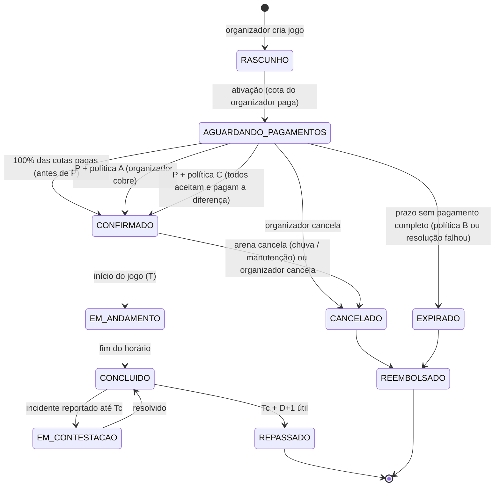
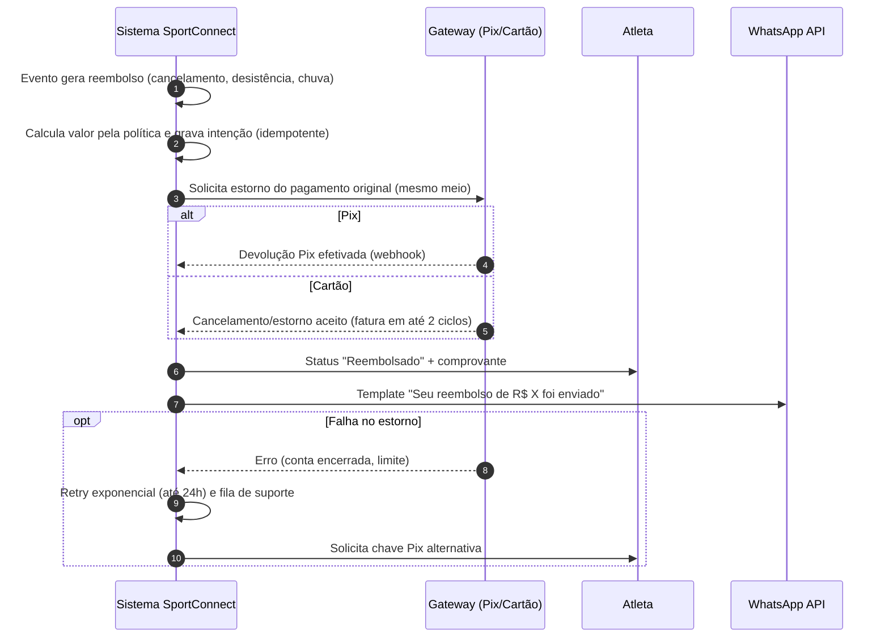
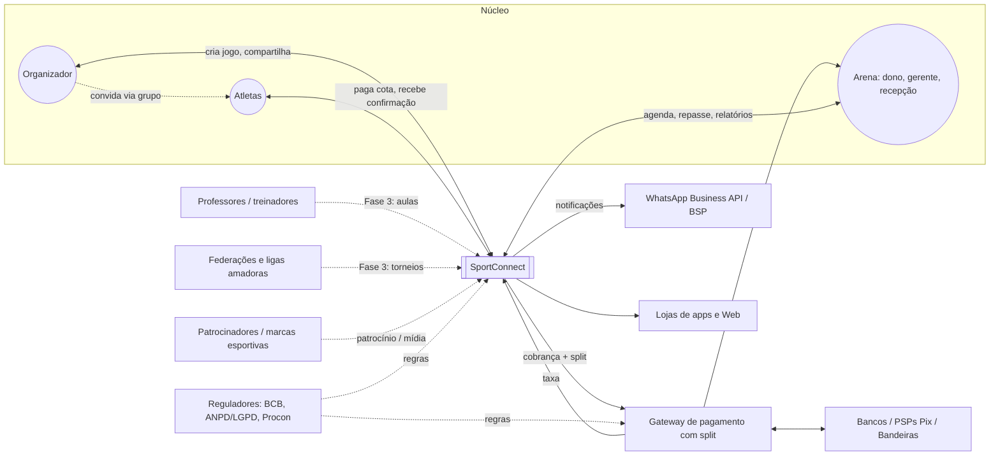

# 02 — Service Design · SportConnect

> **Status:** proposta v1.0 (pré-validação). Políticas e prazos são **propostas** a validar com a pesquisa ([01-ux-research.md](./01-ux-research.md), hipóteses H3, H4, H5, H12) e com revisão jurídica (CDC, LGPD, regras do gateway e do Pix).
> **Base:** [00-brief.md](./00-brief.md) · **Data:** nov/2026
> **v1.1 (17/11/2026):** o modelo de prazos e os nomes dos estados foram alinhados ao PRD ([03-product-design-prd.md](./03-product-design-prd.md), RN-09 a RN-12). Em caso de divergência, vale o PRD.

---

## Sumário

1. [Princípios do serviço](#1-princípios-do-serviço)
2. [Glossário e linha do tempo de referência](#2-glossário-e-linha-do-tempo-de-referência)
3. [Service blueprint — fluxo central](#3-service-blueprint--fluxo-central)
4. [Blueprints dos fluxos de exceção](#4-blueprints-dos-fluxos-de-exceção)
5. [Políticas de serviço propostas](#5-políticas-de-serviço-propostas)
6. [Ecossistema de stakeholders e mapa de valor](#6-ecossistema-de-stakeholders-e-mapa-de-valor)
7. [Pontos de falha e mitigação](#7-pontos-de-falha-fail-points-e-mitigação)
8. [Questões em aberto](#8-questões-em-aberto)
9. [Fontes](#fontes)

---

## 1. Princípios do serviço

| # | Princípio | Implicação no serviço |
|---|---|---|
| P1 | **Ninguém banca ninguém sem querer** | Reserva só é confirmada com 100% das cotas pagas (ou cobertura explícita do organizador). |
| P2 | **A regra decide, não a discussão** | Toda exceção (chuva, desistência, no-show) tem política automática, visível antes do pagamento. |
| P3 | **Dinheiro nunca "some"** | Todo pagamento tem estado visível: pago → retido → repassado / reembolsado. Reembolso é automático, pelo mesmo meio. |
| P4 | **Zero instalação para o atleta** | Link web abre, identifica, cobra via Pix em < 60 s. |
| P5 | **A agenda da arena é a fonte da verdade** | Hold bloqueia o horário em tempo real; nada é vendido duas vezes. |
| P6 | **Plataforma não custodia** | Valores ficam no gateway (split programado/conta escrow do gateway); a plataforma só orquestra. |
| P7 | **Comunicação no canal que o usuário já usa** | WhatsApp (API oficial) + push + e-mail como fallback. |

---

## 2. Glossário e linha do tempo de referência

| Termo | Definição |
|---|---|
| **T** | Horário de início do jogo. |
| **Hold** | Pré-reserva do horário na agenda da arena enquanto as cotas são pagas. |
| **Ativação** | Instante em que a cota do organizador está paga (e, na política A com cartão, a pré-autorização foi aprovada). É quando o horário vira pré-reserva e os prazos começam a contar (PRD, RN-09). |
| **Prazo do hold (H)** | `min(ativação + duração_hold, T − 2h)`. A duração padrão é 4h e a arena pode configurá-la entre 1h e 48h (PRD, RN-10). Nunca ultrapassa T − 2h. |
| **Prazo das cotas (P)** | Último instante para os atletas pagarem. Política A com Pix e política C: `P = H − 30 min` (janela de resolução). Política A com cartão e política B: `P = H` (PRD, RN-11). |
| **Cota** | Valor total ÷ nº de vagas (ex.: R$ 240 ÷ 12 = R$ 20) + taxa de conveniência (R$ 1–2). |
| **Regra de não pagamento** | Escolhida na criação: **(a) organizador cobre a diferença** (padrão), **(b) cancelar e reembolsar todos**, **(c) re-ratear entre pagantes** (exige aceite de cada pagante). |
| **Retenção** | Valor pago fica no gateway com split programado; não é liberado à arena antes do jogo. |
| **Janela de contestação (Tc)** | Fim do jogo + 12h: período para arena ou organizador reportar incidente antes do repasse. |
| **Repasse** | Liberação do split para a arena (líquido de taxas) após Tc — proposta: D+1 útil para Pix. |
| **Check-in** | Confirmação de presença (QR na recepção ou geolocalização) — evidência para no-show e disputas. |

**Linha do tempo padrão (jogo quinta 20h, criado segunda 10h):**

```
Seg 10:00  Ativação (cota do organizador paga) ──► Seg 14:00 H (fim do hold, 4h)
                                   Seg 13:30 P (política A-Pix ou C; nas demais, P = H)
                                   │ 100% pago? ──sim──► CONFIRMADO (a qualquer momento antes de P)
                                   └─não──► aplica regra (a/b/c) em P; resolução até H
Qui 18:00  T−2h  (limite absoluto de hold; lembretes finais)
Qui 20:00  T     (check-in, jogo)
Qui 21:00  Fim do jogo
Sex 09:00  Tc    (fim da janela de contestação)
Sex/Seg    Repasse D+1 útil à arena
```

> **Jogos de última hora:** o rateio exige que a janela de coleta (`P − ativação`) tenha pelo menos 30 min (PRD, RN-12). Na prática: ativação até T − 2h30 (política B ou A com cartão) ou até T − 3h (A com Pix ou C). Perto do jogo, o organizador só pode reservar com **pagamento integral**: paga o valor total sozinho e o jogo nasce `CONFIRMADO`, sem rateio. O modo "reembolso ao organizador" (cobrar as cotas depois para devolver ao organizador) fica **fora do MVP**.

---

## 3. Service blueprint — fluxo central

**Fluxo:** criar jogo → hold → rateio → pagamentos → confirmação/cancelamento → jogo → repasse.

### 3.1 Visão geral (diagrama)

```mermaid
flowchart TB
    subgraph EV[Evidências físicas]
        E1[Tela de agenda da arena] --> E2[Link + card no WhatsApp] --> E3[QR/Copia-e-cola Pix] --> E4[Comprovante + status da cota] --> E5[Ingresso do jogo / QR check-in] --> E6[Recibo de reembolso ou extrato de repasse]
    end
    subgraph ORG[Organizador]
        O1[Escolhe esporte, arena, quadra, data/hora] --> O2[Define vagas e regra de não pagamento] --> O3[Compartilha link no grupo] --> O4[Acompanha painel de pagantes] --> O5{Prazo do hold}
    end
    subgraph ATL[Atleta]
        A1[Abre link] --> A2[Identifica-se: nome + celular OTP] --> A3[Paga cota via Pix/cartão] --> A4[Recebe confirmação] --> A5[Faz check-in e joga]
    end
    subgraph FS[Frontstage - App/Web]
        F1[Busca de horários disponíveis] --> F2[Resumo: valor, cota, prazo, políticas] --> F3[Página do jogo com barra de progresso] --> F4[Checkout Pix] --> F5[Status: CONFIRMADO / CANCELADO]
    end
    LOV{{"──── linha de visibilidade ────"}}
    subgraph BS[Backstage - Sistema]
        B1[Cria HOLD (na ativação) com lock otimista na agenda] --> B2[Calcula cotas e agenda timers P, H, T−2h, Tc] --> B3[Gera cobranças com split programado] --> B4[Recebe webhooks do gateway, idempotente] --> B5[Avalia 100% pago ou aplica regra] --> B6[Confirma reserva / dispara reembolsos] --> B7[Libera split após Tc]
    end
    subgraph SP[Processos de suporte]
        S1[Gateway: cobrança Pix, cartão, split, estorno] 
        S2[WhatsApp Business API: notificações]
        S3[Arena: agenda, recepção, quadra]
        S4[Suporte humano / antifraude]
    end
    O1 --> F1 --> B1
    O2 --> F2 --> B2
    O3 --> A1 --> F3
    A3 --> F4 --> B3 --> S1
    S1 -- webhook --> B4 --> B5
    O4 --> F3
    B5 --> O5
    O5 -- 100% pago --> B6 --> F5 --> A4
    B6 --> S2
    B6 --> S3
    A5 --> S3
    S3 --> B7 --> S1
```



### 3.2 Blueprint detalhado (tabela por etapa × raia)

| Etapa | Evidências físicas | Ações do atleta | Ações do organizador | Frontstage (app/web) | ┆ Backstage (sistema) | Processos de suporte | Fail points (ver §7) |
|---|---|---|---|---|---|---|---|
| **1. Descobrir horário** | Grade de horários com preço por quadra/esporte | — | Escolhe esporte, arena, quadra, data, hora | Busca com disponibilidade em tempo real; preço total e por pessoa estimado | Consulta agenda (cache curto + leitura confirmatória) | Arena mantém agenda, preços e bloqueios atualizados | FP1 agenda desatualizada |
| **2. Criar jogo + HOLD** | Tela "Horário segurado até 14:00" com contador | — | Define nº de vagas, regra (a/b/c), visibilidade (privado / vagas abertas – Fase 2); aceita políticas | Resumo: total, cota (R$ 20 + R$ 1,50), prazos P e H, política de cancelamento em linguagem simples | Cria HOLD com lock transacional (sem overbooking); calcula P e H; agenda timers (lembretes 50%/80% do prazo, P, H, T−2h, T, Tc) | Arena recebe notificação "Horário em pré-reserva" (sem ação necessária) | FP2 corrida por horário; FP3 organizador não entende regra |
| **3. Convidar (rateio)** | Card de link no WhatsApp com prévia (esporte, arena, data, R$/pessoa, "X de 12 pagos") | Recebe link no grupo | Compartilha link no grupo (deep link + Open Graph) | Página do jogo pública via link assinado; barra de progresso; lista de confirmados | Gera token do convite; registra vagas | WhatsApp (compartilhamento nativo pelo organizador) | FP4 link visto como golpe |
| **4. Pagar cota** | QR Pix + copia-e-cola; comprovante na tela; mensagem "Cota paga ✓" no WhatsApp | Informa nome + celular (OTP por WhatsApp/SMS); escolhe Pix (padrão) ou cartão; paga | Acompanha quem pagou; pode lembrar faltantes com 1 toque | Checkout Pix com expiração de até 10 min (nunca depois de P); status em tempo real | Cria cobrança no gateway com **split programado** (arena / plataforma) e retenção até liberação; reserva a vaga por 10 min durante o checkout (PRD, RN-19) | Gateway gera QR dinâmico; banco do atleta | FP5 Pix pago e webhook atrasado; FP6 pagamento em duplicidade; FP7 vaga ultrapassada |
| **5. Conciliar** | Barra "10/12 pagos" | — | Recebe aviso "faltam 2, prazo em 1h" | Atualização ao vivo (push/WebSocket) | Webhook idempotente (chave = id da cobrança); reconciliação ativa a cada 5 min para cobranças pendentes; trata pagamentos após expiração (estorno automático) | Gateway (webhooks, API de consulta) | FP5, FP8 webhook perdido |
| **6a. Confirmação** | Mensagem "Jogo CONFIRMADO ✅" + ingresso com QR | Recebe confirmação, adiciona à agenda | Recebe confirmação; vê resumo financeiro | Status CONFIRMADO; política de cancelamento pós-confirmação destacada | Converte HOLD → RESERVA; dispara notificações; registra evento auditável | Arena: reserva aparece no painel como "Pago ✓"; WhatsApp API envia templates aprovados | FP9 notificação não entregue |
| **6b. Prazo vencido sem 100%** | Mensagem com opções claras e contagem | (Regra c) aceita ou recusa pagar diferença | (Regra a) paga a diferença em 1 toque; (b) nada a fazer | Tela de decisão com valores exatos | Aplica regra; (a) gera cobrança da diferença ao organizador com prazo de 30 min (senão cai para b); (b) cancela e estorna todos; (c) envia pedido de aceite aos pagantes | Gateway (nova cobrança ou estornos em lote) | FP10 organizador não paga diferença; FP11 re-rateio sem aceite |
| **7. Pré-jogo** | Lembrete T−24h e T−2h com endereço e mapa | Lê lembrete; pode transferir vaga (Fase 2) | Vê lista final | Página do jogo com endereço, quadra, regras da arena | Timers de lembrete; congela lista em T−2h | Arena prepara quadra; recepção vê lista do turno | FP12 quadra indisponível (ver §4.6) |
| **8. Jogo / check-in** | QR na recepção; tela do ingresso | Faz check-in (QR ou geolocalização) e joga | Faz check-in | Ingresso com QR; botão "reportar problema" | Registra check-in (evidência para no-show/disputa) | Recepção valida pelo painel; arena controla tempo e iluminação | FP13 internet ruim na arena |
| **9. Pós-jogo / contestação** | Pedido de avaliação (Fase 2) | Avalia (opcional) | Pode reportar incidente até Tc | Formulário de incidente com fotos | Abre janela Tc = fim + 12h; bloqueia repasse se incidente aberto | Suporte humano analisa incidentes | FP14 disputa sem evidência |
| **10. Repasse** | Extrato da arena: bruto, taxas, líquido, data | — | Recibo consolidado (útil p/ prestação de contas ao grupo) | Painel financeiro da arena | Após Tc: libera split (D+1 útil para Pix; cartão conforme prazo de liquidação do gateway, com antecipação opcional); gera relatório | Gateway liquida na conta da arena (subconta) | FP15 dados bancários/KYC da arena incompletos |

---

## 4. Blueprints dos fluxos de exceção

### 4.1 Chuva / cancelamento pela arena

**Gatilho:** arena declara condição impraticável (chuva em quadra descoberta, alagamento, falta de energia) antes ou durante o jogo.

| Momento | Evidência | Atleta | Organizador | Frontstage | Backstage | Suporte |
|---|---|---|---|---|---|---|
| Decisão da arena (até T−1h idealmente; ou no local) | Botão "Cancelar por chuva" no painel; mensagem com motivo | — | — | Painel da arena exige motivo + foto opcional | Valida que o jogo está CONFIRMADO; registra motivo e autor | Recepção/gerente decide (política da arena define quem pode) |
| Escolha do grupo | Mensagem: "Remarcar ou reembolsar?" | (se votação) vota | Escolhe **remarcar** (sugestões de horários livres da mesma arena) ou **reembolsar** em até 24h | Tela de remarcação com horários equivalentes | Se remarcar: cria nova reserva já paga, transfere cotas; se nenhum aceite em 24h → reembolso automático | WhatsApp API |
| Reembolso | Comprovante de estorno | Recebe 100% da cota **+ taxa de conveniência** | Recebe 100% do que pagou | Status REEMBOLSADO | Estorno Pix (devolução) / cartão (cancelamento) via gateway; plataforma absorve custo do gateway | Gateway |
| Chuva durante o jogo | Botão "Interromper jogo" com minutos jogados | — | Confirma ou contesta minutos | — | Calcula reembolso proporcional (§5) | Suporte em caso de contestação |

### 4.2 Desistência de atleta

| Situação | Atleta | Organizador | Frontstage | Backstage | Resultado |
|---|---|---|---|---|---|
| Antes da confirmação (durante hold) | Toca "Sair do jogo" | Notificado; vaga volta a aberta | Confirmação com valor a reembolsar | Estorno da cota (sem taxa de conveniência); progresso recalculado | Vaga reaberta; hold continua |
| Após confirmação, ≥ 24h antes | "Sair do jogo" → opção **transferir vaga** (link para substituto) ou **colocar na lista de espera** (Fase 2) | Aprova substituto (opcional) | Mostra "Seu reembolso depende de alguém assumir a vaga" | Quando substituto paga: estorno ao desistente | Reembolso só se vaga for preenchida |
| Após confirmação, < 24h | Pode apenas transferir vaga | — | Aviso de política | Sem estorno automático | Vaga paga; jogo segue |

### 4.3 No-show

| Tipo | Detecção | Ação de sistema | Financeiro | Reputação (Fase 2) |
|---|---|---|---|---|
| **Individual** | Sem check-in até T+15 min | Marca "ausente" provisório; organizador confirma | Sem reembolso (vaga estava paga) | −1 na pontualidade/presença; 3 no-shows em 60 dias → aviso |
| **Grupo inteiro** | Nenhum check-in até T+30 min | Arena confirma no painel | Arena recebe 100%; nada é estornado | Organizador recebe aviso |
| **Arena não abriu / quadra ocupada** | Organizador reporta com foto/geolocalização até Tc | Repasse bloqueado; suporte contata arena | Se confirmado: reembolso 100% + crédito de R$ 10/atleta custeado pela arena (multa) | Registro de incidente da arena |

### 4.4 Reembolso (fluxo genérico)



| Regra | Detalhe |
|---|---|
| Meio | Sempre pelo mesmo meio do pagamento original. Pix: devolução; cartão: estorno. |
| Prazo-alvo | Pix: até 1h após o evento. Cartão: solicitação imediata; crédito na fatura conforme emissor. |
| Crédito em vez de dinheiro | Somente por escolha do atleta (nunca imposto). |
| Taxa de conveniência | Devolvida quando a culpa não é do atleta (arena, sistema, regra b). |

### 4.5 Disputa / chargeback / MED

| Etapa | Ação | Responsável | Evidências usadas |
|---|---|---|---|
| 1. Notificação | Gateway notifica chargeback (cartão) ou MED – Mecanismo Especial de Devolução (Pix, casos de fraude/falha) | Gateway → Sistema | — |
| 2. Congelamento | Bloqueia valor da cota no repasse pendente da arena (se ainda não repassado) ou debita do **fundo de risco da plataforma** | Sistema | — |
| 3. Dossiê automático | Monta pacote: aceite dos termos, IP/dispositivo, OTP do celular, check-in, confirmação da arena, mensagens enviadas | Sistema | Logs auditáveis |
| 4. Contestação | Envia ao gateway no prazo | Suporte/antifraude | Dossiê |
| 5. Resultado | Ganho: libera valor. Perdido: plataforma absorve (MVP) via fundo de risco; usuário bloqueado para cartão | Suporte | — |
| 6. Prevenção | Limitar cartão para contas novas; 3DS; Pix como padrão | Produto | — |

> Princípio: **a arena nunca perde um jogo realizado e comprovado por check-in** em razão de chargeback de atleta.

### 4.6 Quadra em manutenção

| Situação | Ação da arena | Sistema | Grupo |
|---|---|---|---|
| Manutenção **programada** | Bloqueia período no painel com antecedência | Impede novos holds; lista reservas afetadas | Oferta automática: outra quadra equivalente da mesma arena (mesmo esporte/piso) → se aceita, troca sem custo; senão, reembolso 100% |
| Manutenção **emergencial** (< 24h) | "Quadra indisponível" + motivo | Mesmo fluxo de 4.1 (cancelamento pela arena) | Reembolso 100% + taxa de conveniência; arena com > 2 ocorrências/mês sem força maior paga multa (§5) |
| Problema descoberto no jogo (iluminação, rede) | Registra no painel | Reembolso proporcional ao tempo perdido | Igual a chuva durante o jogo |

---

## 5. Políticas de serviço propostas

> Valores e prazos são **defaults da plataforma**. No plano Pro, a arena pode ajustar dentro de limites (ex.: janela de cancelamento entre 12h e 72h). Toda política é exibida **antes** do pagamento e aceita explicitamente. Requer revisão jurídica (CDC, inclusive art. 49 para compras fora do estabelecimento).

### 5.1 Hold e pagamento

| Item | Política proposta |
|---|---|
| Duração do hold | Padrão 4h, que a arena pode configurar entre 1h e 48h; o hold termina no máximo em T − 2h (PRD, RN-10). |
| Extensão do hold | **Proposta fora do MVP** (não consta no PRD): 1 extensão de até +2h, se respeitar T − 2h e a arena permitir. Avaliar após o MVP. |
| Holds simultâneos por organizador | **Proposta fora do MVP** (não consta no PRD): máx. 2 ativos, para evitar "segurar" horários nobres. Avaliar com dados de uso. |
| Organizador cobre diferença (regra a) | Janela de resolução de 30 min entre P e H para pagar o que falta (com Pix); com cartão, a captura é imediata em P. Se não pagar, o jogo expira e vale a regra (b) (PRD, RN-14). |
| Re-rateio (regra c) | Diferença dividida entre os pagantes, e cada um precisa aceitar. O pedido de aceite vai de P até H (`P = H − 30 min`). Se alguém recusar, aplica-se o fallback do PRD (RN-16) (organizador cobre ou cancelamento com reembolso). |
| Pagamento após expiração | Estorno automático integral. |
| Taxa de conveniência | R$ 1,50 por cota (proposta; testar R$ 1–2). |

### 5.2 Cancelamento, reembolso e multas

| Quem / o quê | Quando | Reembolso ao atleta | Arena recebe | Taxa de conveniência | Multa / consequência |
|---|---|---|---|---|---|
| Jogo não fecha no hold (regra b) | Em P (= H nessa regra) | **100%** | 0 | Devolvida | — |
| Atleta desiste antes da confirmação | Durante hold | 100% da cota | 0 | Retida | — |
| Atleta desiste após confirmação | ≥ 24h antes | 100% **se a vaga for preenchida**; senão 0% | 100% | Retida | — |
| Atleta desiste após confirmação | < 24h | 0% (pode transferir vaga) | 100% | Retida | — |
| Organizador cancela jogo confirmado | ≥ 48h antes | 100% − taxa de gateway | 0 | Retida | — |
| Organizador cancela jogo confirmado | 24h–48h antes | 50% | 50% | Retida | — |
| Organizador cancela jogo confirmado | < 24h | 0% | 100% | Retida | 3 cancelamentos tardios em 90 dias → só pode criar jogos com regra (a) |
| Arena cancela (chuva/força maior) | Qualquer momento antes do jogo | **100%** ou remarcação | 0 | Devolvida | Sem multa |
| Arena cancela (sem força maior / manutenção emergencial) | < 24h | **100%** ou remarcação | 0 | Devolvida | Multa à arena = taxas do gateway + crédito R$ 10/atleta |
| Chuva/problema durante o jogo | < 25% do tempo jogado | 100% | 0 | Devolvida | — |
| Chuva/problema durante o jogo | 25%–75% jogado | 50% (dinheiro ou crédito, escolha do atleta) | 50% | Retida | — |
| Chuva/problema durante o jogo | > 75% jogado | 0% | 100% | Retida | — |
| No-show individual | — | 0% | 100% | Retida | Reputação (Fase 2) |
| No-show do grupo | — | 0% | 100% | Retida | Aviso ao organizador |
| Arena não disponibiliza quadra reservada | Reportado até Tc | 100% | 0 | Devolvida | Multa = crédito R$ 10/atleta + revisão de conta |

### 5.3 Prazos operacionais (SLAs)

| Processo | Prazo |
|---|---|
| Confirmação após 100% pago | < 30 s |
| Reembolso Pix | Iniciado em < 5 min; alvo < 1h |
| Janela de contestação (Tc) | Fim do jogo + 12h |
| Repasse à arena (Pix) | D+1 útil após Tc |
| Repasse à arena (cartão) | Prazo de liquidação do gateway; antecipação opcional com custo |
| Resposta do suporte (incidente no dia do jogo) | < 15 min (18h–23h) |
| Resposta do suporte (geral) | < 24h |

---

## 6. Ecossistema de stakeholders e mapa de valor

### 6.1 Mapa do ecossistema



### 6.2 Mapa de valor (quem ganha o quê)

| Stakeholder | Entrega (dá) | Recebe (ganha) | Paga | Risco que assume |
|---|---|---|---|---|
| **Organizador** | Cria o jogo, traz o grupo (aquisição viral) | Zero cobrança manual; não banca faltosos; transparência; status social | Nada (ou diferença, se escolher regra a) | Cobrir diferença (opcional) |
| **Atleta** | Pagamento antecipado; presença | Vaga garantida; reembolso automático; pagamento em segundos sem app | Cota + taxa de conveniência | Perder cota se desistir tarde |
| **Arena (dono)** | Inventário de horários; quadra em condições | Pagamento garantido; menos no-show; ocupação de horários ociosos; conciliação | Taxa por transação; plano Pro (opcional) | Receber após o jogo; multas por cancelamento indevido |
| **Gerente/recepção** | Operação da agenda e check-in | Menos mensagens e conflitos; "quem pagou" em um só lugar | — | Curva de aprendizado |
| **SportConnect** | Orquestração, produto, suporte, políticas | Take rate, taxa de conveniência, assinatura Pro, dados de mercado | Custos de gateway em reembolsos de força maior; fundo de risco de chargeback; WhatsApp API | Chargebacks, fraude, reputação |
| **Gateway** | Infraestrutura de cobrança, split, estorno, KYC de subcontas | Taxa por transação; volume | — | Compliance/KYC |
| **WhatsApp BSP** | Entrega de notificações | Cobrança por conversa | — | — |
| **Federações / professores / marcas** (futuro) | Torneios, aulas, patrocínio | Canal de acesso ao atleta amador | Comissão / mídia | — |

### 6.3 Fluxo de dinheiro (exemplo R$ 240, 12 vagas)

| Item | Valor |
|---|---|
| Cota base | 12 × R$ 20,00 = R$ 240,00 |
| Taxa de conveniência (atleta) | 12 × R$ 1,50 = R$ 18,00 → plataforma |
| Total cobrado | R$ 258,00 |
| Taxa de transação da plataforma sobre a arena (ex.: 5%, a definir) | R$ 12,00 |
| Custos de gateway (Pix, ilustrativo) | pagos pela plataforma a partir da taxa de conveniência |
| **Repasse líquido à arena** | **R$ 228,00** (D+1 útil após Tc) |

> Percentuais são ilustrativos; precificação final depende de H6/H7 e da negociação com o gateway.

---

## 7. Pontos de falha (fail points) e mitigação

Severidade: **A** = perda financeira ou jogo não acontece · **M** = atrito/insatisfação · **B** = incômodo.

| ID | Fail point | Etapa | Sev. | Causa provável | Mitigação | Métrica de monitoramento |
|---|---|---|---|---|---|---|
| FP1 | Agenda da arena desatualizada (horário vendido por fora) | 1 | A | Arena vende no balcão/WhatsApp sem registrar | Painel de recepção "1 toque para bloquear"; app de recepção; alerta de conflito; onboarding com treinamento; integração futura com sistemas existentes | Conflitos/1.000 reservas |
| FP2 | Dois organizadores disputam o mesmo horário | 2 | A | Concorrência | Lock transacional + hold atômico; segundo usuário vê "acabou de ser reservado" e alternativas | Erros de overbooking (meta = 0) |
| FP3 | Organizador não entende a regra de não pagamento | 2 | M | Linguagem/conceito novo | Default (a) pré-selecionado; exemplos com valores reais; microcopy testada (doc 07) | % que troca a regra; tickets |
| FP4 | Atleta desconfia do link (golpe) | 3 | A | Fraudes com links no WhatsApp | Domínio próprio curto; prévia rica com nome da arena e organizador; recebedor Pix exibido = nome da arena/gateway reconhecível; selo "pagamento protegido" | Conversão link → pagamento |
| FP5 | Pix pago mas status não atualiza | 4–5 | A | Webhook atrasado | Polling de reconciliação; tela "Estamos confirmando seu Pix" com prazo; nunca pedir para pagar de novo | Tempo pago → confirmado (p95) |
| FP6 | Pagamento em duplicidade | 4 | M | Duplo clique / dois dispositivos | Idempotência por atleta+jogo; estorno automático do excedente | Duplicidades/semana |
| FP7 | Mais pagantes que vagas | 4 | M | Pagamentos simultâneos na última vaga | Reserva da vaga por 15 min no checkout; excedente estornado em segundos | Estornos por excesso |
| FP8 | Webhook perdido | 5 | A | Falha de rede/gateway | Reconciliação periódica via API; fila com retry; alerta | Divergência sistema × gateway |
| FP9 | Notificação de confirmação/cancelamento não chega | 6 | M | Template WhatsApp bloqueado, push desativado | Multicanal (WhatsApp + push + SMS/e-mail fallback); status sempre consultável no link | Taxa de entrega |
| FP10 | Organizador não paga a diferença (regra a) | 6b | A | Ausente/indisposto | Aviso antecipado (50%/80% do prazo); prazo de 30 min; fallback automático para (b) | % jogos que caem em (b) |
| FP11 | Re-rateio trava por falta de aceite | 6b | M | Pagantes não respondem | Timeout curto; aceite em 1 toque; fallback (a)/(b) | Tempo até decisão |
| FP12 | Quadra indisponível na hora | 7–8 | A | Manutenção/erro da arena | Fluxo 4.6; troca de quadra; multa; ranking de confiabilidade da arena | Incidentes por arena |
| FP13 | Sem internet na arena para check-in | 8 | B | Cobertura ruim | QR offline (assinado) validado depois; check-in por geolocalização ao chegar; recepção marca manualmente | % check-ins manuais |
| FP14 | Disputa sem evidência | 9 | M | Falta de registro | Check-in obrigatório; fotos no incidente; logs auditáveis | Disputas perdidas |
| FP15 | Repasse falha (KYC/dados bancários) | 10 | A | Cadastro incompleto da arena | KYC no onboarding antes de ativar vendas; alerta de pendência; repasse retido com segurança | Repasses pendentes > D+3 |
| FP16 | Chargeback após repasse | 10+ | A | Fraude com cartão | Pix padrão; 3DS; limites para contas novas; fundo de risco; dossiê automático | Taxa de chargeback (< 0,5%) |
| FP17 | Arena abusa do "cancelar por chuva" | 4.1 | M | Revenda de horário | Motivo + foto obrigatórios; cruzamento com dados meteorológicos; auditoria e multa | Cancelamentos por chuva / arena |
| FP18 | Atleta sem conta bancária compatível para devolução | 4.4 | M | Conta encerrada | Solicitar chave Pix alternativa; suporte | Reembolsos pendentes > 24h |

---

## 8. Questões em aberto

1. Prazo de repasse aceitável pela arena (H3): D+1 é suficiente ou será preciso adiantar parte (ex.: 50% na confirmação)?
2. A plataforma deve permitir que a arena configure políticas mais rígidas que o default? Até onde?
3. Qual gateway oferece split com retenção programada, devolução Pix via API e subcontas com KYC simplificado no melhor custo? (ADR no doc de engenharia.)
4. Como tratar **mensalistas** (contrato recorrente) no modelo de rateio — cobrança semanal por jogo ou mensal antecipada?
5. Regras específicas por esporte (ex.: beach tennis/padel em duplas: hold menor? cota por 4 pessoas?).
6. Validação jurídica das retenções (multas e não reembolso < 24h) frente ao CDC.

---

## Fontes

1. Jornal do Brasil (Informe JB) — "Pix já domina mais de 50% das transações financeiras" (BCB, 1º sem./2025): base para Pix como meio padrão. https://www.jb.com.br/brasil/informe-jb/2025/11/1057568-pix-ja-domina-mais-de-50-das-transacoes-financeiras.html
2. BM&C News — "Pix 2025: 80 bilhões de transações, R$ 35 trilhões" (Relatório de Gestão do Pix, BCB). https://bmcnews.com.br/economia/pix-2025-80-bilhoes-transacoes-35-trilhoes-banco-central/
3. Startups.com.br — Appito: modelo de mensalidade por grupo em arenas de society (referência do status quo de pagamento). https://startups.com.br/negocios/conheca-a-appito-que-levantou-r-27-mi-para-mudar-a-pelada-da-turma/
4. Playtomic — "O que é a Playtomic Manager?" (referência de funcionalidades de gestão de clubes: reservas, partidas abertas, pagamentos integrados). https://playtomic.com/pt/playtomic-manager
5. Pesquisa interna: [01-ux-research.md](./01-ux-research.md) (hipóteses, personas, jornadas).

> Os mecanismos de devolução Pix, MED e chargeback de cartão citados devem ser confirmados na documentação do gateway escolhido e no regulamento do Pix (Banco Central) antes da implementação.
