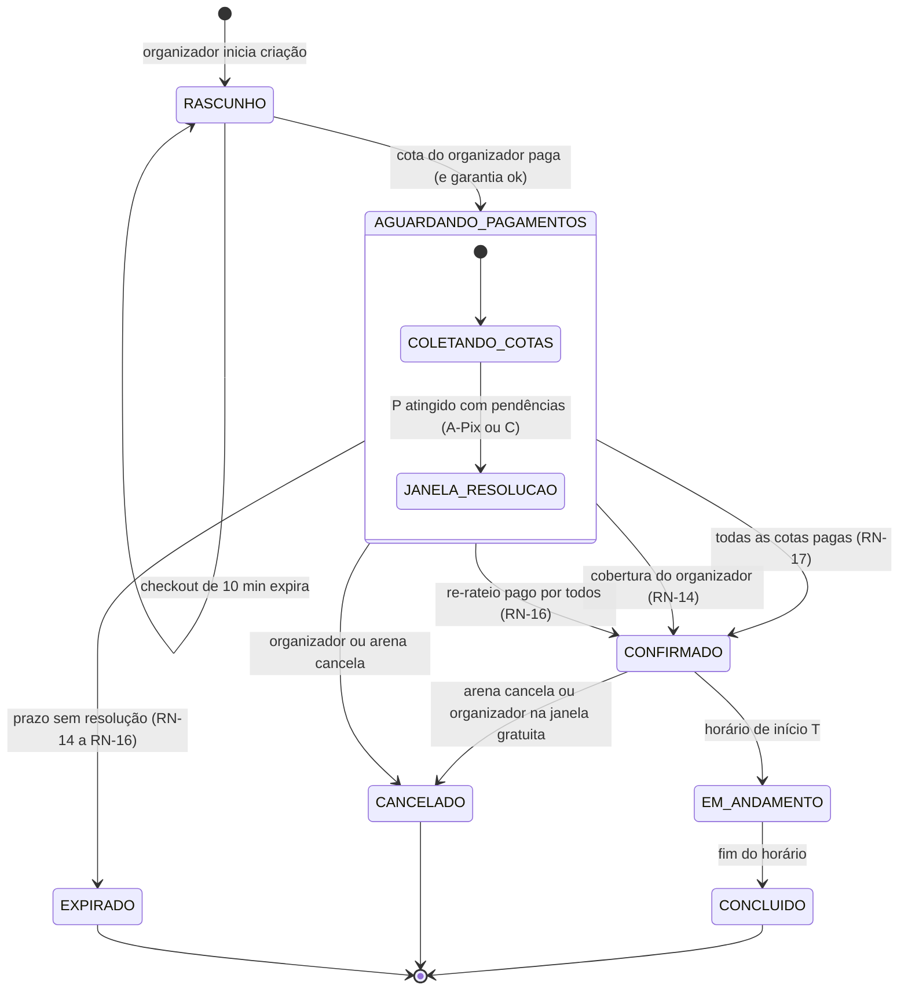
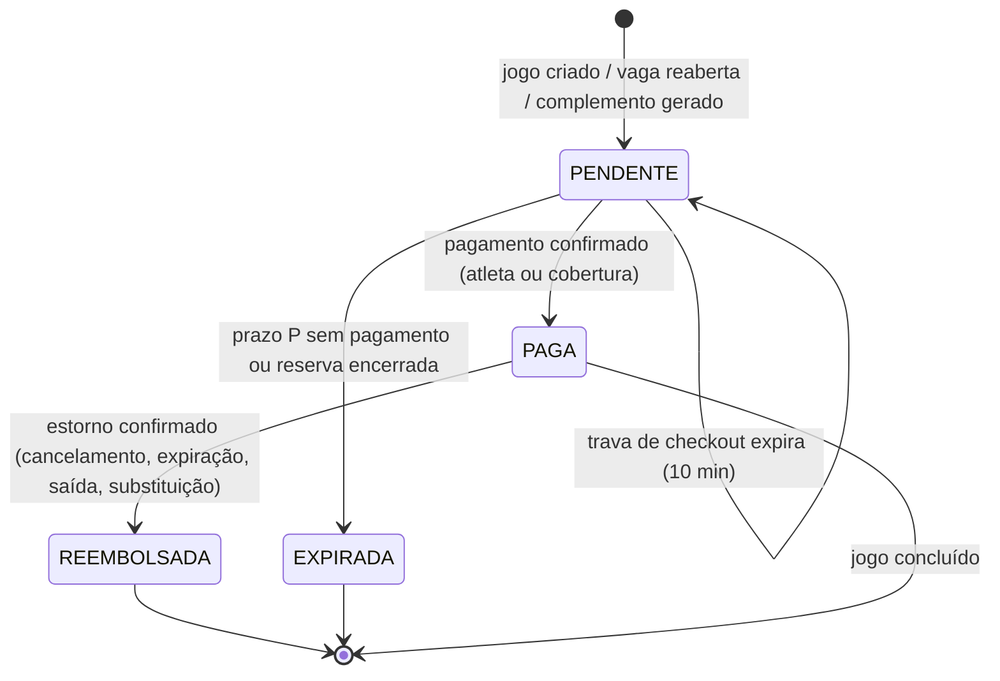
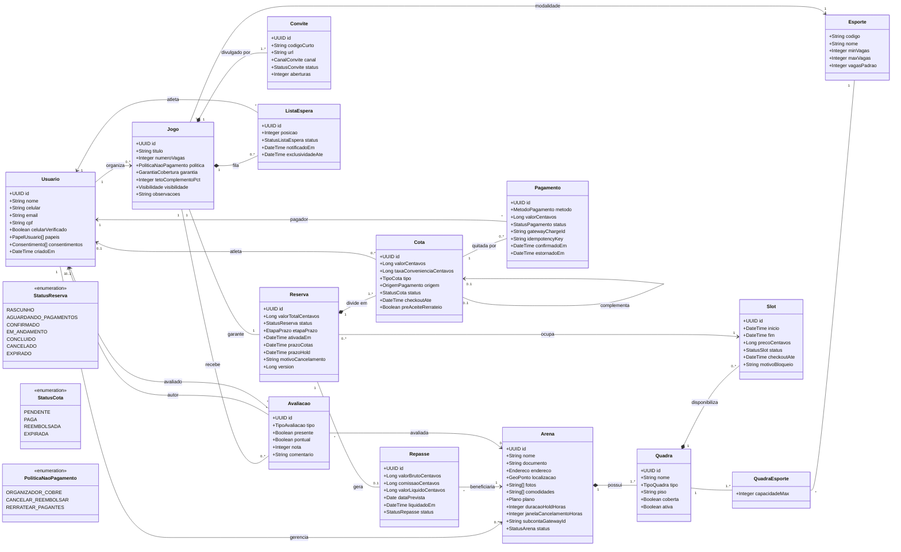

# SportConnect — PRD (Product Requirements Document)

> **Documento:** 03-product-design-prd.md · **Versão:** 1.0 · **Data:** 16/11/2026
> **Dono:** Product Design / PM · **Status:** Para revisão (Engenharia, Design, Jurídico, Financeiro)
> **Fonte de contexto:** `docs/00-brief.md`. Métricas detalhadas em `docs/04-ux-metrics.md`.

---

## Sumário

1. [Problema](#1-problema)
2. [Visão](#2-visão)
3. [Objetivos e não-objetivos](#3-objetivos-e-não-objetivos)
4. [Princípios de produto](#4-princípios-de-produto)
5. [Atores e glossário](#5-atores-e-glossário)
6. [Escopo por fase, épicos e user stories](#6-escopo-por-fase-épicos-e-user-stories)
7. [Critérios de aceite do MVP (Gherkin)](#7-critérios-de-aceite-do-mvp-gherkin)
8. [Regras de negócio (RN)](#8-regras-de-negócio-rn)
9. [Máquinas de estado](#9-máquinas-de-estado)
10. [Modelo de domínio](#10-modelo-de-domínio)
11. [Requisitos não funcionais](#11-requisitos-não-funcionais)
12. [Integrações](#12-integrações)
13. [Modelo de negócio e precificação](#13-modelo-de-negócio-e-precificação)
14. [Riscos](#14-riscos)
15. [Questões em aberto](#15-questões-em-aberto)
16. [Roadmap Now / Next / Later](#16-roadmap-now--next--later)

---

## 1. Problema

**Organizar uma pelada (ou um vôlei, um beach tennis) no Brasil ainda é um trabalho manual, arriscado e chato — e quem paga a conta do risco é sempre o organizador ou a arena.**

- **Organizador:** reserva a quadra por telefone/WhatsApp, cobra um por um no grupo, adianta o dinheiro do próprio bolso e convive com o "te passo o Pix depois" que nunca chega. Quando alguém desiste na véspera, ele cobre o buraco ou cancela o jogo.
- **Atleta:** não sabe se o jogo está confirmado, quanto vai pagar, nem quem já pagou. Para jogos com vagas abertas, depende de "conhecer alguém do grupo".
- **Arena:** controla agenda em caderno/planilha, sofre com reservas "de boca" que não aparecem (no-show), double booking e inadimplência. Horários ociosos não são vendidos porque não há vitrine.

**Custo de não resolver:** horário reservado e não pago é receita perdida para a arena; o organizador acumula prejuízo e desgaste social (cobrar amigos); jogos deixam de acontecer. Hoje não existe, no mercado brasileiro amador, uma solução que **una agenda da quadra + rateio + garantia de pagamento** num único fluxo que funcione para quem nem tem o app.

> **Evidência a validar:** hipóteses acima derivam do brief. A pesquisa em `01-ux-research.md` deve quantificar: % de organizadores que já cobriram cotas não pagas, ticket médio de prejuízo, taxa de no-show reportada por arenas.

## 2. Visão

> **"Marcou, rachou, jogou."** O SportConnect é o jeito mais fácil de transformar "bora jogar sábado?" em um jogo confirmado, pago e com quadra garantida — em minutos, direto do WhatsApp.

Em 3 anos: a plataforma padrão de esportes amadores em quadras alugadas no Brasil, onde a arena vende 100% da sua agenda e o atleta encontra jogo a qualquer hora.

## 3. Objetivos e não-objetivos

### 3.1 Objetivos (mensuráveis — ver `04-ux-metrics.md`)

| # | Tipo | Objetivo | Métrica / meta (90 dias pós-lançamento do MVP) |
|---|------|----------|-----------------------------------------------|
| O1 | Usuário (organizador) | Eliminar o risco financeiro de organizar | ≥ 80% dos jogos que entram em pré-reserva terminam **CONFIRMADO**; ≤ 10% dos confirmados dependem de cobertura do organizador |
| O2 | Usuário (atleta) | Pagar a cota sem fricção | Mediana ≤ 60 s entre abrir o link e cota paga; ≥ 70% de conversão convite aberto → cota paga |
| O3 | Usuário (arena) | Agenda garantida e sem calote | 0 casos de double booking; inadimplência de reservas via plataforma = 0% (por construção) |
| O4 | Negócio | Provar tração do marketplace em 1 cidade-piloto | ≥ 40 arenas ativas, ≥ 1.500 jogos confirmados/mês, GMV ≥ R$ 350 mil/mês |
| O5 | Negócio | Unit economics positivo por transação | Margem de contribuição ≥ R$ 1,00 por cota paga após custos de gateway |

### 3.2 Não-objetivos (MVP)

| Não-objetivo | Por quê |
|---|---|
| **Custodiar dinheiro em conta própria** | Exigiria autorização do BACEN como instituição de pagamento. Usamos subcontas e split do gateway. |
| **Chat interno entre atletas** | O WhatsApp já é o canal social; competir com ele aumenta escopo e reduz adoção. Integramos via link. |
| **ERP completo da arena** (estoque de bar, folha, catraca) | Fora do problema central; o painel do MVP cobre agenda, reservas e repasses. |
| **Matchmaking por nível, torneios e ligas** | Exigem massa crítica de usuários e dados de avaliação (Fase 3). |
| **Busca em mapa e preço dinâmico** | Valor depende de densidade de oferta; MVP usa lista simples por cidade/esporte/data. |
| **Pagamento parcelado ou carteira/créditos internos** | Complexidade regulatória e contábil; cartão à vista e Pix bastam. |

## 4. Princípios de produto

Os princípios desempatam decisões de design. Em conflito, vale a ordem abaixo.

1. **Reserva só existe com dinheiro garantido.** Nenhum horário vira "Confirmado" para a arena sem que 100% do valor esteja pago ou garantido (cobertura do organizador). A pré-reserva também exige "skin in the game": ela só começa quando o organizador paga a própria cota.
2. **Convidado paga sem instalar app.** O link de convite abre uma página web leve; Pix em ≤ 3 toques; identificação mínima (nome + celular). O app é um convite, nunca um pedágio.
3. **Ninguém é surpreendido por dinheiro.** Toda cobrança, taxa, prazo e regra de não pagamento aparece antes do pagamento, em linguagem simples, com valores em R$. A política escolhida pelo organizador é visível para todos os convidados.
4. **O relógio é transparente.** Todo jogo pré-reservado mostra um contador regressivo do prazo e o que acontece quando ele zerar.
5. **Justo por padrão, não por boa vontade.** Arredondamentos, reembolsos e penalidades seguem regras determinísticas e auditáveis (RN-XX), nunca decisões manuais caso a caso.
6. **O WhatsApp é o nosso canal, não nosso concorrente.** Compartilhar, lembrar e cobrar acontecem com um toque para o WhatsApp.
7. **Multiesporte nativo.** Nenhuma regra assume futebol; mínimos, máximos e vocabulário são parametrizados por esporte.
8. **Acessível e em português claro.** WCAG 2.1 AA, sem jargão financeiro ("cota", "prazo", "reembolso" — nunca "split", "hold" ou "chargeback" na interface).

## 5. Atores e glossário

| Ator | Descrição |
|---|---|
| **Organizador** | Usuário que cria o jogo, escolhe quadra/horário, define vagas e política de não pagamento, convida a galera. Também é um atleta pagante (paga a própria cota). |
| **Atleta convidado** | Recebe o link, paga a cota, confirma presença. Pode não ter conta (pagamento como visitante identificado por celular). |
| **Atleta avulso** (Fase 2) | Encontra jogos com vagas abertas e entra sem conhecer o organizador. |
| **Arena** | Pessoa jurídica/física dona de quadras. Usuários com papel *Gestor da arena* (dono) e *Operador* (recepção). |
| **Sistema** | Jobs automáticos (prazos, transições, repasses) e webhooks do gateway. |
| **Suporte SportConnect** | Time interno com permissões de backoffice (cancelamento excepcional, estorno manual). |

| Termo | Definição |
|---|---|
| **Jogo** | Evento esportivo social: participantes, vagas, cotas, convites. |
| **Reserva** | Bloqueio de um *Slot* de uma *Quadra* vinculado a um Jogo (1:1). Carrega o estado canônico (§9). |
| **Slot** | Intervalo de tempo reservável de uma quadra, com preço. |
| **Cota** | Fração do valor da reserva atribuída a uma vaga. |
| **Pré-reserva (hold)** | Período em que o Slot fica bloqueado aguardando o pagamento de todas as cotas. Na interface: "Pré-reservado". |
| **T** | Data/hora de início do jogo. "T−2h" = duas horas antes do início. |
| **Prazo do hold (H)** | Momento em que a pré-reserva expira e o Slot é liberado se o jogo não estiver confirmado. |
| **Prazo das cotas (P)** | Momento limite para atletas pagarem suas cotas. P ≤ H. |
| **Janela de resolução** | Intervalo entre P e H usado para cobertura do organizador via Pix (política A) ou re-rateio (política C). |
| **Taxa de conveniência** | Valor fixo por cota pago pelo atleta à plataforma, fora do rateio. |
| **Comissão (take rate)** | Percentual da plataforma sobre o valor da quadra, descontado do repasse à arena. |
| **Repasse** | Liquidação do valor líquido à subconta da arena após o jogo. |

---

## 6. Escopo por fase, épicos e user stories

Legenda de prioridade dentro do MVP: **P0** = não lança sem; **P1** = entra no MVP se couber, senão release 1.1.

### 6.1 MVP — "Rachou, confirmou"

**Hipótese do MVP:** se organizadores conseguirem pré-reservar uma quadra e o rateio via Pix confirmar a reserva automaticamente, eles deixam de usar caderno/WhatsApp para cobrar — e as arenas aceitam a plataforma porque recebem garantido.

#### Épico E1 — Identidade e acesso

| ID | User story | Prio |
|---|---|---|
| US-001 | Como **atleta convidado** quero pagar minha cota pelo navegador, sem instalar o app e sem criar senha, para entrar no jogo em menos de um minuto. | P0 |
| US-002 | Como **usuário** quero entrar com meu número de celular e um código de verificação para não precisar lembrar senha. | P0 |
| US-003 | Como **usuário** quero ver e revogar meus consentimentos e solicitar a exclusão dos meus dados para ter controle sobre minhas informações pessoais (LGPD). | P0 |

#### Épico E2 — Cadastro e configuração da arena

| ID | User story | Prio |
|---|---|---|
| US-010 | Como **gestor da arena** quero cadastrar minha arena (nome, endereço, fotos, comodidades, contato) para aparecer para organizadores. | P0 |
| US-011 | Como **gestor da arena** quero cadastrar quadras e os esportes que cada uma suporta para receber reservas do esporte certo. | P0 |
| US-012 | Como **gestor da arena** quero definir grade de funcionamento, duração dos horários e preço por faixa (dia da semana × hora) para que os horários disponíveis sejam gerados automaticamente. | P0 |
| US-013 | Como **operador da arena** quero bloquear horários manualmente (reservas por telefone, manutenção, aulas) para evitar reservas duplicadas. | P0 |
| US-014 | Como **gestor da arena** quero conectar minha conta de recebimento (dados bancários e verificação) para receber os repasses automaticamente. | P0 |
| US-015 | Como **gestor da arena** quero configurar a duração da pré-reserva e a janela de cancelamento gratuito para adequar as regras ao meu negócio. | P1 |

#### Épico E3 — Criação do jogo

| ID | User story | Prio |
|---|---|---|
| US-020 | Como **organizador** quero buscar arenas por cidade, esporte e data, vendo só horários livres, para escolher onde jogar. | P0 |
| US-021 | Como **organizador** quero ver o preço total e o valor exato de cada cota antes de confirmar para saber quanto cada um vai pagar. | P0 |
| US-022 | Como **organizador** quero definir o número de vagas e a política para cotas não pagas para controlar o risco do jogo. | P0 |
| US-023 | Como **organizador** quero pagar minha cota para ativar a pré-reserva e segurar o horário enquanto a galera paga. | P0 |
| US-024 | Como **organizador** quero compartilhar o link do jogo no WhatsApp com mensagem pronta para convidar todo mundo de uma vez. | P0 |

#### Épico E4 — Pagamento da cota

| ID | User story | Prio |
|---|---|---|
| US-030 | Como **atleta convidado** quero ver pelo link os detalhes do jogo (local, horário, valor, quem já pagou, prazo e política) para decidir se entro. | P0 |
| US-031 | Como **atleta** quero pagar minha cota com Pix (QR code e copia-e-cola) para pagar na hora com o app do meu banco. | P0 |
| US-032 | Como **atleta** quero pagar minha cota com cartão de crédito para quando não puder usar Pix. | P1 |
| US-033 | Como **atleta** quero receber confirmação e comprovante do pagamento para ter certeza de que estou no jogo. | P0 |

#### Épico E5 — Acompanhamento, prazos e políticas

| ID | User story | Prio |
|---|---|---|
| US-040 | Como **organizador** quero acompanhar em tempo real quem pagou e quanto falta para saber se o jogo vai sair. | P0 |
| US-041 | Como **organizador** quero cobrar os pendentes com um toque (mensagem pronta no WhatsApp) para não ter o constrangimento de redigir cobrança. | P0 |
| US-042 | Como **organizador e atleta** quero que o jogo seja confirmado automaticamente quando todas as cotas forem pagas para não depender de ação manual de ninguém. | P0 |
| US-043 | Como **organizador** com a política "Eu cubro a diferença" quero que o valor faltante seja cobrado de mim no prazo para que o jogo seja confirmado mesmo sem todos pagarem. | P0 |
| US-044 | Como **organizador** com a política "Cancelar e reembolsar todos" quero que o jogo seja cancelado e todos reembolsados automaticamente no prazo para não ficar com prejuízo. | P0 |
| US-045 | Como **atleta pagante** num jogo com a política "Re-ratear entre pagantes" quero aceitar (ou não) pagar um complemento para que o jogo aconteça mesmo com faltantes. | P1 |
| US-046 | Como **atleta** quero receber lembretes antes do prazo e antes do jogo para não perder o pagamento nem o horário. | P0 |

#### Épico E6 — Cancelamento e reembolso

| ID | User story | Prio |
|---|---|---|
| US-050 | Como **atleta** quero sair de um jogo ainda não confirmado e ser reembolsado para não pagar por algo de que desisti a tempo. | P0 |
| US-051 | Como **organizador** quero cancelar o jogo dentro da janela de cancelamento gratuito para que todos sejam reembolsados sem atrito. | P0 |
| US-052 | Como **gestor da arena** quero cancelar uma reserva por força maior (chuva, manutenção) para que os atletas sejam reembolsados integralmente. | P0 |
| US-053 | Como **atleta** quero acompanhar o status do meu reembolso para saber quando o dinheiro volta. | P0 |

#### Épico E7 — Painel da arena

| ID | User story | Prio |
|---|---|---|
| US-060 | Como **operador da arena** quero ver a agenda do dia/semana por quadra com o status de cada reserva para organizar a operação. | P0 |
| US-061 | Como **gestor da arena** quero ser notificado quando uma reserva for confirmada ou cancelada para me planejar. | P0 |
| US-062 | Como **gestor da arena** quero ver o extrato de repasses (bruto, comissão, líquido, data) para conciliar meu caixa. | P0 |
| US-063 | Como **gestor da arena** quero um relatório simples de ocupação e receita por quadra para entender meu negócio. | P1 |

### 6.2 Fase 2 — "Time completo" (formação de times e recorrência)

| ID | Épico | User story |
|---|---|---|
| US-100 | E8 Vagas abertas | Como organizador quero abrir vagas restantes para avulsos para completar o time sem depender só do meu grupo. |
| US-101 | E8 | Como atleta avulso quero buscar jogos com vagas por esporte, data e bairro para jogar mesmo sem turma. |
| US-102 | E8 | Como organizador quero aprovar ou recusar avulsos antes do pagamento para manter o perfil do jogo. |
| US-110 | E9 Lista de espera e substituição | Como atleta quero entrar na lista de espera de um jogo lotado para ser chamado se abrir vaga. |
| US-111 | E9 | Como atleta pago que não pode mais ir quero transferir minha vaga para um substituto e ser reembolsado para não perder o dinheiro. |
| US-112 | E9 | Como organizador que cobriu cotas quero que as vagas cobertas sejam oferecidas à lista de espera para recuperar meu dinheiro. |
| US-120 | E10 Jogos recorrentes | Como organizador quero criar um jogo semanal recorrente para não refazer o processo toda semana. |
| US-121 | E10 | Como gestor da arena quero aprovar mensalistas (recorrência) para garantir ocupação fixa. |
| US-130 | E11 Reputação | Como organizador quero avaliar presença e pontualidade dos atletas após o jogo para formar grupos mais confiáveis. |
| US-131 | E11 | Como atleta quero ver minha reputação (presença %, pontualidade) para ser aceito em mais jogos. |
| US-132 | E11 | Como atleta quero avaliar a arena (quadra, vestiário, atendimento) para ajudar outros jogadores. |
| US-140 | E12 Operação | Como operador da arena quero fazer check-in dos atletas na chegada (inclusive offline) para registrar presença e no-show. |
| US-141 | E12 | Como gestor da arena quero propor reagendamento em caso de chuva em vez de cancelar para não perder a receita. |
| US-142 | E12 | Como organizador quero transferir a organização do jogo para outro atleta para não ficar preso ao papel. |
| US-150 | E13 WhatsApp | Como atleta quero receber lembretes de pagamento pelo WhatsApp oficial do SportConnect para não depender do organizador me cobrar. |
| US-151 | E13 | Como organizador quero pagar o jogo inteiro e depois ratear entre os amigos ("racha depois") para jogos marcados em cima da hora. |

### 6.3 Fase 3 — "Marketplace e competição"

| ID | Épico | User story |
|---|---|---|
| US-200 | E14 Descoberta | Como atleta quero buscar quadras e jogos num mapa, filtrando por esporte, preço e distância, para achar a melhor opção perto de mim. |
| US-201 | E14 | Como atleta quero salvar arenas favoritas e receber alerta de horário livre para reservar rápido. |
| US-210 | E15 Nível e matchmaking | Como atleta quero declarar e ter calibrado meu nível por esporte para jogar com pessoas do meu nível. |
| US-211 | E15 | Como atleta avulso quero receber sugestões de jogos compatíveis com meu nível e agenda para jogar mais. |
| US-212 | E15 | Como organizador quero sortear times equilibrados por nível para jogos mais disputados. |
| US-220 | E16 Torneios e ligas | Como organizador quero criar um torneio com inscrição paga por time e chaveamento automático para promover competições. |
| US-221 | E16 | Como arena quero criar ligas com tabela e rodadas na minha agenda para fidelizar clientes. |
| US-230 | E17 Gestão avançada | Como gestor da arena quero preço dinâmico (horário nobre, ociosidade, antecedência) para maximizar receita. |
| US-231 | E17 | Como gestor da arena quero relatórios avançados (cohort de clientes, ticket, ocupação por faixa) e exportação para gestão. |
| US-232 | E17 | Como gestor de rede de arenas quero gerenciar múltiplas unidades num só painel para centralizar a operação. |

---

### 6.4 Requisitos de conteúdo (além de texto de interface)

Plano de **Escopo** (Garrett): o texto de interface está no [07-ux-writing.md](./07-ux-writing.md). Esta seção cobre o conteúdo que a plataforma, as arenas e o jurídico precisam fornecer. Itens marcados com ⚖️ exigem revisão jurídica antes de ir ao ar.

| ID | Conteúdo | Quem produz | Requisitos | Fase |
|---|---|---|---|---|
| CT-01 | Fotos da arena e das quadras | Arena (upload) | Mínimo de 1 foto da arena e 1 por quadra para publicar (hoje o cadastro não exige; a lista usa um desenho de quadra no lugar). JPEG ou PNG, até 5 MB, proporção 16:9 ou 4:3, compressão no envio. Texto alternativo gerado a partir do nome da quadra e do esporte. Moderação básica (sem rostos de terceiros em destaque, sem dados pessoais visíveis) | MVP |
| CT-02 | Descrição e comodidades da arena | Arena | Até 400 caracteres de descrição. Comodidades em lista fechada (vestiário, estacionamento, bar, churrasqueira, iluminação, acessibilidade). Endereço completo, com ponto no mapa e instruções de chegada ("Como chegar") | MVP |
| CT-03 | Regras e formato por esporte | Plataforma | Para cada um dos 10 esportes: número mínimo e máximo de vagas (RN-05), duração padrão, formato em uma linha (ex.: "5 contra 5 + goleiros"), material necessário e observações de segurança. Exibido no criar jogo e no detalhe do jogo | MVP |
| CT-04 | Regras da arena | Arena | Texto livre curto: calçado permitido, atraso tolerado, uso de colete, consumo no local. Exibido no detalhe do jogo e no convite, sempre antes do pagamento ("Ver regras") | MVP |
| CT-05 | Termos de uso e Política de privacidade ⚖️ | Plataforma + jurídico | Texto completo e versionado, com data de vigência. Aceite registrado no cadastro (LGPD, US-003). Resumo em linguagem simples na tela de convite | MVP |
| CT-06 | Política de cancelamento e reembolso ⚖️ | Plataforma + jurídico | Versão completa e resumo em uma tela. Exibida **antes** do pagamento e aceita explicitamente (ver [02-service-design.md](./02-service-design.md) §5). Coerente com as RN-18 a RN-25 e com o CDC | MVP |
| CT-07 | Contrato e termos para a arena ⚖️ | Plataforma + jurídico | Termo de adesão com taxas, prazos de repasse, responsabilidade em cancelamentos pela arena e tratamento de dados dos atletas. Aceite no cadastro da arena (US-010) | MVP |
| CT-08 | Ajuda e perguntas frequentes | Plataforma | Mínimo de 12 respostas curtas cobrindo: como o rateio funciona, o que acontece se alguém não pagar, prazos do Pix, reembolso, cancelamento por chuva, como chegar. Acesso a partir do detalhe do jogo, do pagamento e do perfil | MVP |
| CT-09 | Comprovante e extrato | Sistema | Comprovante com identificador da transação, valor, taxa de conveniência discriminada, data e hora, recebedor. Extrato da arena com bruto, taxa e líquido (RN-30) | MVP |
| CT-10 | Mensagens externas (WhatsApp, push, e-mail) | Plataforma | Modelos aprovados pela API do WhatsApp, com os textos do 07. Prévia do link do convite (título, descrição e imagem) com o nome do jogo, esporte, data e vagas restantes | MVP |
| CT-11 | Ilustrações e estados vazios | Design | Conjunto do design system (06) para: sem jogos, sem resultados, sem conexão, erro. Ilustrações próprias dos esportes sem ícone no Material Symbols (futevôlei, padel, beach tennis) | Fase 2 |
| CT-12 | Conteúdo de onboarding por esporte | Plataforma | Dicas curtas por esporte para quem joga pela primeira vez | Fase 2 |

**Responsabilidade e governança:** cada item tem um responsável e uma versão. Conteúdo de arena é revisado antes de aparecer na busca (CT-01, CT-02, CT-04). Textos jurídicos têm data de vigência e histórico de aceite por usuário.

## 7. Critérios de aceite do MVP (Gherkin)

```gherkin
# language: pt
```

> Convenções: valores em R$; "T" = início do jogo; "agora" = relógio do servidor (America/Sao_Paulo). Referências a regras: RN-XX (§8).

### US-001 — Pagar sem instalar app

```gherkin
Funcionalidade: Pagamento de cota como visitante pelo navegador

  Cenário: Convidado sem conta paga a cota pelo link
    Dado um jogo no estado "AGUARDANDO_PAGAMENTOS" com cotas pendentes
    E um convidado sem conta e sem o app instalado
    Quando ele abre o link do convite em um navegador móvel
    Então vê a página do jogo sem ser obrigado a baixar o app
    E consegue informar nome e celular, validar por código e pagar via Pix
    E após a confirmação do pagamento vê "Você está no jogo" com opção (não obrigatória) de baixar o app

  Cenário: Link aberto com o app instalado
    Dado que o convidado tem o app instalado
    Quando abre o link do convite
    Então o app abre direto na página do jogo (deep link)

  Cenário: Link de jogo encerrado
    Dado um jogo nos estados "CANCELADO", "EXPIRADO" ou "CONCLUIDO"
    Quando o convidado abre o link
    Então vê o status do jogo e nenhuma opção de pagamento
```

### US-002 — Login por celular

```gherkin
Funcionalidade: Autenticação por OTP

  Cenário: Código válido
    Dado que informei um celular brasileiro válido
    Quando recebo o código de 6 dígitos e o digito em até 10 minutos
    Então sou autenticado e minha sessão permanece ativa por 90 dias neste dispositivo

  Cenário: Código inválido ou expirado
    Quando digito um código errado ou após 10 minutos
    Então vejo "Código inválido ou expirado" e a opção "Reenviar código"
    E após 5 tentativas erradas o reenvio fica bloqueado por 15 minutos

  Cenário: Preenchimento automático
    Dado um dispositivo Android ou iOS com suporte a autofill de SMS
    Quando o código chega
    Então ele é sugerido/preenchido automaticamente
```

### US-003 — Privacidade (LGPD)

```gherkin
Funcionalidade: Gestão de consentimentos e exclusão

  Cenário: Revogar consentimento de marketing
    Dado que consenti com comunicações de marketing
    Quando desativo esse consentimento em "Privacidade"
    Então deixo de receber comunicações de marketing em até 24 horas
    E continuo recebendo mensagens transacionais (pagamento, prazo, jogo)

  Cenário: Solicitar exclusão com jogo ativo
    Dado que tenho uma cota "PAGA" em um jogo ainda não concluído
    Quando solicito a exclusão da conta
    Então sou informado de que a exclusão ocorrerá após a conclusão ou reembolso desse jogo
    E os dados financeiros obrigatórios serão retidos pelo prazo legal de forma anonimizada no restante
```

### US-010 — Cadastro da arena

```gherkin
Funcionalidade: Cadastro da arena

  Cenário: Cadastro completo
    Dado que sou um gestor autenticado
    Quando preencho nome, CPF/CNPJ, endereço com CEP, telefone, ao menos 1 foto e comodidades
    Então a arena é criada no estado "em configuração"
    E ela só aparece na busca após ter ao menos 1 quadra com grade publicada e conta de recebimento aprovada

  Cenário: CEP inválido
    Quando informo um CEP inexistente
    Então vejo erro no campo e o endereço não é salvo
```

### US-011 — Quadras e esportes

```gherkin
Funcionalidade: Cadastro de quadras

  Cenário: Quadra poliesportiva
    Dado uma arena em configuração
    Quando cadastro a quadra "Quadra 1" do tipo "coberta" com piso "sintético" e esportes "Futsal" e "Vôlei"
    Então a quadra aceita reservas apenas desses esportes
    E posso definir capacidade máxima de atletas por esporte, limitada ao máximo da RN-05

  Cenário: Quadra sem esporte
    Quando tento salvar uma quadra sem nenhum esporte
    Então vejo "Selecione ao menos um esporte"
```

### US-012 — Grade e preços

```gherkin
Funcionalidade: Grade de horários e preço por faixa

  Cenário: Geração de slots
    Dado a quadra "Quadra 1" aberta de segunda a sexta das 18h às 23h com duração de 60 minutos
    E preço de R$ 180 de segunda a quinta e R$ 240 na sexta após 19h
    Quando publico a grade
    Então são gerados slots de 60 min para os próximos 60 dias com os preços da faixa correspondente
    E slots já reservados ou bloqueados não são alterados por mudanças posteriores de preço

  Cenário: Sobreposição de faixas de preço
    Quando crio duas faixas de preço que se sobrepõem no mesmo dia e horário
    Então vejo erro indicando o conflito e a grade não é publicada
```

### US-013 — Bloqueio manual

```gherkin
Funcionalidade: Bloqueio manual de horários

  Cenário: Bloquear slot livre
    Dado um slot "LIVRE"
    Quando o operador o bloqueia com o motivo "Reserva por telefone"
    Então o slot fica "BLOQUEADO" e não aparece para organizadores

  Cenário: Tentar bloquear slot com reserva ativa
    Dado um slot vinculado a uma reserva "AGUARDANDO_PAGAMENTOS" ou "CONFIRMADO"
    Quando o operador tenta bloqueá-lo
    Então a ação é impedida e é oferecida a opção "Cancelar reserva por força maior" (US-052)
```

### US-014 — Conta de recebimento

```gherkin
Funcionalidade: Conexão da conta de recebimento

  Cenário: Verificação aprovada
    Dado que informei titular, CPF/CNPJ, dados bancários ou chave Pix de recebimento e documentos exigidos pelo gateway
    Quando o gateway aprova a subconta
    Então vejo "Recebimentos ativos" e a arena fica apta a publicar horários

  Cenário: Verificação pendente ou recusada
    Quando o gateway retorna pendência ou recusa
    Então vejo o motivo em linguagem simples e o que fazer para corrigir
    E a arena não aparece na busca
```

### US-015 — Configurações de prazo e cancelamento (P1)

```gherkin
Funcionalidade: Parâmetros da arena

  Cenário: Alterar duração da pré-reserva
    Quando defino a duração da pré-reserva para 6 horas
    Então novos jogos usam 6h no cálculo da RN-10
    E jogos já criados mantêm o prazo original

  Cenário: Valor fora dos limites
    Quando tento definir 30 minutos ou 72 horas
    Então vejo "Escolha entre 1 e 48 horas"
```

### US-020 — Buscar arenas e horários

```gherkin
Funcionalidade: Busca de horários livres

  Cenário: Busca com resultados
    Dado arenas publicadas em "Campinas" com quadras de "Beach tennis"
    Quando busco "Campinas", "Beach tennis", "sábado 22/11"
    Então vejo a lista de arenas com os horários "LIVRE" daquele dia, preço por horário e distância (se a localização foi permitida)
    E horários em checkout ou pré-reservados por outros não aparecem como livres

  Cenário: Sem resultados
    Quando nenhuma quadra atende aos filtros
    Então vejo sugestões de datas próximas com horários livres para o mesmo esporte
```

### US-021 — Preço total e valor da cota

```gherkin
Funcionalidade: Simulação do rateio

  Cenário: Divisão exata
    Dado um slot de R$ 240,00 para futebol society
    Quando informo 12 vagas
    Então vejo "R$ 20,00 por pessoa + R$ 1,50 de taxa de conveniência no Pix"

  Cenário: Divisão com sobra de centavos (RN-04)
    Dado um slot de R$ 250,00
    Quando informo 12 vagas
    Então vejo "R$ 20,83 por pessoa" para os convidados
    E vejo "Sua cota: R$ 20,87 (inclui R$ 0,04 de arredondamento)"
```

### US-022 — Vagas e política

```gherkin
Funcionalidade: Configuração de vagas e política de não pagamento

  Cenário: Vagas fora do limite do esporte
    Dado o esporte "Padel" com limites de 2 a 4 vagas
    Quando informo 6 vagas
    Então vejo "Para padel, escolha entre 2 e 4 vagas" e não avanço

  Cenário: Política padrão
    Quando chego à etapa de política
    Então "Eu cubro a diferença" vem pré-selecionada
    E cada opção mostra um exemplo em R$ do que acontece se 2 pessoas não pagarem

  Cenário: Prazo curto restringe políticas (RN-12)
    Dado que a janela até o prazo das cotas é menor que 30 minutos para as políticas A e C
    Quando chego à etapa de política
    Então apenas "Cancelar e reembolsar todos" está disponível, se a janela dela for ao menos 30 minutos
    E caso nenhuma política seja viável vejo "Este horário está muito próximo. Pague o valor integral para reservar."
```

### US-023 — Ativar pré-reserva

```gherkin
Funcionalidade: Ativação da pré-reserva pelo pagamento da cota do organizador

  Cenário: Pagamento dentro do bloqueio de checkout
    Dado que selecionei um slot "LIVRE" e configurei o jogo
    Quando inicio o pagamento
    Então o slot fica "EM_CHECKOUT" por até 10 minutos exclusivamente para mim
    E ao confirmar o pagamento da minha cota a reserva passa para "AGUARDANDO_PAGAMENTOS"
    E o slot passa para "PRE_RESERVADO" com o prazo H calculado pela RN-10

  Cenário: Bloqueio de checkout expira
    Quando não pago em 10 minutos
    Então o slot volta a "LIVRE" e o jogo permanece em "RASCUNHO"
    E sou avisado de que preciso escolher o horário novamente se ele não estiver mais disponível

  Cenário: Concorrência no mesmo slot
    Dado que dois organizadores tentam iniciar o checkout do mesmo slot no mesmo instante
    Então apenas um obtém o bloqueio
    E o outro vê "Esse horário acabou de ser escolhido por outra pessoa" com horários alternativos

  Cenário: Política A com cartão de garantia
    Dado que escolhi "Eu cubro a diferença" com garantia por cartão
    Quando confirmo
    Então é feita uma pré-autorização no cartão do valor total menos a minha cota
    E se a pré-autorização for negada a pré-reserva não é ativada e posso optar por garantia via Pix
```

### US-024 — Compartilhar no WhatsApp

```gherkin
Funcionalidade: Compartilhamento do convite

  Cenário: Compartilhar
    Dado um jogo "AGUARDANDO_PAGAMENTOS"
    Quando toco em "Convidar no WhatsApp"
    Então o WhatsApp abre com a mensagem pronta contendo esporte, arena, data, horário, valor da cota, prazo e o link
    E o link tem pré-visualização (título, imagem da arena, data) quando colado em conversas

  Cenário: WhatsApp indisponível
    Dado um dispositivo sem WhatsApp
    Quando toco em "Convidar"
    Então abre a folha de compartilhamento nativa e há opção "Copiar link"
```

### US-030 — Detalhes do jogo pelo link

```gherkin
Funcionalidade: Página pública do jogo

  Cenário: Informações exibidas
    Quando abro o link de um jogo "AGUARDANDO_PAGAMENTOS"
    Então vejo esporte, arena, endereço com atalho para mapas, data, horário, valor da cota, taxa de conveniência
    E vejo o contador "Faltam 2h14 para o prazo" e o progresso "8 de 12 pagos"
    E vejo os primeiros nomes de quem já pagou
    E vejo a política em linguagem simples, por exemplo "Se faltar gente, o organizador cobre a diferença"

  Cenário: Jogo lotado
    Dado que todas as cotas estão pagas ou em checkout
    Quando abro o link
    Então vejo "Jogo completo" sem opção de pagamento
```

### US-031 — Pagar com Pix

```gherkin
Funcionalidade: Pagamento via Pix

  Cenário: Pix pago
    Dado que escolhi pagar via Pix
    Quando o QR code e o código copia-e-cola são exibidos
    Então a cota fica reservada para mim por 10 minutos (RN-19)
    E ao receber a confirmação do gateway a cota passa para "PAGA" em até 5 segundos
    E a tela atualiza sozinha para "Pagamento confirmado"

  Cenário: Copiar código
    Quando toco em "Copiar código Pix"
    Então o código é copiado e vejo a confirmação "Código copiado" anunciada também ao leitor de tela

  Cenário: Pix expirado
    Quando 10 minutos passam sem pagamento
    Então a reserva da cota para mim é liberada e posso gerar um novo Pix se ainda houver vaga e prazo

  Cenário: Pix pago após o prazo (RN-18)
    Dado que a cota já está "EXPIRADA"
    Quando o gateway confirma um pagamento tardio
    Então o valor é devolvido automaticamente ao pagador e ele é notificado
```

### US-032 — Pagar com cartão (P1)

```gherkin
Funcionalidade: Pagamento com cartão de crédito

  Cenário: Cartão aprovado
    Quando informo um cartão válido e o pagamento é aprovado (com 3-D Secure se exigido)
    Então a cota passa para "PAGA" e vejo a taxa de conveniência de cartão aplicada

  Cenário: Cartão recusado
    Quando o pagamento é recusado
    Então vejo o motivo em linguagem simples e a sugestão de pagar com Pix
    E a cota continua reservada para mim até o fim dos 10 minutos
```

### US-033 — Confirmação e comprovante

```gherkin
Funcionalidade: Comprovante

  Cenário: Comprovante após pagamento
    Quando minha cota é paga
    Então recebo comprovante por e-mail (se informado) e na tela, com valor da cota, taxa, data, identificador da transação e arena
    E o jogo aparece em "Meus jogos" se eu tiver conta
```

### US-040 — Acompanhamento em tempo real

```gherkin
Funcionalidade: Painel do organizador

  Cenário: Atualização em tempo real
    Dado que estou na tela do jogo
    Quando um convidado paga
    Então em até 2 segundos (p95) vejo o nome dele marcado como pago e o progresso atualizado
    E a mudança é anunciada ao leitor de tela de forma não intrusiva

  Cenário: Sem conexão
    Quando perco a conexão
    Então vejo "Sem conexão — exibindo dados de 14:32" e a lista é atualizada ao reconectar
```

### US-041 — Cobrar pendentes

```gherkin
Funcionalidade: Cobrança com um toque

  Cenário: Cobrar no grupo
    Dado 4 cotas pendentes e 1h restante para o prazo
    Quando toco em "Cobrar quem falta"
    Então o WhatsApp abre com mensagem pronta "Faltam 4 pagamentos e 1h para o prazo! Paga aqui: <link>"

  Cenário: Nenhum pendente
    Dado que todas as cotas estão pagas
    Quando abro a tela do jogo
    Então o botão "Cobrar quem falta" não é exibido
```

### US-042 — Confirmação automática

```gherkin
Funcionalidade: Confirmação automática

  Cenário: Última cota paga antes do prazo
    Dado um jogo "AGUARDANDO_PAGAMENTOS" com 11 de 12 cotas pagas
    Quando a 12ª cota é paga antes de P
    Então a reserva passa imediatamente para "CONFIRMADO"
    E o slot passa para "RESERVADO"
    E organizador, atletas pagantes e arena são notificados
    E pré-autorizações de garantia (política A) são canceladas integralmente
```

### US-043 — Política A: organizador cobre

```gherkin
Funcionalidade: Política "Eu cubro a diferença"

  Cenário: Garantia por cartão
    Dado um jogo com política A, garantia por cartão, 10 de 12 cotas pagas
    Quando o prazo P é atingido
    Então o sistema captura da pré-autorização o valor das 2 cotas pendentes
    E as 2 cotas passam para "PAGA" com pagador = organizador
    E a reserva passa para "CONFIRMADO"
    E o restante da pré-autorização é liberado

  Cenário: Garantia por Pix paga na janela
    Dado um jogo com política A, garantia por Pix, 10 de 12 cotas pagas
    Quando o prazo P é atingido
    Então o organizador recebe uma cobrança Pix do valor faltante válida até H
    E ao pagar dentro da janela a reserva passa para "CONFIRMADO"

  Cenário: Garantia por Pix não paga
    Quando H é atingido sem o pagamento da diferença
    Então a reserva passa para "EXPIRADO"
    E todas as cotas "PAGA" são reembolsadas conforme RN-25
    E as cotas "PENDENTE" passam para "EXPIRADA"
```

### US-044 — Política B: cancelar e reembolsar

```gherkin
Funcionalidade: Política "Cancelar e reembolsar todos"

  Cenário: Prazo atingido com pendências
    Dado um jogo com política B e 9 de 12 cotas pagas
    Quando o prazo P (= H) é atingido
    Então a reserva passa para "EXPIRADO" e o slot volta a "LIVRE"
    E as 9 cotas pagas passam para "REEMBOLSADA" após o estorno ser concluído, com valor integral incluindo taxa de conveniência
    E todos recebem notificação explicando o motivo
```

### US-045 — Política C: re-rateio (P1)

```gherkin
Funcionalidade: Política "Re-ratear entre pagantes"

  Cenário: Todos aceitam e pagam o complemento
    Dado um jogo com política C, valor R$ 240,00, 12 vagas, 10 pagantes e teto de complemento de 50%
    Quando o prazo P é atingido
    Então cada pagante recebe a proposta "Faltaram 2. Pague R$ 4,00 a mais para o jogo acontecer" válida até H
    E quando todos os 10 aceitam e pagam o complemento a reserva passa para "CONFIRMADO"
    E as 2 cotas pendentes passam para "EXPIRADA"

  Cenário: Complemento acima do teto
    Dado que o complemento por pagante excederia o teto configurado
    Quando o prazo P é atingido
    Então a política C não é oferecida e aplica-se a regra de fallback da RN-16

  Cenário: Alguém não paga o complemento
    Quando H é atingido com ao menos um complemento não pago
    E o organizador não cobriu o residual
    Então a reserva passa para "EXPIRADO" e todos os valores pagos (cotas e complementos) são reembolsados
```

### US-046 — Lembretes

```gherkin
Funcionalidade: Lembretes automáticos

  Cenário: Lembrete de prazo
    Dado um jogo "AGUARDANDO_PAGAMENTOS"
    Quando faltam 60 minutos para P
    Então organizador recebe push com o número de pendentes e atalho "Cobrar quem falta"
    E convidados identificados com cota em checkout expirado recebem lembrete

  Cenário: Lembrete do jogo
    Dado um jogo "CONFIRMADO"
    Quando faltam 3 horas para T
    Então todos os pagantes recebem lembrete com endereço e atalho para mapas
```

### US-050 — Sair antes da confirmação

```gherkin
Funcionalidade: Saída voluntária antes da confirmação

  Cenário: Atleta sai
    Dado que minha cota está "PAGA" e o jogo está "AGUARDANDO_PAGAMENTOS"
    Quando toco em "Sair do jogo" e confirmo
    Então minha cota é reembolsada no valor da cota, sem a taxa de conveniência (RN-21)
    E a cota volta a ficar disponível como nova cota "PENDENTE"
    E o organizador é notificado

  Cenário: Organizador tenta sair
    Quando o organizador toca em "Sair do jogo"
    Então é informado de que deve cancelar o jogo (US-051) ou, na Fase 2, transferir a organização
```

### US-051 — Organizador cancela

```gherkin
Funcionalidade: Cancelamento pelo organizador

  Cenário: Cancelamento antes da confirmação
    Dado um jogo "AGUARDANDO_PAGAMENTOS"
    Quando o organizador cancela
    Então a reserva passa para "CANCELADO", o slot volta a "LIVRE" e todos os pagantes recebem reembolso integral incluindo taxa

  Cenário: Cancelamento de jogo confirmado dentro da janela gratuita
    Dado um jogo "CONFIRMADO" e faltam 30 horas para T, com janela gratuita da arena de 24 horas
    Quando o organizador cancela
    Então todos recebem reembolso integral incluindo taxa e a arena é notificada

  Cenário: Cancelamento fora da janela gratuita
    Dado um jogo "CONFIRMADO" e faltam 10 horas para T
    Quando o organizador tenta cancelar
    Então vê que o cancelamento não é mais possível pelo app e que pode falar com a arena
    E a opção "Cancelar" fica indisponível
```

### US-052 — Arena cancela

```gherkin
Funcionalidade: Cancelamento por força maior

  Cenário: Chuva em quadra descoberta
    Dado uma reserva "CONFIRMADO"
    Quando o gestor cancela com motivo "Condições climáticas" e confirma
    Então a reserva passa para "CANCELADO"
    E todas as cotas pagas são reembolsadas integralmente, incluindo taxa de conveniência
    E o cancelamento conta no indicador de confiabilidade da arena
```

### US-053 — Status do reembolso

```gherkin
Funcionalidade: Acompanhamento de reembolso

  Cenário: Reembolso Pix
    Dado que tenho direito a reembolso via Pix
    Então vejo "Reembolso em processamento" com previsão "até 1 dia útil"
    E quando o gateway confirma vejo "Reembolsado em 16/11 às 14:02" e a cota fica "REEMBOLSADA"

  Cenário: Falha no reembolso
    Quando o estorno falha no gateway
    Então o sistema tenta novamente por até 3 vezes em 24 horas e abre chamado automático para o suporte
    E eu vejo "Estamos resolvendo seu reembolso" com canal de contato
```

### US-060 — Agenda da arena

```gherkin
Funcionalidade: Agenda da arena

  Cenário: Visão do dia
    Quando abro a agenda em "Hoje"
    Então vejo cada quadra em coluna com os slots e o status: Livre, Pré-reservado (com prazo), Confirmado, Em andamento, Bloqueado
    E os status são diferenciados por texto e ícone, não só por cor

  Cenário: Detalhe da reserva
    Quando toco numa reserva confirmada
    Então vejo organizador, contato, esporte, número de atletas, valor bruto e valor líquido previsto
```

### US-061 — Notificações da arena

```gherkin
Funcionalidade: Notificações para a arena

  Cenário: Reserva confirmada
    Quando uma reserva passa para "CONFIRMADO"
    Então o gestor e operadores recebem push e e-mail com quadra, data, horário e valor líquido

  Cenário: Pré-reserva expirada
    Quando uma reserva passa para "EXPIRADO"
    Então a arena recebe notificação silenciosa (sem som) e o slot aparece novamente livre
```

### US-062 — Extrato de repasses

```gherkin
Funcionalidade: Extrato de repasses

  Cenário: Repasse liquidado
    Dado um jogo "CONCLUIDO" com valor da quadra R$ 240,00 e comissão de 8%
    Quando o repasse é liquidado (RN-30)
    Então vejo bruto R$ 240,00, comissão R$ 19,20, líquido R$ 220,80, data prevista e data efetiva
    E posso exportar o extrato do período em CSV
```

### US-063 — Relatório simples (P1)

```gherkin
Funcionalidade: Relatório de ocupação e receita

  Cenário: Relatório mensal
    Quando abro "Relatórios" e escolho "novembro"
    Então vejo por quadra: taxa de ocupação (horas reservadas / horas disponíveis), receita líquida e número de reservas canceladas e expiradas
```

---

## 8. Regras de negócio (RN)

> Todas as regras são determinísticas, aplicadas no servidor e cobertas por testes automatizados. Valores monetários sempre em **centavos inteiros (BRL)**. Fuso de referência: **America/Sao_Paulo**. Parâmetros configuráveis estão marcados com ⚙️ e o valor padrão.

### 8.1 Valores e rateio

**RN-01 — Representação monetária.** Todo valor é armazenado e calculado como inteiro em centavos. Nenhum cálculo usa ponto flutuante. Exibição: `R$ 1.234,56`.

**RN-02 — Valor da reserva congelado.** O valor total da reserva (V) é o preço do slot vigente no momento em que o organizador inicia o checkout (RN-08). Alterações posteriores de preço pela arena não afetam reservas existentes.

**RN-03 — Número de vagas (N).** N = número de cotas. Deve respeitar `mín_esporte ≤ N ≤ min(máx_esporte, capacidade_da_quadra_para_o_esporte)` (RN-05). N é definido na criação e **não pode ser alterado** após a ativação da pré-reserva no MVP (Fase 2: aumento de vagas com recálculo apenas para cotas pendentes — questão aberta Q-07).

**RN-04 — Cálculo da cota com arredondamento em centavos.**
```
cota_base      = floor(V / N)                 # em centavos
sobra          = V − cota_base × N            # 0 ≤ sobra < N centavos
cota_convidado = cota_base
cota_organizador = cota_base + sobra
```
- A **sobra de centavos sempre vai para a cota do organizador**, que é paga primeiro (RN-09).
- Exemplos:

| V | N | cota_base | sobra | Convidados | Organizador |
|---|---|---|---|---|---|
| R$ 240,00 | 12 | R$ 20,00 | R$ 0,00 | 11 × R$ 20,00 | R$ 20,00 |
| R$ 250,00 | 12 | R$ 20,83 | R$ 0,04 | 11 × R$ 20,83 | R$ 20,87 |
| R$ 100,00 | 3 | R$ 33,33 | R$ 0,01 | 2 × R$ 33,33 | R$ 33,34 |
| R$ 199,99 | 4 | R$ 49,99 | R$ 0,03 | 3 × R$ 49,99 | R$ 50,02 |

- Invariante verificada em teste: `Σ cotas = V` sempre.

**RN-05 — Mínimo e máximo de vagas por esporte.** Valores padrão da plataforma (a arena pode reduzir o máximo por quadra, nunca ampliar):

| Esporte | Mín. | Máx. | Padrão sugerido |
|---|---|---|---|
| Futebol society | 10 | 20 | 14 |
| Futsal | 8 | 16 | 12 |
| Vôlei (quadra) | 8 | 16 | 12 |
| Vôlei de praia | 4 | 12 | 4 |
| Futevôlei | 4 | 8 | 4 |
| Beach tennis | 2 | 8 | 4 |
| Padel | 2 | 4 | 4 |
| Tênis | 2 | 4 | 2 |
| Basquete | 6 | 15 | 10 |
| Handebol | 10 | 18 | 14 |

**RN-06 — Cota mínima.** `cota_base ≥ R$ 5,00`. Se a combinação V/N resultar em cota menor, o sistema impede a configuração e sugere reduzir N.

**RN-07 — Taxa de conveniência.** ⚙️ Valor fixo por cota, cobrado do pagador **além** da cota e **fora do rateio** (não entra em V nem no repasse).
- Pix: **R$ 1,50** · Cartão: **R$ 1,99** (faixa permitida: R$ 1,00–R$ 2,00).
- **Não** se aplica a complementos de re-rateio (RN-16) nem à cobertura do organizador (RN-14), para não punir quem salva o jogo.
- Arenas no plano Pro podem optar por absorver a taxa (descontada do repasse) — Fase 2.
- Sempre exibida separadamente antes do pagamento (CDC, art. 6º, III).

**RN-07a — Comissão da plataforma (take rate).** ⚙️ Percentual sobre V, descontado no repasse à arena: **8%** no plano Básico, **4%** no plano Pro (§13).

### 8.2 Pré-reserva, prazos e ativação

**RN-08 — Bloqueio de checkout do organizador.** Ao iniciar o pagamento da própria cota, o slot passa a `EM_CHECKOUT` por **10 minutos** ⚙️, exclusivo para aquele organizador. Expirado sem pagamento, o slot volta a `LIVRE` e o jogo permanece `RASCUNHO`. Apenas um bloqueio por slot pode existir (garantia transacional — §11).

**RN-09 — Ativação da pré-reserva.** A reserva sai de `RASCUNHO` para `AGUARDANDO_PAGAMENTOS` somente quando:
- (a) a cota do organizador está `PAGA`; **e**
- (b) se política A com garantia por cartão, a pré-autorização foi aprovada.

No mesmo instante: slot → `PRE_RESERVADO`, H e P são calculados e gravados (imutáveis).

**RN-10 — Prazo do hold (H).**
```
H = min( ativação + duração_hold , T − 2h )
```
- `duração_hold` ⚙️ padrão **4 horas**, configurável pela arena entre 1h e 48h.
- **Nunca** H > T − 2h. O slot é liberado em H se a reserva não estiver `CONFIRMADO`.
- Exemplos (T = sábado 20:00): ativado sexta 10:00 → H = sexta 14:00. Ativado sábado 16:00 → H = sábado 18:00 (limite T−2h).

**RN-11 — Prazo das cotas (P) e janela de resolução.**
```
Política A (garantia Pix) ou C:  P = H − 30 min      # janela de resolução de 30 min ⚙️
Política A (garantia cartão):    P = H              # captura imediata, sem janela
Política B:                      P = H
```
Atletas podem pagar cotas até P. Entre P e H ocorre apenas a resolução da política (cobertura via Pix ou re-rateio).

**RN-12 — Antecedência mínima.** A janela de coleta (`P − ativação`) deve ser **≥ 30 minutos** ⚙️. Políticas cuja janela fique abaixo disso não são oferecidas. Se nenhuma for viável, o organizador só pode reservar com **pagamento integral** (paga V sozinho; jogo nasce `CONFIRMADO`, sem rateio — no MVP). Consequência prática: jogos com rateio exigem ativação até T − 2h30 (B ou A-cartão) ou T − 3h (A-Pix ou C).

**RN-13 — Escolha de política.** Obrigatória na criação; padrão **A — "Eu cubro a diferença"**. A política fica visível para todos os convidados e **não pode ser alterada** após a primeira cota de terceiro ser paga.

### 8.3 Políticas de não pagamento (aplicadas em P)

**RN-14 — Política A: Organizador cobre a diferença (padrão).**
- Garantia escolhida na criação:
  - **Cartão:** pré-autorização de `V − cota_organizador` na ativação. Em P, captura-se exatamente `Σ cotas PENDENTE`; o restante é liberado. Se tudo for pago antes de P, a pré-autorização é cancelada integralmente. Se a captura falhar → aplica-se RN-15 (cancelar e reembolsar).
  - **Pix:** em P, gera-se cobrança Pix do valor faltante para o organizador, válida até H. Pago → `CONFIRMADO`. Não pago até H → `EXPIRADO` e RN-15.
- As cotas cobertas passam a `PAGA` com `pagador = organizador` e `origem = COBERTURA`. Sem taxa de conveniência (RN-07).
- Fase 2: vagas cobertas podem ser "revendidas" à lista de espera (RN-28).

**RN-15 — Política B: Cancelar e reembolsar todos.**
- Em P (= H) com qualquer cota `PENDENTE`: reserva → `EXPIRADO`; slot → `LIVRE`; cotas `PENDENTE` → `EXPIRADA`; cotas `PAGA` → reembolso integral **incluindo a taxa de conveniência** (o atleta não deu causa) → `REEMBOLSADA` após confirmação do estorno.

**RN-16 — Política C: Re-ratear entre pagantes (com aceite).**
- Parâmetro do organizador: **teto de complemento** ⚙️ padrão 50% da cota base (0–100%).
- Em P, sendo `F = Σ cotas PENDENTE` e `k = nº de pagantes`:
  ```
  complemento_base = floor(F / k);  sobra_c = F − complemento_base × k
  complemento do organizador = complemento_base + sobra_c
  ```
- Pré-condições para executar C (senão, fallback para B): `complemento_base ≤ teto` **e** `k ≥ mín_esporte` (RN-05).
- Cada pagante recebe proposta com valor exato e prazo H. Aceite = pagar o complemento (pagamento é o próprio aceite; recusa é explícita ou silêncio).
- Se todos pagarem até H → `CONFIRMADO`; cotas `PENDENTE` → `EXPIRADA`; N efetivo = k.
- Se algum pagante não pagar, o organizador recebe a opção de cobrir o residual até H (Pix). Se não cobrir → `EXPIRADO`; todos os valores pagos (cotas + complementos) são reembolsados integralmente (incluindo taxas).
- Complementos são registrados como `Cota` do tipo `COMPLEMENTO`, vinculada à cota original do pagante.
- Opção de **pré-aceite** no checkout ("Se faltar gente, aceito pagar até R$ X a mais") — apenas sinaliza intenção e pré-preenche a proposta; não dispensa o pagamento. (Teste A/B — ver `04-ux-metrics.md`.)

**RN-17 — Confirmação antecipada.** A qualquer momento antes de P, se todas as N cotas estiverem `PAGA`, a reserva vai imediatamente para `CONFIRMADO` (slot → `RESERVADO`) e a arena é notificada. Pré-autorizações pendentes são canceladas.

**RN-18 — Pagamento tardio.** Pagamento confirmado pelo gateway para uma cota `EXPIRADA`, ou de jogo `CANCELADO`/`EXPIRADO`, é estornado automaticamente e integralmente (incluindo taxa) em até 1 hora, com notificação ao pagador. O QR Pix de cota é emitido com expiração ≤ min(10 min, P) para minimizar o caso.

### 8.4 Participação

**RN-19 — Reserva de cota em checkout.** Ao iniciar o pagamento, o atleta trava uma cota `PENDENTE` por **10 minutos** ⚙️ (campo `checkout_ate`). Cotas travadas não ficam disponíveis a outros. Expirado o tempo sem pagamento, a trava é removida (a cota continua `PENDENTE`).

**RN-20 — Uma cota por pessoa.** No MVP, cada pessoa identificada (celular verificado) paga no máximo uma cota por jogo. Exceção: organizador via cobertura (RN-14). Fase 2: "pagar por um amigo" com nome do convidado.

**RN-21 — Saída voluntária antes da confirmação.** Atleta (exceto organizador) com cota `PAGA` em reserva `AGUARDANDO_PAGAMENTOS` pode sair até P. Reembolso do **valor da cota, sem a taxa de conveniência**. Uma nova cota `PENDENTE` de mesmo valor é criada para a vaga.

**RN-22 — Saída após a confirmação.** Sem reembolso, **exceto** por substituição (RN-26). O atleta pode marcar "Não vou" para liberar a vaga à lista de espera (Fase 2).

### 8.5 Cancelamento e reembolso

**RN-23 — Cancelamento pelo organizador.**
- `AGUARDANDO_PAGAMENTOS`: livre, a qualquer momento → `CANCELADO`, reembolso integral (incluindo taxa) a todos.
- `CONFIRMADO`: permitido somente se `T − agora ≥ janela_cancelamento_gratuito` ⚙️ da arena (padrão **24h**, configurável 0–72h). Reembolso integral (incluindo taxa). Fora da janela, só a arena ou o suporte podem cancelar.

**RN-24 — Cancelamento pela arena.** Permitido em `AGUARDANDO_PAGAMENTOS` ou `CONFIRMADO` com motivo obrigatório (clima, manutenção, força maior, outro). Reembolso integral **incluindo taxa** a todos. Cancelamentos de arena em `CONFIRMADO` são contabilizados no indicador de confiabilidade e, acima de 3% das reservas confirmadas no mês, geram revisão comercial.

**RN-25 — Matriz de reembolso.**

| Situação | Estado de origem | Cota | Taxa de conveniência | Complemento/cobertura |
|---|---|---|---|---|
| Expirou — política B, ou falha de A/C | AGUARDANDO_PAGAMENTOS | 100% | Devolvida | 100% |
| Organizador cancela | AGUARDANDO_PAGAMENTOS / CONFIRMADO (na janela) | 100% | Devolvida | 100% |
| Arena cancela | AGUARDANDO_PAGAMENTOS / CONFIRMADO | 100% | Devolvida | 100% |
| Atleta sai antes da confirmação | AGUARDANDO_PAGAMENTOS | 100% | **Retida** | — |
| Atleta substituído | CONFIRMADO | 100% (após o substituto pagar) | **Retida** | — |
| Atleta não comparece (no-show) | CONFIRMADO / CONCLUIDO | 0% | Retida | — |
| Pagamento tardio | qualquer terminal / cota EXPIRADA | 100% | Devolvida | — |

- **Meio:** sempre o meio original (devolução Pix para a conta de origem; estorno no cartão).
- **SLA:** solicitação ao gateway em ≤ 5 min do evento; Pix concluído em ≤ 1 dia útil (meta: minutos); cartão conforme emissor (até 2 faturas) — comunicado ao usuário.
- **Retentativa:** até 3 tentativas automáticas em 24h; falha persistente abre chamado no backoffice.
- A cota só muda para `REEMBOLSADA` após a confirmação do estorno pelo gateway; enquanto isso, o `Pagamento` fica `ESTORNO_EM_PROCESSAMENTO`.

### 8.6 Substituição e lista de espera (Fase 2 — regras definidas desde já)

**RN-26 — Substituição de atleta.** Atleta com cota `PAGA` em reserva `CONFIRMADO` pode indicar um substituto (link pessoal) ou liberar a vaga para a lista de espera até **T − 1h** ⚙️. Quando o substituto paga uma nova cota de mesmo valor, a cota original → `REEMBOLSADA` (sem taxa). Se ninguém pagar até T − 1h, a substituição é cancelada e o atleta original permanece no jogo, sem reembolso. O valor do repasse à arena não muda.

**RN-27 — Lista de espera.**
- Disponível quando não há cota `PENDENTE` livre (todas pagas ou travadas em checkout).
- Ordem FIFO por horário de entrada; limite de **10** ⚙️ pessoas por jogo.
- Ao liberar vaga (saída RN-21, substituição RN-26, trava expirada RN-19, cota coberta RN-28), o 1º da fila recebe notificação com **exclusividade de 15 min** ⚙️ (ou até P/T−1h, o que vier antes); sem pagamento, passa ao próximo.
- Entrar na lista não cobra nada. A lista é encerrada em T − 1h.

**RN-28 — Revenda de cota coberta.** Em reserva `CONFIRMADO` sob política A, as cotas com `origem = COBERTURA` são oferecidas à lista de espera/vagas abertas até T − 1h. Quando um atleta paga, o valor é reembolsado ao organizador (sem taxa, pois não houve).

### 8.7 Execução e liquidação

**RN-29 — Transições temporais.** Jobs com precisão ≤ 60 s: `CONFIRMADO → EM_ANDAMENTO` em T; `EM_ANDAMENTO → CONCLUIDO` em T + duração do slot.

**RN-30 — Repasse.** Valor = `V − comissão (RN-07a)`. Programado no split do gateway com liberação em **D+1 útil após `CONCLUIDO`** ⚙️. Para pagamentos com cartão, a disponibilidade segue o prazo de liquidação do gateway (antecipação opcional, custo da arena, questão aberta Q-04). Repasse tem estados próprios: `AGENDADO → LIQUIDADO` ou `RETIDO` (disputa/chargeback).

**RN-31 — No-show.** Não gera reembolso. No MVP o organizador pode marcar ausentes após o jogo (registro apenas); na Fase 2 alimenta a reputação (Avaliação).

**RN-32 — Chargeback de cartão.** Contestação de cota após `CONCLUIDO` não reverte o repasse da arena se a reserva ocorreu; a plataforma contesta com evidências (confirmação, check-in quando houver) e absorve perdas até um limite mensal, coberto por reserva técnica (questão aberta Q-05).

**RN-33 — Bloqueios e reservas externas.** Slots `BLOQUEADO` pela arena nunca são oferecidos. A arena não pode bloquear um slot `EM_CHECKOUT`, `PRE_RESERVADO` ou `RESERVADO` — deve cancelar a reserva (RN-24).

**RN-34 — Auditoria.** Toda transição de estado de Reserva, Cota, Pagamento e Repasse grava evento imutável (quem, quando, de/para, motivo, idempotency key).

---

## 9. Máquinas de estado

### 9.1 Reserva / Jogo

O estado é da **Reserva**; o Jogo o expõe (1:1). Rótulos de interface entre parênteses.

| Estado (enum) | Rótulo na UI | Terminal? | Slot associado |
|---|---|---|---|
| `RASCUNHO` | Rascunho | Não | `LIVRE` ou `EM_CHECKOUT` |
| `AGUARDANDO_PAGAMENTOS` | Pré-reservado · aguardando pagamentos | Não | `PRE_RESERVADO` |
| `CONFIRMADO` | Confirmado | Não | `RESERVADO` |
| `EM_ANDAMENTO` | Em andamento | Não | `RESERVADO` |
| `CONCLUIDO` | Concluído | Sim | `RESERVADO` (histórico) |
| `CANCELADO` | Cancelado | Sim | `LIVRE` (se futuro) |
| `EXPIRADO` | Expirado | Sim | `LIVRE` |

Sub-etapa de `AGUARDANDO_PAGAMENTOS` (campo `etapa_prazo`): `COLETANDO_COTAS` (até P) → `JANELA_RESOLUCAO` (P até H, apenas A-Pix e C).

> Diferença semântica: **CANCELADO** = ação humana (organizador, arena, suporte). **EXPIRADO** = automático por prazo sem pagamento completo/garantido.



Rascunhos sem atividade por 7 dias são excluídos (não são um estado de negócio).

### 9.2 Cota

| Estado (enum) | Rótulo na UI | Significado |
|---|---|---|
| `PENDENTE` | Aguardando pagamento | Vaga não paga (pode estar travada em checkout por `checkout_ate`). |
| `PAGA` | Paga | Pagamento confirmado pelo gateway (pelo atleta ou por cobertura do organizador). |
| `REEMBOLSADA` | Reembolsada | Estorno confirmado pelo gateway. Terminal. |
| `EXPIRADA` | Expirada | Não paga até P, ou reserva encerrada (cancelada/expirada) com a cota pendente. Terminal. |

Atributos que complementam o estado: `tipo` (`PADRAO` | `COMPLEMENTO`), `origem_pagamento` (`ATLETA` | `COBERTURA`), `checkout_ate`, `valor_centavos`, `taxa_conveniencia_centavos`.



### 9.3 Estados auxiliares (para referência de engenharia)

| Entidade | Estados |
|---|---|
| **Slot** | `LIVRE`, `EM_CHECKOUT`, `PRE_RESERVADO`, `RESERVADO`, `BLOQUEADO` |
| **Pagamento** | `CRIADO`, `AGUARDANDO_CONFIRMACAO`, `CONFIRMADO`, `FALHOU`, `EXPIRADO`, `ESTORNO_EM_PROCESSAMENTO`, `ESTORNADO` |
| **Repasse** | `AGENDADO`, `LIQUIDADO`, `RETIDO` |
| **Convite** | `ATIVO`, `ENCERRADO` |
| **ListaEspera (entrada)** | `AGUARDANDO`, `NOTIFICADO`, `CONVERTIDO`, `EXPIRADO`, `SAIU` |

---

## 10. Modelo de domínio



**Notas de modelagem**
- `Reserva → Slot` é `0..*` porque reservas terminais (`CANCELADO`/`EXPIRADO`) permanecem no histórico; **no máximo uma reserva não terminal por slot** (restrição de unicidade — §11).
- `Cota → Usuario` é `0..1`: a cota nasce sem atleta e é atribuída no checkout. Convidados sem conta completa são `Usuario` com `celularVerificado = true` e sem senha.
- `Pagamento` 1..* por cota permite tentativas falhas, cobertura e estorno; apenas um `CONFIRMADO` por cota.
- `Reserva.version` suporta controle de concorrência otimista.
- `Avaliacao` é Fase 2; incluída para estabilizar o modelo.

---

## 11. Requisitos não funcionais

### 11.1 Tempo real
| ID | Requisito |
|---|---|
| RNF-01 | Mudança de estado de cota/reserva propagada a todos os clientes conectados em **≤ 2 s (p95)** após o webhook do gateway (WebSocket/SSE; fallback polling a cada 10 s). |
| RNF-02 | Webhook de pagamento processado em ≤ 1 s (p95); reconciliação ativa com o gateway a cada 5 min para cobrir webhooks perdidos. |
| RNF-03 | Jobs de prazo (P, H, T) executam com atraso máximo de **60 s**; são idempotentes e reexecutáveis. |

### 11.2 Concorrência e integridade da reserva
| ID | Requisito |
|---|---|
| RNF-04 | **Zero double booking.** Restrição no banco: no máximo uma reserva não terminal por slot, e sem sobreposição de intervalos por quadra (ex.: PostgreSQL `EXCLUDE USING gist` sobre `tstzrange`). |
| RNF-05 | Bloqueio de checkout (RN-08, RN-19) atômico com TTL; disputa resolvida no banco (não no cliente). |
| RNF-06 | Toda chamada ao gateway e todo webhook usam **idempotency key**; reprocessamento não duplica cobrança, estorno ou transição. |
| RNF-07 | Transições de estado validadas por máquina de estados no servidor; transições inválidas rejeitadas e logadas. |
| RNF-08 | Testes de carga: 200 tentativas simultâneas no mesmo slot → exatamente 1 sucesso. |

### 11.3 LGPD e segurança
| ID | Requisito |
|---|---|
| RNF-09 | Minimização: convidado fornece só nome + celular (e CPF apenas se exigido pelo gateway — Q-01). |
| RNF-10 | Bases legais documentadas: execução de contrato (pagamento, reserva), obrigação legal (registros financeiros por 5 anos), consentimento (marketing, localização). |
| RNF-11 | Portal do titular: acesso, correção, portabilidade (JSON/CSV), exclusão/anonimização em ≤ 15 dias. |
| RNF-12 | Dados de cartão nunca trafegam/armazenam na plataforma: tokenização no gateway (escopo PCI DSS SAQ-A). |
| RNF-13 | Visibilidade: na página pública do jogo, mostrar apenas primeiro nome + inicial do sobrenome dos pagantes; celular nunca exposto. |
| RNF-14 | Criptografia em trânsito (TLS 1.2+) e em repouso para PII; logs sem PII; DPO nomeado e RIPD elaborado antes do lançamento. |
| RNF-15 | Rate limiting em OTP, criação de checkout e busca; proteção antifraude e 3-D Secure em cartão. |

### 11.4 Acessibilidade (WCAG 2.1 AA)
| ID | Requisito |
|---|---|
| RNF-16 | Contraste mínimo 4,5:1 (texto) e 3:1 (componentes/gráficos). |
| RNF-17 | Alvos de toque ≥ 48×48 dp; foco visível e ordem lógica em teclado (Web/Desktop). |
| RNF-18 | Semântica para leitores de tela (TalkBack, VoiceOver, NVDA) via Compose semantics; contador regressivo anunciado em intervalos (não a cada segundo). |
| RNF-19 | Status nunca comunicado só por cor (texto + ícone). |
| RNF-20 | Suporte a fonte ampliada até 200% sem perda de conteúdo; respeitar "reduzir movimento". |
| RNF-21 | Código Pix com botão "Copiar" acessível e QR com alternativa textual. |

### 11.5 Offline parcial
| ID | Requisito |
|---|---|
| RNF-22 | Disponível offline (cache local): "Meus jogos" confirmados (local, horário, participantes), agenda da arena dos próximos 7 dias, comprovantes. |
| RNF-23 | Ações financeiras e de reserva **exigem conexão**; a UI indica claramente "Sem conexão" e a idade dos dados. |
| RNF-24 | Fase 2: check-in da arena offline com fila de sincronização e resolução de conflito por timestamp do servidor. |

### 11.6 Desempenho, disponibilidade e plataforma
| ID | Requisito |
|---|---|
| RNF-25 | Página do convite (web): LCP ≤ 2,5 s em 4G mediano; peso inicial ≤ 500 KB. Se o bundle Compose/Wasm não atingir a meta, servir a página de convite/pagamento como web leve (Q-06). |
| RNF-26 | Disponibilidade: 99,5% (MVP) e 99,9% para fluxo de pagamento/webhooks. |
| RNF-27 | Apps: Android 8+, iOS 15+, navegadores evergreen (2 últimas versões), Desktop Windows/macOS. |
| RNF-28 | Observabilidade: tracing do fluxo de pagamento ponta a ponta; alertas para falha de webhook, job atrasado > 2 min e taxa de estorno falho > 1%. |

---

## 12. Integrações

### 12.1 Gateway de pagamento (split + Pix)

| Capacidade exigida | Uso | Obrigatória no MVP |
|---|---|---|
| Subcontas / recebedores com KYC | Uma subconta por arena (RN-30) | Sim |
| Split de pagamento | Separar valor da arena, comissão e taxa de conveniência na origem | Sim |
| Liberação programada / custódia do split | Repasse D+1 após o jogo | Sim |
| Pix dinâmico com expiração e webhook | Cotas, cobertura, complementos | Sim |
| Devolução Pix (MED/estorno) via API | Reembolsos | Sim |
| Cartão com tokenização, 3DS e **pré-autorização/captura parcial** | Cotas por cartão; garantia da política A | Sim (P1 para cotas) |
| Webhooks assinados + API de consulta | Idempotência e reconciliação | Sim |

Candidatos avaliados: **Asaas**, **Pagar.me**, **Mercado Pago**. **Decisão (Q-02): Asaas** — avaliação técnica e comercial completa, com trade-offs e lacunas pendentes de verificação empírica, no [ADR — 17](17-adr-gateway-pagamento.md). Arquitetura com **porta/adaptador** (`PaymentGateway`) para permitir troca.

### 12.2 WhatsApp
- **MVP:** compartilhamento via deep link `https://wa.me/?text=` / intent nativa com mensagem pré-preenchida; meta tags Open Graph para pré-visualização do link.
- **Fase 2:** WhatsApp Business Platform (Cloud API) para lembretes oficiais (templates aprovados, opt-in explícito, custo por conversa) e OTP via WhatsApp como alternativa ao SMS.

### 12.3 Notificações
- Push: FCM (Android/Web) e APNs (iOS); Web Push no navegador quando autorizado.
- E-mail transacional (comprovantes, extratos).
- SMS para OTP (provedor com fallback).

### 12.4 Mapas e localização
- **MVP:** geocodificação do endereço da arena (CEP → coordenadas), ordenação por distância, botão "Como chegar" abrindo Google Maps/Apple Maps/Waze.
- **Fase 3:** mapa interativo com clusters (Google Maps Platform ou Mapbox).

### 12.5 Outras
- ViaCEP/serviço de CEP; validação de CPF/CNPJ.
- Analytics de produto e feature flags (ver `04-ux-metrics.md`).
- Calendário: arquivo `.ics` e "Adicionar à agenda" (MVP).

---

## 13. Modelo de negócio e precificação

### 13.1 Fontes de receita
1. **Comissão sobre a reserva (take rate)** — paga pela arena, descontada do repasse.
2. **Taxa de conveniência por cota** — paga pelo atleta; cobre custo transacional e gera margem.
3. **Assinatura Plano Pro para arenas** — reduz comissão e libera recursos.

### 13.2 Planos sugeridos para arenas

| | **Básico** (grátis) | **Pro** (R$ 149/mês por arena, até 4 quadras; + R$ 29/quadra extra) |
|---|---|---|
| Comissão sobre V | 8% | 4% |
| Quadras | até 2 | ilimitadas |
| Agenda, bloqueios, repasses | ✓ | ✓ |
| Relatórios | Básico (US-063) | Avançados + exportação |
| Duração de hold e janela de cancelamento customizadas | Padrão | ✓ |
| Absorver taxa de conveniência do atleta (Fase 2) | — | ✓ |
| Mensalistas/recorrência, reagendamento (Fase 2) | — | ✓ |
| Preço dinâmico (Fase 3) | — | ✓ |

Ponto de equilíbrio para a arena migrar ao Pro: GMV mensal ≥ R$ 3.725 (149 ÷ 4%).

### 13.3 Exemplo de unit economics (por jogo)

Jogo de futebol society: V = R$ 240,00, 12 cotas, todas via Pix, arena no plano Básico.

| Linha | Valor |
|---|---|
| Atletas pagam (12 × R$ 20,00 + 12 × R$ 1,50) | R$ 258,00 |
| Comissão (8% × 240) | R$ 19,20 |
| Taxas de conveniência | R$ 18,00 |
| **Receita da plataforma** | **R$ 37,20** |
| Custo gateway estimado (12 Pix × ~R$ 0,99 + split) | ~R$ 12,00 |
| **Margem de contribuição** | **~R$ 25,20** (≈ R$ 2,10 por cota) |
| Repasse à arena | R$ 220,80 |

> Custos de gateway são estimativas a confirmar na negociação (Q-02). Reembolsos integrais com devolução da taxa (RN-25) são custo da plataforma — monitorar como KPI.

### 13.4 Proposta de valor para justificar a comissão à arena
- Inadimplência zero nas reservas da plataforma; fim do no-show sem pagamento.
- Venda de horários ociosos (vitrine, Fase 2/3).
- Menos tempo de recepção no WhatsApp.
- Lançamento: **3 meses sem comissão** para arenas fundadoras da cidade-piloto.

---

## 14. Riscos

| # | Risco | Prob. | Impacto | Mitigação |
|---|---|---|---|---|
| R1 | **Ovo e galinha**: sem arenas, sem organizadores (e vice-versa) | Alta | Alto | Lançar por cidade-piloto; aquisição *supply-first* (arenas fundadoras); permitir que o organizador indique a arena ("Convide sua arena"). |
| R2 | Atletas rejeitam a taxa de conveniência | Média | Médio | Valor baixo e transparente; teste A/B de apresentação; Pro pode absorver. |
| R3 | Prazo de 4h é curto para jogos marcados com dias de antecedência | Alta | Alto | Arena configura até 48h; medir taxa de expiração por antecedência; Fase 2 "racha depois" e recorrentes. |
| R4 | Organizador não paga cobertura via Pix na política A | Média | Médio | Garantia por cartão (pré-autorização) recomendada; fallback automático para cancelamento e reembolso. |
| R5 | Arena mantém agenda paralela (telefone) e gera conflito | Alta | Alto | Bloqueio manual em 2 toques; agenda como fonte única; onboarding assistido. |
| R6 | Dependência de um único gateway (indisponibilidade, mudança de preço) | Média | Alto | Porta/adaptador; reconciliação; plano de contingência com 2º gateway na Fase 2. |
| R7 | Enquadramento regulatório (BACEN) se a plataforma parecer custodiar recursos | Baixa | Alto | Recursos sempre em subcontas do gateway; parecer jurídico antes do lançamento. |
| R8 | Desempenho do Compose/Wasm no link de convite | Média | Alto | Meta RNF-25; plano B de página web leve. |
| R9 | Fraude/chargeback em cartão | Média | Médio | 3DS, Pix como padrão, limites por usuário novo, reserva técnica. |
| R10 | Custo de reembolsos integrais (taxa devolvida + custo de estorno) | Média | Médio | KPI de % de jogos expirados; otimizar prazos e lembretes. |
| R11 | Complexidade da política C confunde usuários | Média | Médio | P1 no MVP; teste de usabilidade antes do lançamento; textos com exemplos em R$. |

## 15. Questões em aberto

| ID | Questão | Responsável | Bloqueante? |
|---|---|---|---|
| Q-01 | O gateway exige CPF do pagador em Pix/cartão? Se sim, coletar no checkout do convidado (impacto na conversão). | Engenharia + Jurídico | ⚠️ Decisão técnica tomada — não é regra do BCB/Pix, é política do gateway; no Asaas escolhido, CPF é obrigatório (sem pagador "convidado" anônimo). Pendente ok de Jurídico sobre a base regulatória antes de fechar ([ADR — 17](17-adr-gateway-pagamento.md#resposta-à-q-01--cpf-obrigatório-é-regra-do-banco-central-ou-política-do-gateway)). |
| Q-02 | Escolha do gateway (Asaas × Pagar.me × Mercado Pago): pré-autorização com captura parcial, liberação programada no split, custos de Pix e estorno. | Engenharia + Financeiro | ✅ Resolvida: **Asaas**, pela Conta Escrow (custódia self-service do split até a data do jogo) — ver trade-offs e lacunas de verificação empírica no [ADR — 17](17-adr-gateway-pagamento.md). |
| Q-03 | A taxa de conveniência retida na saída voluntária (RN-21) é aceitável sob o CDC? Redação dos termos. | Jurídico | **Sim** |
| Q-04 | Repasse D+1 para cartão: plataforma antecipa ou a arena espera a liquidação do cartão? | Financeiro | Não |
| Q-05 | Tamanho da reserva técnica para chargebacks e política de absorção. | Financeiro | Não |
| Q-06 | Página de convite em Compose/Wasm atinge LCP ≤ 2,5 s? Precisamos de página web leve separada? | Engenharia | **Sim** (spike na sprint 1) |
| Q-07 | Permitir alterar o número de vagas após a ativação (com recálculo apenas das pendentes)? | Produto + Design | Não |
| Q-08 | Qual a duração ideal do hold por antecedência do jogo (4h fixo × proporcional)? | Produto + Dados | Não (validar com piloto) |
| Q-09 | Emissão de nota fiscal: quem emite para o atleta (arena pelo valor da quadra, plataforma pela taxa)? | Jurídico + Contábil | **Sim** |
| Q-10 | Pré-aceite do re-rateio pode autorizar cobrança automática no cartão tokenizado? | Jurídico + Produto | Não |
| Q-11 | Cidade-piloto e meta de arenas fundadoras. | Negócios | Não |

## 16. Roadmap Now / Next / Later

| Horizonte | Foco | Itens | Critério para avançar |
|---|---|---|---|
| **Now** (MVP · ~T1 2027) | Fluxo central "rachou, confirmou" numa cidade-piloto | E1–E7 (P0); política A (cartão e Pix) e B; Pix; painel da arena; reembolsos automáticos; compartilhamento WhatsApp; tracking completo (`04-ux-metrics.md`) | ≥ 80% das pré-reservas confirmadas; mediana ≤ 60 s para pagar via link; 0 double booking; ≥ 20 arenas ativas |
| **Now+** (release 1.1) | Completar o MVP | Política C (re-rateio), cartão para cotas, configurações da arena (US-015), relatório (US-063) | P1 entregues sem regressão de conversão |
| **Next** (Fase 2 · T2–T3 2027) | Formar times e reter | Vagas abertas e busca de jogos (E8), lista de espera e substituição (E9), recorrentes/mensalistas (E10), reputação (E11), check-in e reagendamento (E12), WhatsApp oficial e "racha depois" (E13), Plano Pro | Retenção M2 de organizadores ≥ 50%; ≥ 15% das vagas preenchidas por avulsos |
| **Later** (Fase 3 · 2028) | Marketplace e competição | Mapa e descoberta (E14), nível e matchmaking (E15), torneios e ligas (E16), preço dinâmico e multiunidade (E17), expansão para novas cidades | Ocupação média das arenas parceiras ≥ 65% no horário nobre; 2 cidades com unit economics positivo |

---

*Próximos documentos dependentes: `09-ux-design.md` (fluxos baseados nas US e RN), `07-ux-writing.md` (rótulos de estados e textos de políticas), `04-ux-metrics.md` (métricas e plano de tracking).*
