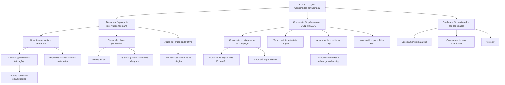

# SportConnect — UX Metrics & Plano de Mensuração

> **Documento:** 04-ux-metrics.md · **Versão:** 1.0 · **Data:** 16/11/2026
> **Dono:** Product Design / UX Metrics · **Depende de:** `03-product-design-prd.md` (estados, RN e US referenciados aqui)

---

## Sumário

1. [Princípios de mensuração](#1-princípios-de-mensuração)
2. [North Star Metric e árvore de métricas](#2-north-star-metric-e-árvore-de-métricas)
3. [Framework HEART por ator](#3-framework-heart-por-ator)
4. [Funis principais](#4-funis-principais)
5. [KPIs de negócio](#5-kpis-de-negócio)
6. [Plano de tracking (eventos)](#6-plano-de-tracking-eventos)
7. [Métricas de usabilidade](#7-métricas-de-usabilidade)
8. [Plano de testes A/B iniciais](#8-plano-de-testes-ab-iniciais)
9. [Alertas](#9-alertas)
10. [Template de scorecard semanal](#10-template-de-scorecard-semanal)

---

## 1. Princípios de mensuração

1. **Estado do servidor é a verdade.** Métricas de pagamento, confirmação e reembolso derivam dos eventos *server-side* (transições de estado — RN-34), nunca de cliques no app.
2. **Toda métrica tem dono, fórmula, janela e meta.** Sem esses quatro, não entra no scorecard.
3. **Metas iniciais são hipóteses.** As metas abaixo valem para os primeiros 90 dias na cidade-piloto e serão recalibradas após 4 semanas de baseline.
4. **Contra-métricas sempre ao lado.** Ex.: subir "% de reservas confirmadas" não pode vir às custas de "% de jogos confirmados por cobertura do organizador".
5. **LGPD por padrão.** IDs pseudonimizados no analytics; sem nome, celular, CPF ou e-mail em propriedades de evento.

## 2. North Star Metric e árvore de métricas

### 2.1 North Star

> **Jogos Confirmados por Semana (JCS)** — número de reservas que atingiram o estado `CONFIRMADO` na semana (segunda a domingo, America/Sao_Paulo) e **não** terminaram em `CANCELADO`.

**Por que essa métrica**

| Critério | Como o JCS atende |
|---|---|
| Alinhada ao valor | Um jogo confirmado é exatamente a promessa: quadra garantida, todos pagaram, arena recebe. Entrega valor aos 3 atores ao mesmo tempo. |
| Preditiva de receita | Receita = f(jogos confirmados × ticket × take rate). |
| Acionável | Produto influencia tanto a oferta (arenas/slots) quanto a conversão (rateio, prazos, lembretes). |
| Compreensível | "Quantos jogos a gente fez acontecer esta semana?" |

**Contra-métricas da North Star:** % de JCS confirmados por cobertura do organizador (saúde do rateio), % de cancelamentos pela arena após confirmação (confiabilidade), NPS do organizador.

**Métrica de valor complementar:** *Atletas-jogo pagos por semana* (cotas `PAGA` em jogos confirmados) — mede amplitude de uso; útil para comparar esportes com tamanhos de time diferentes.

### 2.2 Árvore de métricas



### 2.3 Hierarquia L1 / L2

| Nível | Métrica | Estágio |
|---|---|---|
| North Star | JCS | — |
| L1 | Arenas ativas (≥ 1 reserva confirmada nos últimos 28 dias) | Oferta |
| L1 | Novos organizadores ativados (1º jogo confirmado) | Aquisição/Ativação |
| L1 | % pré-reservas → `CONFIRMADO` | Conversão core |
| L1 | Retenção de organizadores M1 (criou jogo confirmado no mês seguinte) | Retenção |
| L1 | GMV e receita líquida | Monetização |
| L1 | NPS por ator | Satisfação |
| L2 | Funis (§4), sucesso de pagamento, tempo até rateio completo, taxa de expiração por antecedência, uso de cobrança WhatsApp, latência de webhook | Diagnóstico |

## 3. Framework HEART por ator

Formato: **Objetivo → Sinal → Métrica (fórmula) → Meta inicial (90 dias)**.

### 3.1 Organizador

| Dimensão | Objetivo | Sinal | Métrica | Meta |
|---|---|---|---|---|
| **Happiness** | Sentir que organizar ficou fácil e sem risco | Resposta à pesquisa pós-jogo; avaliação na loja | NPS do organizador (pesquisa 24h após `CONCLUIDO`, máx. 1×/30 dias); CSAT "organizar este jogo foi fácil" (1–5) | NPS ≥ 50; CSAT ≥ 4,4 |
| **Engagement** | Usar a plataforma para todo jogo | Jogos criados; uso de cobrança | Jogos confirmados por organizador ativo/mês; % de jogos com ≥ 1 "cobrar quem falta" | ≥ 2,5 jogos/mês; métrica de diagnóstico (sem meta) |
| **Adoption** | Novos organizadores chegam ao 1º jogo confirmado | 1º jogo confirmado | Taxa de ativação = organizadores com 1º `CONFIRMADO` ÷ usuários que iniciaram criação de jogo (coorte 14 dias) | ≥ 55% |
| **Retention** | Voltar a organizar | Novo jogo após o 1º | Retenção M1 de organizadores (coorte mensal); % de organizadores com jogo recorrente (Fase 2) | M1 ≥ 45%; M3 ≥ 30% |
| **Task success** | Criar e compartilhar rápido, sem erro | Fluxo de criação; erros | Conclusão do fluxo `jogo_criacao_iniciada` → `pre_reserva_ativada`; tempo mediano; % de jogos que precisaram de cobertura | ≥ 70%; ≤ 3 min; ≤ 10% |

### 3.2 Atleta (convidado / avulso)

| Dimensão | Objetivo | Sinal | Métrica | Meta |
|---|---|---|---|---|
| **Happiness** | Pagar sem atrito e confiar que está no jogo | Micro-pesquisa pós-pagamento (1 pergunta) | CES "Foi fácil pagar?" (1–7); NPS atleta (trimestral, in-app) | CES ≥ 6,0; NPS ≥ 40 |
| **Engagement** | Participar de mais jogos | Cotas pagas | Jogos pagos por atleta ativo/mês | ≥ 2,0 |
| **Adoption** | Convidado vira usuário com conta/app | Instalação/conta após pagar como visitante | % de visitantes que instalam o app ou completam perfil em 30 dias | ≥ 25% |
| **Retention** | Voltar a jogar pela plataforma | 2º jogo pago | % de atletas com 2º jogo pago em até 30 dias do 1º | ≥ 50% |
| **Task success** | Pagar a cota em segundos | Tempo e conversão no link | Mediana `convite_link_aberto` → `cota_paga`; taxa de erro de pagamento; % de reembolsos concluídos no SLA | ≤ 60 s; ≤ 3%; ≥ 98% |

### 3.3 Arena

| Dimensão | Objetivo | Sinal | Métrica | Meta |
|---|---|---|---|---|
| **Happiness** | Ver a plataforma como fonte de receita garantida | Pesquisa mensal; contato com suporte | NPS da arena (mensal); tickets de suporte por arena/mês | NPS ≥ 45; ≤ 1,0 ticket |
| **Engagement** | Operar a agenda pela plataforma | Uso do painel | Dias com acesso ao painel/semana; % de slots bloqueados manualmente (indica agenda paralela) | ≥ 4 dias; tendência de queda |
| **Adoption** | Arena cadastrada chega à 1ª reserva | 1ª reserva confirmada | % de arenas com 1ª `CONFIRMADO` em até 14 dias do início do cadastro | ≥ 60% |
| **Retention** | Continuar recebendo reservas | Reservas mensais | Retenção de arenas ativas M3; churn do plano Pro | ≥ 80%; ≤ 4%/mês |
| **Task success** | Configurar e operar sem ajuda | Funil de onboarding; tarefas da agenda | Tempo mediano cadastro → grade publicada; % concluindo sem suporte; % repasses liquidados na data prevista | ≤ 20 min; ≥ 70%; ≥ 99% |

## 4. Funis principais

Metas iniciais = hipótese de lançamento; revisar após 4 semanas de baseline. Janela de conversão indicada em cada funil.

### 4.1 Funil A — Criar jogo → todas as cotas pagas (janela: até H do jogo)

| # | Etapa | Evento | Conversão da etapa (meta) | Acumulado (meta) |
|---|---|---|---|---|
| A1 | Iniciou criação do jogo | `jogo_criacao_iniciada` | — | 100% |
| A2 | Selecionou slot | `slot_selecionado` | 85% | 85% |
| A3 | Configurou vagas e política | `jogo_configurado` | 92% | 78% |
| A4 | Iniciou checkout da própria cota | `checkout_iniciado` (papel=organizador) | 92% | 72% |
| A5 | Pré-reserva ativada | `pre_reserva_ativada` | 95% | 68% |
| A6 | Compartilhou convite | `convite_compartilhado` | 95% | 65% |
| A7 | ≥ 50% das cotas pagas | `cota_paga` (marco 50%) | 92% | 60% |
| A8 | **Todas as cotas pagas (sem política)** | `jogo_confirmado` (motivo=todas_pagas) | 82% | **49%** |
| A8' | Confirmado incluindo políticas A/C | `jogo_confirmado` (qualquer motivo) | 90% de A7 | 54% |

Diagnóstico: quebrar por esporte, nº de vagas, antecedência (ativação → T), política escolhida e plataforma.

### 4.2 Funil B — Convite aberto → cota paga (janela: até P; por sessão)

| # | Etapa | Evento | Conversão da etapa (meta) | Acumulado (meta) |
|---|---|---|---|---|
| B1 | Abriu o link | `convite_link_aberto` | — | 100% |
| B2 | Viu detalhes do jogo (página carregada) | `jogo_visualizado` | 95% | 95% |
| B3 | Tocou "Entrar e pagar" | `checkout_iniciado` (papel=atleta) | 82% | 78% |
| B4 | Identificou-se (OTP verificado ou sessão existente) | `otp_verificado` ou sessão válida em `checkout_iniciado` | 92% | 72% |
| B5 | Escolheu método e gerou cobrança | `cobranca_gerada` | 97% | 70% |
| B6 | **Cota paga** | `cota_paga` | 92% | **≥ 64%** |

Meta consolidada por **pessoa única** (não por sessão): ≥ 70% dos convidados que abrem o link pagam. Contra-métrica: % de aberturas de jogo já lotado/encerrado (indica convites enviados tarde).

### 4.3 Funil C — Arena cadastrada → 1ª reserva confirmada (janela: 30 dias)

| # | Etapa | Evento | Conversão da etapa (meta) | Acumulado (meta) |
|---|---|---|---|---|
| C1 | Iniciou cadastro da arena | `arena_cadastro_iniciado` | — | 100% |
| C2 | Concluiu dados da arena | `arena_cadastro_concluido` | 85% | 85% |
| C3 | Cadastrou ≥ 1 quadra | `quadra_cadastrada` | 92% | 78% |
| C4 | Publicou grade e preços | `grade_horarios_publicada` | 88% | 69% |
| C5 | Conta de recebimento aprovada | `conta_recebimento_aprovada` | 87% | 60% |
| C6 | 1ª pré-reserva recebida | `pre_reserva_ativada` (1ª da arena) | 85% | 51% |
| C7 | **1ª reserva confirmada** | `jogo_confirmado` (1ª da arena) | 90% | **≥ 46%** |

Nota: no piloto com onboarding assistido, a meta C1→C7 sobe para ≥ 60% em 14 dias (meta HEART de adoção da arena).

## 5. KPIs de negócio

| KPI | Fórmula | Meta MVP (mês 3 no piloto) | Frequência | Dono |
|---|---|---|---|---|
| **GMV** | Σ valor das cotas `PAGA` em reservas `CONFIRMADO`/`EM_ANDAMENTO`/`CONCLUIDO` + taxas de conveniência no período | ≥ R$ 350 mil/mês | Semanal | PM |
| **Receita líquida** | Comissões + taxas de conveniência − taxas devolvidas | ≥ R$ 50 mil/mês | Mensal | Financeiro |
| **Take rate efetivo** | Receita líquida ÷ GMV | 12–15% | Mensal | Financeiro |
| **Margem de contribuição por cota** | (Receita líquida − custos de gateway − estornos) ÷ cotas pagas | ≥ R$ 1,00 | Mensal | Financeiro |
| **Taxa de ocupação das quadras** | Horas `RESERVADO` via plataforma ÷ horas de grade publicadas (arenas ativas) | ≥ 35% geral; ≥ 60% horário nobre (18h–23h) | Semanal | PM Arena |
| **% reservas confirmadas** | Reservas que atingiram `CONFIRMADO` ÷ reservas que atingiram `AGUARDANDO_PAGAMENTOS` (coorte por data de ativação) | ≥ 80% | Semanal | PM |
| **% confirmadas por cobertura/re-rateio** (contra-métrica) | Confirmações com motivo ≠ `todas_pagas` ÷ confirmações | ≤ 15% | Semanal | PM |
| **Tempo médio até rateio completo** | Média e mediana de (`jogo_confirmado.ts` − `pre_reserva_ativada.ts`) para motivo=`todas_pagas` | Mediana ≤ 90 min | Semanal | PM |
| **Taxa de expiração** | Reservas `EXPIRADO` ÷ reservas ativadas | ≤ 12% | Semanal | PM |
| **Taxa de inadimplência** | Valor de cotas `EXPIRADA` (não cobertas) ÷ valor total das reservas ativadas — mede o "calote" que a plataforma neutraliza | ≤ 8% (e 0% de perda para a arena, por construção) | Semanal | PM |
| **No-show** | Atletas marcados ausentes ÷ atletas pagantes de jogos `CONCLUIDO` com marcação | ≤ 5% | Mensal | PM (Fase 2: check-in) |
| **Cancelamento pela arena** | Reservas `CANCELADO` por arena após `CONFIRMADO` ÷ confirmadas | ≤ 2% | Semanal | Ops Arenas |
| **Custo de reembolso** | (Taxas devolvidas + custo de estorno) ÷ receita líquida | ≤ 6% | Mensal | Financeiro |
| **SLA de reembolso** | Estornos concluídos no SLA (RN-25) ÷ estornos solicitados | ≥ 98% | Diário | Engenharia |
| **Sucesso de pagamento** | Pagamentos `CONFIRMADO` ÷ cobranças geradas | Pix ≥ 90%; cartão ≥ 85% | Diário | Engenharia |
| **Arenas ativas** | Arenas com ≥ 1 `CONFIRMADO` nos últimos 28 dias | ≥ 40 | Semanal | Negócios |
| **Conversão para Pro** | Arenas Pro ÷ arenas ativas | ≥ 15% (a partir da Fase 2) | Mensal | Negócios |

## 6. Plano de tracking (eventos)

### 6.1 Convenções
- Nomes em `snake_case`, padrão **objeto_ação no particípio** (`cota_paga`, `jogo_confirmado`).
- **Fonte:** `C` = cliente (app/web), `S` = servidor (fonte da verdade para dinheiro e estados). Eventos de estado são sempre `S`.
- **Propriedades globais** (enviadas em todos os eventos): `event_id` (UUID, deduplicação), `timestamp` (UTC ISO 8601), `user_id_hash` (pseudonimizado, nulo se anônimo), `anonymous_id`, `session_id`, `plataforma` (`android` | `ios` | `web` | `desktop`), `app_version`, `cidade`, `origem_utm` (quando houver), `ator` (`organizador` | `atleta` | `arena` | `sistema`).
- **Proibido** em propriedades: nome, celular, e-mail, CPF, endereço do usuário, chave Pix.
- Valores monetários em centavos (`*_centavos`).

### 6.2 Tabela de eventos

| # | Evento | Fonte | Gatilho | Propriedades específicas |
|---|---|---|---|---|
| 1 | `convite_link_aberto` | C/S | Requisição da URL do convite (web ou deep link) | `jogo_id`, `convite_id`, `canal` (whatsapp/copiado/outro), `app_instalado` (bool), `status_reserva`, `vagas_restantes`, `minutos_ate_prazo` |
| 2 | `jogo_visualizado` | C | Página/tela do jogo renderizada | `jogo_id`, `esporte`, `status_reserva`, `origem` (convite/meus_jogos/busca), `lcp_ms` (web) |
| 3 | `cadastro_iniciado` | C | Usuário toca "Entrar"/"Criar conta" | `contexto` (checkout/organizar/arena) |
| 4 | `otp_solicitado` | S | Código enviado | `canal_otp` (sms/whatsapp), `tentativa_n` |
| 5 | `otp_verificado` | S | Código validado | `segundos_ate_verificar`, `tentativas` |
| 6 | `otp_falhou` | S | Código inválido/expirado ou bloqueio | `motivo` (invalido/expirado/bloqueado) |
| 7 | `cadastro_concluido` | S | Perfil mínimo criado | `tipo` (visitante/conta_completa), `contexto` |
| 8 | `consentimento_atualizado` | S | Alteração em consentimento LGPD | `tipo_consentimento` (marketing/localizacao/push), `valor` (bool) |
| 9 | `arena_cadastro_iniciado` | C | Início do onboarding da arena | `origem` (convite_organizador/organico/vendas) |
| 10 | `arena_cadastro_concluido` | S | Dados da arena salvos | `arena_id`, `minutos_no_fluxo`, `qtd_fotos` |
| 11 | `quadra_cadastrada` | S | Quadra salva | `arena_id`, `quadra_id`, `esportes[]`, `coberta` |
| 12 | `grade_horarios_publicada` | S | Grade e preços publicados | `arena_id`, `quadra_id`, `slots_gerados`, `faixas_preco`, `preco_min_centavos`, `preco_max_centavos` |
| 13 | `conta_recebimento_aprovada` | S | Webhook de KYC aprovado | `arena_id`, `horas_ate_aprovar`, `tentativas` |
| 14 | `horario_bloqueado` | S | Bloqueio manual de slot | `arena_id`, `quadra_id`, `motivo`, `horas_ate_slot` |
| 15 | `busca_realizada` | C | Busca de arenas/horários | `cidade`, `esporte`, `data_alvo`, `qtd_resultados`, `localizacao_permitida` |
| 16 | `slot_selecionado` | C | Organizador escolhe um horário | `arena_id`, `quadra_id`, `slot_id`, `esporte`, `preco_centavos`, `horas_ate_jogo` |
| 17 | `jogo_criacao_iniciada` | C | Toque em "Organizar jogo" | `origem` (home/busca/arena/repetir) |
| 18 | `jogo_configurado` | C | Vagas e política confirmadas | `jogo_id`, `esporte`, `numero_vagas`, `cota_base_centavos`, `sobra_centavos`, `politica`, `garantia` (cartao/pix/na), `teto_complemento_pct` |
| 19 | `checkout_iniciado` | S | Trava de checkout criada (slot ou cota) | `jogo_id`, `cota_id`, `papel` (organizador/atleta), `tipo_cota` (padrao/complemento/cobertura) |
| 20 | `checkout_conflito` | S | Disputa perdida pelo mesmo slot/cota | `jogo_id`/`slot_id`, `tipo` (slot/cota) |
| 21 | `metodo_pagamento_selecionado` | C | Escolha de Pix ou cartão | `metodo`, `default_exibido` |
| 22 | `cobranca_gerada` | S | Pix/cartão criado no gateway | `pagamento_id`, `metodo`, `valor_centavos`, `taxa_centavos` |
| 23 | `pix_codigo_copiado` | C | Toque em "Copiar código Pix" | `pagamento_id` |
| 24 | `pagamento_confirmado` | S | Webhook de confirmação do gateway | `pagamento_id`, `metodo`, `valor_centavos`, `segundos_ate_confirmar`, `latencia_webhook_ms` |
| 25 | `pagamento_falhou` | S | Recusa/erro/expiração da cobrança | `pagamento_id`, `metodo`, `motivo` (recusado/expirado/erro_gateway/3ds) |
| 26 | `cota_paga` | S | Cota → `PAGA` | `jogo_id`, `cota_id`, `origem` (atleta/cobertura), `tipo_cota`, `posicao` (n de N), `pct_pago_apos`, `minutos_desde_ativacao` |
| 27 | `pre_reserva_ativada` | S | Reserva → `AGUARDANDO_PAGAMENTOS` | `jogo_id`, `arena_id`, `esporte`, `numero_vagas`, `valor_total_centavos`, `politica`, `minutos_ate_prazo_cotas`, `horas_ate_jogo` |
| 28 | `convite_compartilhado` | C | Toque em "Convidar" e escolha do canal | `jogo_id`, `canal` (whatsapp/nativo/copiar) |
| 29 | `cobranca_pendentes_enviada` | C | Toque em "Cobrar quem falta" | `jogo_id`, `pendentes`, `minutos_ate_prazo` |
| 30 | `lembrete_enviado` | S | Push/e-mail automático disparado | `jogo_id`, `tipo` (prazo_60min/jogo_3h/rerrateio/reembolso), `canal` |
| 31 | `notificacao_aberta` | C | Abertura de push | `tipo`, `minutos_desde_envio` |
| 32 | `prazo_cotas_atingido` | S | Job de P executado com pendências | `jogo_id`, `politica`, `pendentes`, `valor_pendente_centavos` |
| 33 | `politica_aplicada` | S | Resultado da política | `jogo_id`, `politica`, `resultado` (coberto/rerrateado/expirado), `valor_coberto_centavos` |
| 34 | `rerrateio_respondido` | S | Pagante paga ou recusa complemento | `jogo_id`, `cota_id`, `resposta` (pagou/recusou/sem_resposta), `complemento_centavos`, `tinha_pre_aceite` |
| 35 | `jogo_confirmado` | S | Reserva → `CONFIRMADO` | `jogo_id`, `arena_id`, `esporte`, `motivo` (todas_pagas/cobertura/rerrateio/integral), `minutos_ate_confirmar`, `aberturas_convite` |
| 36 | `reserva_expirada` | S | Reserva → `EXPIRADO` | `jogo_id`, `politica`, `pct_pago`, `motivo` (politica_b/cobertura_nao_paga/rerrateio_falhou) |
| 37 | `jogo_cancelado` | S | Reserva → `CANCELADO` | `jogo_id`, `por` (organizador/arena/suporte), `motivo`, `estado_anterior`, `horas_ate_jogo` |
| 38 | `atleta_saiu_do_jogo` | S | Saída voluntária (RN-21) | `jogo_id`, `cota_id`, `estado_reserva`, `minutos_ate_prazo` |
| 39 | `reembolso_solicitado` | S | Estorno pedido ao gateway | `pagamento_id`, `motivo` (RN-25), `valor_centavos`, `taxa_devolvida` (bool), `metodo` |
| 40 | `reembolso_concluido` | S | Cota → `REEMBOLSADA` | `pagamento_id`, `horas_ate_concluir`, `dentro_sla` (bool), `tentativas` |
| 41 | `jogo_iniciado` | S | Reserva → `EM_ANDAMENTO` | `jogo_id` |
| 42 | `jogo_concluido` | S | Reserva → `CONCLUIDO` | `jogo_id`, `atletas_pagantes` |
| 43 | `repasse_liquidado` | S | Repasse → `LIQUIDADO` | `repasse_id`, `arena_id`, `valor_liquido_centavos`, `dias_apos_jogo`, `no_prazo` (bool) |
| 44 | `agenda_arena_visualizada` | C | Abertura da agenda no painel | `arena_id`, `visao` (dia/semana), `papel` (gestor/operador) |
| 45 | `pesquisa_respondida` | C | Resposta de NPS/CSAT/CES/SUS | `tipo` (nps/csat/ces/sus), `nota`, `ator`, `contexto` |
| 46 | `erro_exibido` | C | Mensagem de erro mostrada ao usuário | `codigo_erro`, `tela`, `recuperavel` (bool) |
| 47 | `app_instalado_apos_convite` | C | Primeira abertura do app atribuída a convite | `convite_id`, `horas_desde_pagamento` |
| 48 | `lista_espera_entrou` *(Fase 2)* | S | Entrada na lista de espera | `jogo_id`, `posicao` |
| 49 | `substituicao_concluida` *(Fase 2)* | S | Substituto pagou (RN-26) | `jogo_id`, `origem_substituto` (indicado/lista_espera), `horas_ate_jogo` |
| 50 | `avaliacao_enviada` *(Fase 2)* | S | Avaliação pós-jogo | `jogo_id`, `tipo` (atleta/arena), `nota` |

### 6.3 Governança do tracking
- Plano versionado junto ao código (`analytics/eventos.yaml` — a criar pela engenharia) com testes que validam esquema.
- Eventos `S` emitidos a partir do log de auditoria de transições (RN-34), garantindo consistência com o banco.
- Revisão do plano a cada épico novo; evento sem consumidor em 90 dias é descontinuado.

## 7. Métricas de usabilidade

### 7.1 Métricas e metas

| Métrica | Método | Meta MVP |
|---|---|---|
| **SUS** (System Usability Scale) | Questionário de 10 itens ao fim de cada sessão de teste moderado; in-app trimestral (amostra) | Organizador ≥ 78; Atleta ≥ 80; Arena ≥ 72 (média global ≥ 75) |
| **SEQ** (Single Ease Question, 1–7) | Após cada tarefa em teste | ≥ 5,5 em todas as tarefas críticas |
| **Tempo na tarefa** | Cronometrado em teste + telemetria em produção (mediana e p75) | Ver 7.2 |
| **Taxa de sucesso na tarefa** | % que conclui sem ajuda | ≥ 90% (tarefas críticas) |
| **Taxa de erro** | Erros por tarefa (ações incorretas, voltas, mensagens de erro) | ≤ 0,5 erro/tarefa crítica; `erro_exibido` ≤ 3% das sessões de checkout |
| **Compreensão de regras** | Perguntas de verificação após ler a política ("o que acontece se 2 não pagarem?") | ≥ 85% de respostas corretas |

### 7.2 Tarefas críticas e metas de tempo

| ID | Tarefa | Ator | Mediana | p75 |
|---|---|---|---|---|
| T1 | Abrir o link no WhatsApp e pagar a cota via Pix (sem app) | Atleta | ≤ 60 s | ≤ 90 s |
| T2 | Criar jogo, pagar a própria cota e compartilhar no WhatsApp | Organizador | ≤ 3 min | ≤ 4 min |
| T3 | Verificar quem falta pagar e cobrar | Organizador | ≤ 15 s | ≤ 25 s |
| T4 | Explicar o que acontece com o jogo ao fim do prazo (política escolhida) | Organizador/Atleta | — | 85% acerto |
| T5 | Sair de um jogo e entender o valor e prazo do reembolso | Atleta | ≤ 45 s | ≤ 60 s |
| T6 | Cadastrar quadra, grade e preços | Arena | ≤ 15 min | ≤ 20 min |
| T7 | Bloquear um horário para reserva por telefone | Arena | ≤ 20 s | ≤ 30 s |
| T8 | Encontrar o valor líquido do último repasse | Arena | ≤ 30 s | ≤ 45 s |

### 7.3 Cadência de pesquisa
- **Pré-lançamento:** 2 rodadas de teste moderado (protótipo navegável) com 6–8 participantes por ator, incluindo ≥ 2 usuários de leitor de tela e ≥ 2 com baixa literacia digital.
- **Pós-lançamento:** teste não moderado mensal (T1, T2, T6); SUS in-app trimestral; revisão de gravações de sessão (com consentimento) para funis com queda > 10 p.p. da meta.

## 8. Plano de testes A/B iniciais

Premissas: volume do piloto é limitado → priorizar testes no **link do convite** (maior tráfego), usar análise sequencial/bayesiana, rodar no mínimo 2 ciclos semanais completos, nunca mais de 2 testes simultâneos na mesma etapa do funil. Randomização por `anonymous_id` (atleta) ou `jogo_id` (quando o tratamento afeta o grupo todo).

| ID | Hipótese | Variantes | Unidade | Métrica primária | Guardrails | MDE / amostra aprox. |
|---|---|---|---|---|---|---|
| AB-01 | Mostrar nomes e progresso de quem já pagou ("8 de 12 pagos: Ana, Léo…") aumenta a conversão por prova social | A: só contador · B: contador + nomes + avatares | Atleta (convite) | Convite aberto → cota paga | Reclamações de privacidade; tempo na página | +4 p.p. sobre 64% → ~2.300 aberturas/variante |
| AB-02 | Pix pré-selecionado reduz passos e aumenta a conversão sem afetar quem prefere cartão | A: escolha explícita · B: Pix pré-selecionado com "Pagar com cartão" secundário | Atleta | Cota paga; tempo até pagar | Sucesso de pagamento com cartão | +3 p.p. → ~3.000/variante |
| AB-03 | Exibir a taxa de conveniência no total ("R$ 21,50 — inclui R$ 1,50 de taxa") vs separada gera menos abandono, mantendo transparência legal | A: linha separada · B: total com detalhamento expansível visível | Atleta | Checkout iniciado → cota paga | Tickets "cobrança indevida"; CES | +2 p.p. → ~5.000/variante (pode exigir 4+ semanas) |
| AB-04 | Mensagem de cobrança com urgência e prazo concreto acelera o rateio | A: "Falta você! Paga aqui" · B: "Faltam 4 e o horário cai às 18h. Garante aqui" | Jogo | Tempo mediano até rateio completo | Taxa de saída voluntária | −15 min na mediana → ~400 jogos/variante |
| AB-05 | Pré-aceite de re-rateio no checkout ("se faltar gente, topo pagar até R$ X a mais") aumenta a taxa de sucesso da política C | A: sem pré-aceite · B: checkbox opcional | Jogo (política C) | % de re-rateios concluídos | Conversão do checkout | +10 p.p. → ~300 jogos/variante (rodar após release 1.1) |
| AB-06 | Recomendar garantia por cartão na política A reduz expirações por cobertura não paga | A: Pix e cartão neutros · B: cartão recomendado com explicação | Organizador | % de jogos política A que expiram | Conclusão do fluxo de criação | −3 p.p. de expiração → ~600 jogos/variante |
| AB-07 | Onboarding da arena com grade-modelo pré-preenchida por esporte reduz tempo até publicar | A: grade em branco · B: modelo editável | Arena | Tempo cadastro → grade publicada; conclusão C1→C4 | Taxa de bloqueios manuais na 1ª semana | Teste qualitativo + quase-experimento (amostra pequena de arenas) |

Processo: cada teste tem ficha (hipótese, métricas, critério de parada, dono) aprovada antes do início e resultado registrado no repositório de aprendizados — mesmo quando neutro.

## 9. Alertas

| Alerta | Condição | Severidade | Dono |
|---|---|---|---|
| Webhook de pagamento atrasado | p95 `latencia_webhook_ms` > 10 s por 10 min | P1 | Engenharia |
| Job de prazo atrasado | Atraso > 2 min em P/H/T | P1 | Engenharia |
| Queda de sucesso Pix | Sucesso Pix < 80% em janela de 1 h | P1 | Engenharia |
| Double booking detectado | Qualquer ocorrência | P0 | Engenharia |
| Estorno falho | > 1% dos estornos falham em 24 h | P1 | Engenharia + Financeiro |
| Conversão do convite | Funil B < 50% em 2 dias seguidos | P2 | PM |
| Expiração | Taxa de expiração > 20% na semana | P2 | PM |
| Cancelamento pela arena | Arena com > 3% de cancelamentos de confirmadas no mês | P3 | Ops Arenas |

## 10. Template de scorecard semanal

> Copiar esta seção para `scorecards/AAAA-SS.md` (ou ferramenta de BI) toda segunda-feira. Revisão de 30 min: PM, Design, Eng. Lead, Ops Arenas.

```markdown
# Scorecard semanal — Semana SS/AAAA (dd/mm a dd/mm)

## 1. Resumo (3 linhas)
- Saúde geral: 🟢 / 🟡 / 🔴 — <frase>
- Maior mudança: <métrica, variação, causa provável>
- Decisão/ação principal da semana: <ação + dono>

## 2. North Star
| Métrica | Semana | Semana anterior | Δ % | Meta | Status |
|---|---|---|---|---|---|
| Jogos Confirmados (JCS) | | | | | |
| Atletas-jogo pagos | | | | | |
| Contra: % confirmados por cobertura/re-rateio | | | | ≤ 15% | |

## 3. L1 — Saúde
| Métrica | Semana | Anterior | Δ | Meta | Status |
|---|---|---|---|---|---|
| Arenas ativas (28d) | | | | | |
| Novos organizadores ativados | | | | | |
| % pré-reservas → CONFIRMADO | | | | ≥ 80% | |
| Retenção M1 organizadores (coorte do mês) | | | | ≥ 45% | |
| GMV (R$) | | | | | |
| Receita líquida (R$) | | | | | |
| NPS (org / atleta / arena) | | | | 50 / 40 / 45 | |

## 4. Funis
| Funil | Conversão total | Anterior | Meta | Maior queda (etapa) |
|---|---|---|---|---|
| A — Criar jogo → todas pagas | | | 49% | |
| B — Convite aberto → cota paga | | | 64% | |
| C — Arena cadastrada → 1ª reserva (coorte 30d) | | | 46% | |

## 5. Operação e qualidade
| Métrica | Semana | Meta | Status |
|---|---|---|---|
| Tempo mediano até rateio completo | | ≤ 90 min | |
| Taxa de expiração | | ≤ 12% | |
| Inadimplência (valor de cotas expiradas) | | ≤ 8% | |
| Cancelamento pela arena | | ≤ 2% | |
| Sucesso de pagamento (Pix / cartão) | | 90% / 85% | |
| SLA de reembolso | | ≥ 98% | |
| Mediana tempo para pagar via link | | ≤ 60 s | |
| Incidentes (P0/P1) | | 0 | |

## 6. Segmentos em destaque
- Por esporte: <ex.: beach tennis +18% JCS; futsal expiração 22%>
- Por plataforma: <web convite vs app>
- Por antecedência: <ativados < 6h do jogo vs > 24h>

## 7. Experimentos ativos
| ID | Status | Dias rodando | Métrica primária (A vs B) | Prob. de B ser melhor | Decisão |
|---|---|---|---|---|---|
| AB-0X | | | | | continuar / encerrar / escalar |

## 8. Bright spots
- 

## 9. Pontos de atenção
- 

## 10. Ações
| Ação | Tipo (investigar / experimentar / investir / alertar) | Dono | Prazo |
|---|---|---|---|
| | | | |

## 11. Contexto e ressalvas
- Eventos externos (feriados, chuva, campeonatos, campanhas):
- Problemas de dados conhecidos:
```

**Legenda de status:** 🟢 no alvo ou melhorando · 🟡 até 10% abaixo da meta ou estável abaixo · 🔴 > 10% abaixo da meta ou piora por 2 semanas seguidas.
