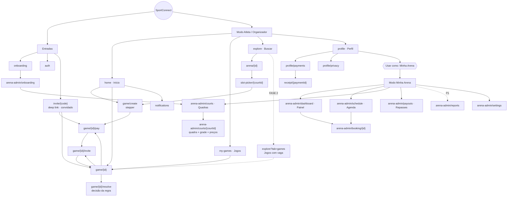
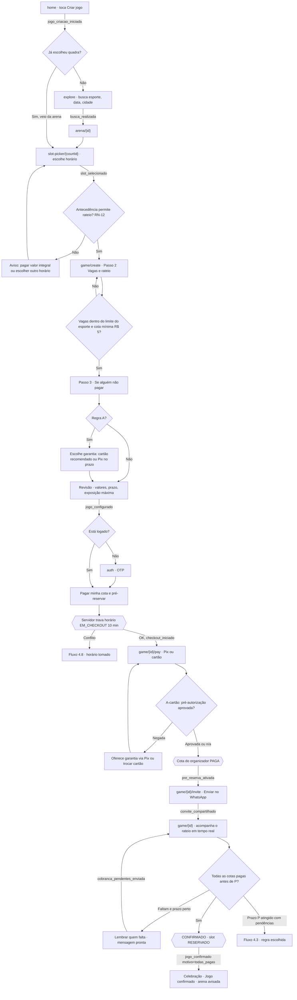
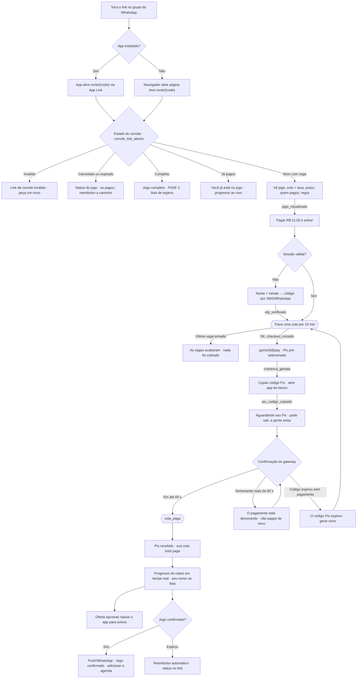
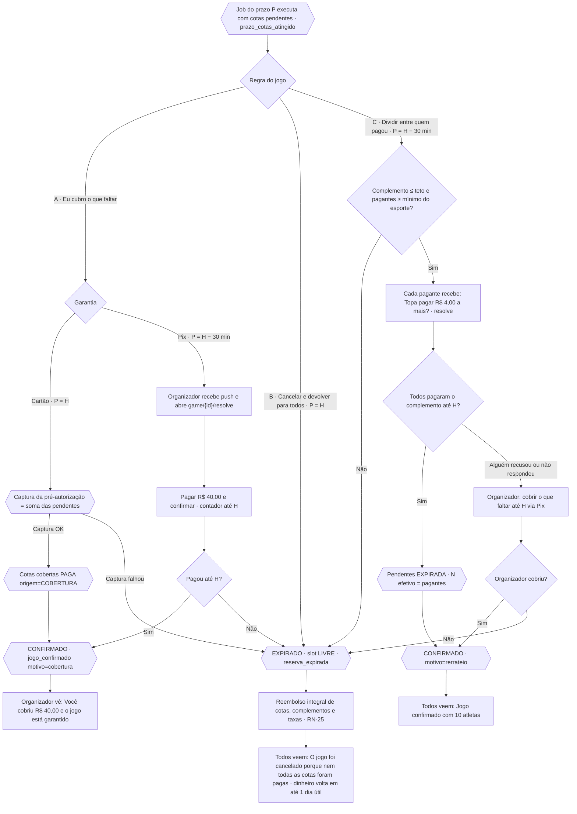
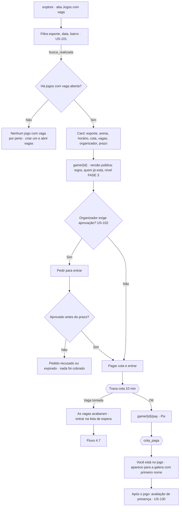
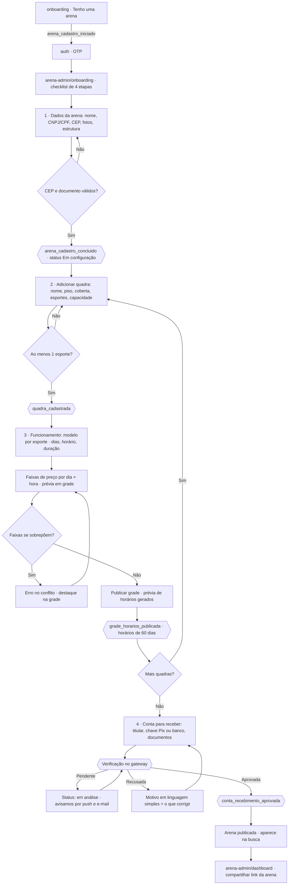
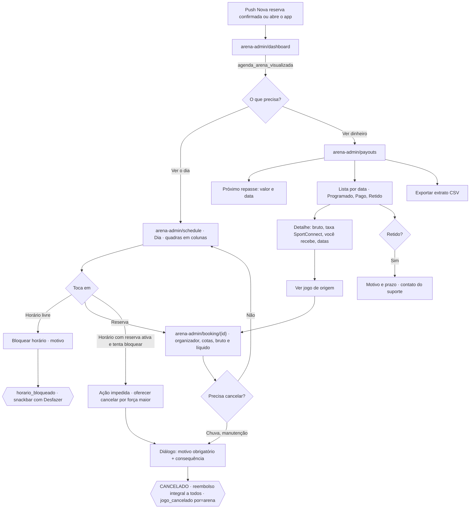
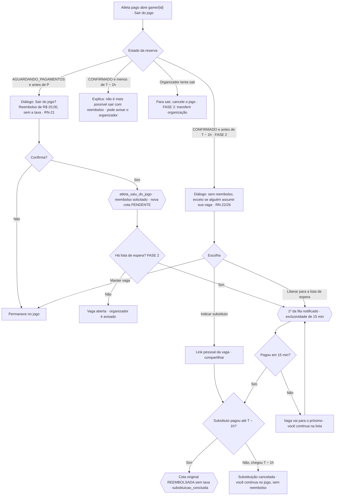
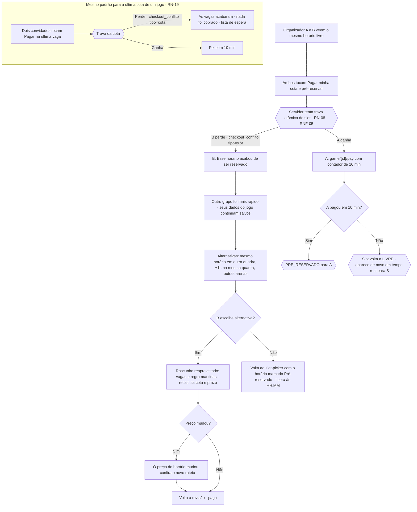

# 09 — UX Design · SportConnect

> **Documento:** 09-ux-design.md · **Versão:** 1.0 · **Data:** 16/11/2026
> **Dono:** UX Design · **Revisores:** Product Design/PM, UX Writing, Engenharia KMP, Acessibilidade
> **Depende de:** [00-brief](./00-brief.md) · [01-ux-research](./01-ux-research.md) · [02-service-design](./02-service-design.md) · [03-product-design-prd](./03-product-design-prd.md) (US, RN, estados) · [04-ux-metrics](./04-ux-metrics.md) (eventos, tarefas T1–T8) · [07-ux-writing](./07-ux-writing.md) (IDs de strings)
> **Alimenta:** `10-ui-design.md` (especificação visual de telas) e o backlog de engenharia (rotas de navegação Compose).
> **Status:** v1.0 para revisão. Trechos marcados **[FASE 2]** e **[FASE 3]** fazem parte do mapa de longo prazo; o resto é MVP.

---

## Sumário

1. [Princípios de UX do produto](#1-princípios-de-ux-do-produto)
2. [Arquitetura de informação](#2-arquitetura-de-informação)
3. [Inventário de telas](#3-inventário-de-telas)
4. [User flows](#4-user-flows)
5. [Wireframes de baixa fidelidade](#5-wireframes-de-baixa-fidelidade)
6. [Padrões de interação](#6-padrões-de-interação)
7. [Heurísticas de Nielsen aplicadas](#7-heurísticas-de-nielsen-aplicadas)
8. [Checklist de acessibilidade por tela](#8-checklist-de-acessibilidade-por-tela)
9. [Plano de teste de usabilidade](#9-plano-de-teste-de-usabilidade)
10. [Inconsistências encontradas e decisões pendentes](#10-inconsistências-encontradas-e-decisões-pendentes)
11. [Anexo — Rotas finais](#11-anexo--rotas-finais)

---

## 1. Princípios de UX do produto

Os princípios vêm da pesquisa (personas, JTBD, jornadas as-is e hipóteses do doc 01), dos princípios de serviço (doc 02) e dos princípios de produto (doc 03 §4). Quando dois princípios entram em conflito, vale a ordem da tabela.

| # | Princípio de UX | De onde vem | O que significa na interface | Como verificar |
|---|---|---|---|---|
| UX1 | **O dinheiro sempre tem endereço.** | P3 "Dinheiro nunca some" (02); dor de Juliana: "o organizador disse que pagou" (01 §7.5); RN-25 | Todo valor mostra estado (pago, em análise, coberto, reembolsado), quem pagou e para onde vai. Nenhuma tela de dinheiro termina em "processando" sem prazo ou próximo passo. | T5 (reembolso) e comprovante no teste; `erro_exibido` em checkout ≤ 3% |
| UX2 | **O link é o produto.** | H8 (link sem app), OP3 score 8,0; Diego "prefere web/link" (01 §7.3); US-001 | O convidado resolve tudo em `invite/{code}` no navegador: ver jogo, entrar, pagar, acompanhar. O app é oferta depois do pagamento, nunca condição. | T1 ≤ 60 s; Funil B ≥ 64% |
| UX3 | **Regras visíveis antes do sim.** | P2 "A regra decide" (02); FP3 organizador não entende a regra; princípio 3 do PRD | A regra de não pagamento, a taxa de conveniência e o prazo aparecem *antes* de qualquer pagamento, com exemplo em R$. Nunca em letra miúda nem só em termos. | T4 ≥ 85% de acerto |
| UX4 | **O relógio é público e honesto.** | Princípio 4 do PRD; H4 (hold de 4h); jornada "Faltam 2… vou ter que pagar" | Contador regressivo sempre junto da consequência ("às 18h, se faltar alguém, você cobre R$ 40,00"). Quem decide o fim do prazo é o servidor, não o relógio do aparelho. | Teste de compreensão do contador; zero relato de "o prazo acabou antes" |
| UX5 | **Cobrar sem constranger.** | JTBD emocional do organizador ("não ser o chato que cobra"); Rafael "não quero ser o banco da pelada" | O sistema cobra por ele: lembretes automáticos e "Lembrar quem falta" com mensagem pronta. A UI nunca expõe valores devidos de uma pessoa específica para o grupo. | T3 ≤ 15 s; uso de `cobranca_pendentes_enviada` |
| UX6 | **A agenda da arena é sagrada.** | P5 (02); Juliana "meu medo é o grupo chegar e a quadra estar com outro time"; RNF-04 | Qualquer conflito é resolvido no servidor e explicado em linguagem humana com alternativa imediata. Bloquear um horário custa ≤ 2 toques. | 0 double booking; T7 ≤ 20 s |
| UX7 | **Confirmação só com confirmação.** | FP5 Pix pago e webhook atrasado; princípio 1 do PRD | Ações de dinheiro e reserva nunca são otimistas. Ações sociais e de navegação são. (§6.3) | Zero "pague de novo" em sessões gravadas |
| UX8 | **Um app, papéis claros.** | 3 atores; Sérgio tem tecnologia média-baixa; Juliana usa celular pessoal | Atleta e organizador são o mesmo usuário (o papel muda por jogo, não por conta). A arena entra num modo próprio, "Minha Arena", com navegação própria e vocabulário profissional. | SUS arena ≥ 72 |
| UX9 | **Multiesporte e inclusivo por padrão.** | H10; princípio 7 do PRD; voz do 07 | Nada assume futebol, gênero ou nível. Mínimos e máximos de vagas vêm do esporte (RN-05). | Revisão de conteúdo no handoff |
| UX10 | **Acessível e legível na quadra.** | Sol, pressa, uma mão só; RNF-16 a RNF-21; amostra de pesquisa com PcD | WCAG 2.1 AA, alvos de 48dp, status com texto + ícone, fonte até 200%, leitor de tela anuncia mudanças de rateio sem atrapalhar. | Checklist §8; ≥ 2 usuários de leitor de tela em cada rodada de teste |

---

## 2. Arquitetura de informação

### 2.1 Modelo de atores e modos

| Ator | Como entra | Modo no app | Navegação principal | Observação |
|---|---|---|---|---|
| **Atleta** (convidado com conta, ou avulso [FASE 2]) | Link de convite, loja de apps, web | **Modo Atleta** (padrão) | Início · Jogos · Buscar · Perfil | Mesma conta do organizador. |
| **Organizador** | Mesmo app; vira organizador ao tocar "Criar jogo" | **Modo Atleta** | Mesma do atleta + FAB/ação "Criar jogo" | O papel é *por jogo*: em `game/{id}` a UI mostra controles de organizador só para quem criou aquele jogo. |
| **Convidado sem conta** | Link `sportconnect.app/j/{code}` | **Fluxo do convite** (sem navegação global) | Nenhuma: tela única com top bar mínima | Identificação leve (nome + celular + OTP). Ao final, oferta não obrigatória de instalar o app ou criar perfil. |
| **Arena — Gestor** (dono) | "Tenho uma arena" no onboarding, ou Perfil → "Minha Arena" | **Modo Minha Arena** | Agenda · Quadras · Repasses · Perfil (+ Painel como início) | Acesso a dados financeiros e configurações. |
| **Arena — Operador** (recepção) | Convite do gestor (e-mail/celular) | **Modo Minha Arena** com permissões reduzidas | Agenda · Quadras (só leitura) · Perfil | Sem acesso a Repasses nem à conta de recebimento. |

**Troca de modo:** quem tem papel de arena vê um seletor no topo do Perfil ("Usar como: Atleta | Minha Arena") e um atalho no menu da conta. O modo escolhido fica salvo por dispositivo. Abrir um deep link do outro modo troca de modo automaticamente e mostra um snackbar ("Você está no modo Minha Arena").

### 2.2 Navegação principal e layouts adaptativos

Seguimos as window size classes do Material 3 (grid de [05-visual-design §9](./05-visual-design.md)) e o `SCBottomNav` de [06-design-system §5.15](./06-design-system.md).

| Classe | Largura | Navegação (Atleta) | Navegação (Minha Arena) | Layout de conteúdo |
|---|---|---|---|---|
| **Compact** | < 600dp (celular retrato) | **Bottom navigation**, 4 destinos, rótulos sempre visíveis | Bottom navigation, 4 destinos | Uma coluna; detalhe empilhado (nova tela); sheets modais de baixo. |
| **Medium** | 600–839dp (celular deitado, dobrável, tablet retrato, janela estreita) | **Navigation rail** (como pede o 05) | Navigation rail | Uma coluna mais larga (máx. 640dp) ou lista + detalhe em 40/60 quando o conteúdo permitir (Meus jogos). Sheets viram diálogos laterais. |
| **Expanded** | ≥ 840dp (desktop, web, tablet deitado) | **Navigation rail obrigatória** com FAB "Criar jogo" no topo da rail | Navigation rail | **Lista + detalhe** (list-detail canônico): `my-games` + `game/{id}`; `explore` + `arena/{id}`; agenda com painel de detalhe da reserva à direita. Sheets viram diálogos centralizados ou painéis laterais. |
| **Large** | ≥ 1200dp | Rail (conteúdo máx. 1040dp, centralizado) | **Navigation drawer** fixo (painel da arena, uso de balcão em monitor) | Agenda semanal com todas as quadras em colunas. |

**Regras de navegação**

1. **Destinos de topo (abas):** Atleta → `home`, `my-games`, `explore`, `profile`. Minha Arena → `arena-admin/dashboard` (rotulado "Painel" e tratado como início), `arena-admin/schedule`, `arena-admin/courts`, `arena-admin/payouts`, `profile`. No compact a arena mostra 4 destinos: **Agenda · Quadras · Repasses · Perfil**; o Painel é a tela inicial da aba Agenda (resumo do dia + agenda). No expanded, "Painel" aparece como destino próprio na rail.
2. **"Pagar" nunca é destino de navegação** (regra do 06). Pagar é sempre uma ação contextual dentro de um jogo.
3. **Criar jogo** é ação primária global: FAB na Home (compact), item no topo da rail (medium/expanded). Abre `game/create` como fluxo em tela cheia, sem bottom nav.
4. **Fluxos transacionais escondem a navegação global:** `game/create`, `game/{id}/pay`, `game/{id}/resolve`, `auth`, `onboarding`, `invite/{code}` e `arena-admin/onboarding`. Fechar (X) pede confirmação se houver dados preenchidos ou dinheiro em andamento.
5. **Voltar (sistema/top bar):** volta na pilha da aba atual. Cada aba guarda a própria pilha (state restoration). Deep link abre a tela-alvo com uma pilha sintética (ex.: `game/{id}` aberto por push → voltar leva a `my-games`).
6. **Badge:** a aba Jogos mostra um número quando há cota sua pendente ou decisão de regra aguardando você (lido como "Jogos, 2 pendências").

### 2.3 Mapa do app por ator

| Área | Atleta / Organizador | Convidado sem conta | Arena — Gestor | Arena — Operador |
|---|---|---|---|---|
| Onboarding e login | `onboarding`, `auth` | `auth` embutido no convite (OTP) | `onboarding` → `arena-admin/onboarding` | `auth` (convite do gestor) |
| Início | `home` | — | `arena-admin/dashboard` | `arena-admin/dashboard` (sem números financeiros) |
| Descoberta | `explore` (aba Quadras; aba Jogos com vaga [FASE 2]), `arena/{id}`, `slot-picker/{courtId}` | — | — | — |
| Criação | `game/create`, `game/{id}/invite` | — | — | — |
| Jogo | `game/{id}`, `game/{id}/pay`, `game/{id}/resolve` | `invite/{code}`, `game/{id}/pay` | `arena-admin/booking/{id}` | `arena-admin/booking/{id}` |
| Meus jogos e histórico | `my-games` | link do convite continua sendo a "página do jogo" | — | — |
| Agenda | — | — | `arena-admin/schedule` | `arena-admin/schedule` |
| Cadastro e configuração | — | — | `arena-admin/courts`, `arena-admin/courts/{courtId}`, `arena-admin/settings` | `arena-admin/courts` (leitura) |
| Financeiro | `profile/payments` (pagamentos e reembolsos), `receipt/{paymentId}` | comprovante na tela + e-mail opcional | `arena-admin/payouts`, `arena-admin/reports` (P1) | — |
| Conta | `profile`, `profile/privacy`, `notifications` | — | `profile` + seletor de modo | `profile` |

### 2.4 Sitemap



### 2.5 Esquema de rotas e deep links

| Padrão | Exemplo | Abre | Precisa de login? |
|---|---|---|---|
| `https://sportconnect.app/j/{code}` | `/j/K7Q2XM` | `invite/{code}` (web leve ou app via App Links/Universal Links) | Não. OTP só ao pagar. |
| `https://sportconnect.app/g/{id}` | push "Jogo confirmado" | `game/{id}` | Sim (ou sessão de visitante válida, 90 dias, US-002) |
| `https://sportconnect.app/g/{id}/pay` | push "Falta sua cota" | `game/{id}/pay` | Sessão de visitante ou conta |
| `https://sportconnect.app/g/{id}/resolve` | push "Topa pagar R$ 4,00 a mais?" | `game/{id}/resolve` | Sessão de visitante ou conta |
| `https://sportconnect.app/a/{id}` | link de arena compartilhado | `arena/{id}` | Não |
| `https://sportconnect.app/arena/agenda?data=2026-11-21` | push "Nova reserva confirmada" | `arena-admin/schedule` | Sim, com papel de arena |
| `https://sportconnect.app/arena/repasses/{id}` | push "Repasse enviado" | `arena-admin/payouts` com o item aberto | Sim, gestor |

**Regra de retorno:** se a rota exige login, o app guarda a rota de destino, abre `auth` e, depois do OTP, leva direto ao destino. Nunca para na Home.

---

## 3. Inventário de telas

**Convenções:** *Ator* = quem usa. *Estados* = loading · vazio · erro · sucesso (mais estados de domínio quando houver). IDs de string entre crases são do [07-ux-writing](./07-ux-writing.md); IDs marcados com † ainda não existem e estão propostos na §10. Eventos são do [04-ux-metrics §6.2](./04-ux-metrics.md); `S` = servidor.

### 3.1 Resumo

| # | Rota | Nome | Ator | Fase | Wireframe |
|---|---|---|---|---|---|
| 1 | `onboarding` | Boas-vindas e preferências | Todos (novo) | MVP | — |
| 2 | `auth` | Entrar com celular | Todos | MVP | — |
| 3 | `home` | Início | Atleta/Organizador | MVP | §5.1 |
| 4 | `explore` | Buscar quadra (e jogos com vaga) | Organizador; avulso [F2] | MVP / F2 | §5.2 |
| 5 | `arena/{id}` | Detalhe da arena | Organizador | MVP | §5.3 |
| 6 | `slot-picker/{courtId}` | Escolher horário | Organizador | MVP | §5.3 |
| 7 | `game/create` | Criar jogo (stepper) | Organizador | MVP | §5.4 |
| 8 | `game/{id}/invite` | Chamar a galera | Organizador | MVP | — |
| 9 | `game/{id}` | Detalhe do jogo + rateio | Organizador, atleta | MVP | §5.5 |
| 10 | `game/{id}/pay` | Pagamento (Pix/cartão) | Organizador, atleta, convidado | MVP | §5.6 |
| 11 | `game/{id}/resolve` | Decisão no fim do prazo | Organizador (A-Pix, C), pagantes (C) | MVP / 1.1 | — |
| 12 | `invite/{code}` | Convite (convidado) | Convidado | MVP | §5.7 |
| 13 | `my-games` | Meus jogos | Atleta/Organizador | MVP | — |
| 14 | `profile` | Perfil e conta | Todos | MVP | — |
| 15 | `profile/payments` · `receipt/{paymentId}` | Pagamentos, reembolsos e comprovante | Atleta | MVP | — |
| 16 | `profile/privacy` | Privacidade e dados | Todos | MVP | — |
| 17 | `notifications` | Avisos | Todos | MVP | — |
| 18 | `arena-admin/onboarding` | Cadastro da arena | Gestor | MVP | — |
| 19 | `arena-admin/dashboard` | Painel da arena | Gestor, operador | MVP | §5.8 |
| 20 | `arena-admin/schedule` | Agenda | Gestor, operador | MVP | §5.8 |
| 21 | `arena-admin/booking/{id}` | Detalhe da reserva | Gestor, operador | MVP | — |
| 22 | `arena-admin/courts` · `arena-admin/courts/{courtId}` | Quadras, grade e preços | Gestor | MVP | — |
| 23 | `arena-admin/payouts` | Repasses | Gestor | MVP | — |
| 24 | `arena-admin/reports` | Relatórios | Gestor | P1 | — |
| 25 | `arena-admin/settings` | Regras da arena e equipe | Gestor | P1 | — |

### 3.2 Fichas de tela

---

#### 1. `onboarding` — Boas-vindas e preferências

| Campo | Conteúdo |
|---|---|
| **Objetivo** | Explicar em 3 telas o modelo "cada um paga a sua parte, quadra garantida quando todo mundo paga" e coletar esportes e cidade para personalizar a busca. |
| **Ator** | Qualquer novo usuário do app instalado. *Não* aparece para quem chega por `invite/{code}` (o convite pula o onboarding). |
| **Conteúdo** | Carrossel 3 passos (`onboarding_1..3_title/body`) · seleção de esportes (`onboarding_sports_*`, chips multisseleção) · localização (`onboarding_location_*`) · link "Tenho uma arena" (`onboarding_role_arena`). |
| **Ações primárias** | `onboarding_next` / `onboarding_start` · `onboarding_location_allow`. |
| **Ações secundárias** | `onboarding_skip` · `onboarding_location_manual` · `onboarding_role_arena` → `auth` → `arena-admin/onboarding`. |
| **Estados** | *Loading:* n/a (conteúdo local). *Vazio:* n/a. *Erro:* permissão de localização negada → campo de cidade (`error_location_denied_*`). *Sucesso:* vai para `home` (visitante pode explorar sem login; login só ao criar jogo ou pagar). |
| **User stories** | US-002 (preparação), US-003 (consentimento de localização com finalidade explícita), US-020 (preferências alimentam a busca). |
| **Eventos** | `consentimento_atualizado` (tipo=localizacao, push) · `arena_cadastro_iniciado` (origem=organico) via "Tenho uma arena". |

---

#### 2. `auth` — Entrar com celular

| Campo | Conteúdo |
|---|---|
| **Objetivo** | Identificar a pessoa sem senha, em ≤ 30 s, via OTP por SMS ou WhatsApp. |
| **Ator** | Todos. Também embutido (como sheet) no convite e no pagamento. |
| **Conteúdo** | Passo 1: `auth_title`, `auth_body`, campo `auth_phone_label` com máscara, `auth_terms`. Passo 2: `auth_code_title`, `auth_code_body`, 6 campos com autofill de SMS, `auth_code_resend_in`. Passo 3 (só primeira vez): `auth_name_title`, `auth_name_label`. Opções sociais (`auth_google`, `auth_apple`) atrás de flag. |
| **Ações primárias** | `auth_send_code` · confirmação automática ao completar 6 dígitos · `common_continue` (nome). |
| **Ações secundárias** | `auth_send_code_whatsapp` · `auth_code_resend` · `auth_code_wrong_number`. |
| **Estados** | *Loading:* botão com spinner "Enviando…"; campos bloqueados. *Vazio:* campo vazio com placeholder `auth_phone_placeholder`. *Erro:* `error_phone_invalid_*`, `error_code_invalid_*`, `error_code_expired_*`, `error_too_many_attempts_*` (bloqueio de 15 min após 5 tentativas, US-002), `error_no_connection_*`. *Sucesso:* volta para a rota de destino guardada (§2.5). |
| **User stories** | US-001, US-002, US-003 (termos e privacidade). |
| **Eventos** | `cadastro_iniciado` (contexto) · `otp_solicitado` (S) · `otp_verificado` (S) · `otp_falhou` (S) · `cadastro_concluido` (S, tipo=visitante/conta_completa) · `erro_exibido`. |

---

#### 3. `home` — Início

| Campo | Conteúdo |
|---|---|
| **Objetivo** | Mostrar em 2 segundos "o que precisa de mim agora": cota a pagar, jogo meu esperando a galera, próximo jogo confirmado. E dar o atalho para criar um jogo. |
| **Ator** | Atleta e organizador (modo Atleta). |
| **Conteúdo** | Saudação (`home_greeting`) · **bloco de ação** "Falta pagar" (`home_section_pending_payment`, cards com `home_pay_now`) · **seus próximos jogos** (`home_section_next_games`, `SCGameCard` com `SCSplitProgress` Compact, `home_card_status_pending`/`home_card_status_confirmed`, `home_card_deadline` com contador) · **atalhos** `home_cta_find_court` · [FASE 2] `home_section_open_games`. Ordem dos cards: decisão pendente (regra) → cota a pagar → jogos que organizo em pré-reserva (mais perto do prazo primeiro) → confirmados (mais perto de T primeiro). |
| **Ações primárias** | `home_cta_create_game` (FAB) · `home_pay_now` no card pendente. |
| **Ações secundárias** | Abrir card → `game/{id}` · `home_cta_find_court` → `explore` · sino → `notifications`. |
| **Estados** | *Loading:* `SCSkeleton` de 2 cards. *Vazio:* `empty_games_title/body/cta` (CTA "Criar jogo"; link secundário "Buscar quadra"). *Erro:* `error_server_*` com `common_retry`; offline mostra cache com banner (§6.6). *Sucesso:* lista atualizada em tempo real (progresso dos cards de jogos que organizo). |
| **User stories** | US-020 (atalho), US-033 (jogo aparece após pagar), US-040 (progresso resumido), US-046 (lembrete leva aqui). |
| **Eventos** | `jogo_criacao_iniciada` (origem=home) · `jogo_visualizado` (origem=meus_jogos) ao tocar card · `notificacao_aberta` quando aberta via push. |

---

#### 4. `explore` — Buscar quadra (e jogos com vaga)

| Campo | Conteúdo |
|---|---|
| **Objetivo** | Encontrar arenas com horário livre que atendam esporte, data e local, mostrando preço por horário e por pessoa estimado. |
| **Ator** | Organizador (MVP). Atleta avulso na aba "Jogos com vaga" [FASE 2]. |
| **Conteúdo** | Campo `search_field_placeholder` · chips de filtro: `search_filter_sport`, `search_filter_date`, `search_filter_time`, `search_filter_covered`, `search_filter_price` · contagem `search_results_count` · ordenação `search_sort_distance`/`search_sort_price` · lista de `SCCourtCard` (foto, nome, distância `search_card_distance`, `search_card_price_from`, próximos 3 horários livres como chips tocáveis) · [FASE 2] abas "Quadras \| Jogos com vaga" (`explore?tab=games`) · [FASE 3] `search_map_view`. |
| **Ações primárias** | Tocar um horário livre no card → `slot-picker/{courtId}` com o horário pré-selecionado. Tocar card → `arena/{id}`. |
| **Ações secundárias** | Filtros (sheet com `search_filter_apply` "Ver N quadras", `search_filter_clear`) · ordenar. |
| **Estados** | *Loading:* skeleton de 3 cards; filtros ficam utilizáveis. *Vazio:* `empty_search_*` + sugestão de datas próximas com horários livres (US-020, cenário "sem resultados"). *Erro:* `error_server_*`; `error_location_denied_*` → campo de cidade. *Sucesso:* resultados; horários `EM_CHECKOUT` ou `PRE_RESERVADO` por outros **não** aparecem como livres. |
| **User stories** | US-020, US-021 (preço por pessoa estimado), [F2] US-101, [F3] US-200. |
| **Eventos** | `busca_realizada` · `consentimento_atualizado` (localizacao) · `jogo_criacao_iniciada` (origem=busca) quando o fluxo começa daqui. |

---

#### 5. `arena/{id}` — Detalhe da arena

| Campo | Conteúdo |
|---|---|
| **Objetivo** | Dar confiança na arena (fotos, endereço, estrutura, regras) e levar à grade de horários de uma quadra. |
| **Ator** | Organizador; qualquer atleta via link compartilhado. |
| **Conteúdo** | Galeria (`cd_arena_photo`) · nome, bairro, distância · `arena_detail_open_maps`, `arena_detail_call` · seletor de esporte (chips só com esportes atendidos) · lista de quadras (`arena_detail_courts`: nome, `arena_detail_court_surface`, coberta/descoberta, faixa de preço) · **mini-grade do dia** por quadra (próximos horários) · `arena_detail_amenities` · `arena_detail_rules` · `arena_detail_cancellation_policy` (janela de cancelamento gratuito da arena, RN-23). No expanded: coluna esquerda com informações, coluna direita com a grade (`SCTimeSlotPicker`) já embutida, sem trocar de tela. |
| **Ações primárias** | `arena_detail_see_times` → `slot-picker/{courtId}` (compact/medium) ou seleção na grade embutida (expanded). |
| **Ações secundárias** | Como chegar · ligar · compartilhar arena · [F3] favoritar (`cd_favorite_add`). |
| **Estados** | *Loading:* skeleton de foto + 2 quadras. *Vazio:* quadra sem horários livres no dia → "Nenhum horário livre hoje" + "Ver amanhã". *Erro:* arena despublicada → "Essa arena não está recebendo reservas agora" + voltar à busca; `error_server_*`. *Sucesso:* conteúdo completo. |
| **User stories** | US-010 (o que a arena cadastrou aparece aqui), US-011, US-020, US-021. |
| **Eventos** | `jogo_criacao_iniciada` (origem=arena) ao escolher horário. Proposto: `arena_visualizada`† (§10). |

---

#### 6. `slot-picker/{courtId}` — Escolher horário

| Campo | Conteúdo |
|---|---|
| **Objetivo** | Escolher data, horário e duração de uma quadra, vendo preço total e por pessoa, e entender que o horário fica pré-reservado enquanto a galera paga. |
| **Ator** | Organizador. |
| **Conteúdo** | Cabeçalho com quadra (`SCCourtCard` compacto) · faixa de dias · legenda de estados (`slot_available`, `slot_unavailable`, `slot_on_hold` "Libera às 18h40") · `slot_duration_label` · grade `SCTimeSlotPicker` (seleção contígua de 1h a 3h) · rodapé fixo: `slot_summary`, preço por pessoa estimado com as vagas padrão do esporte (RN-05) · `slot_hold_notice` · aviso `slot_too_soon_hint` quando aplicável · `slot_select_cta`. |
| **Ações primárias** | `slot_select_cta` → `game/create` (passo 2, com passo 1 já preenchido). |
| **Ações secundárias** | Trocar dia, trocar duração, trocar quadra (menu no cabeçalho). |
| **Estados** | *Loading:* grade em skeleton; faixa de dias utilizável. *Vazio:* "Nenhum horário livre neste dia" + próximo dia com horário livre. *Erro:* `error_server_*`; horário ficou indisponível em tempo real → o slot muda para Ocupado/Pré-reservado com anúncio polite e a seleção é desfeita com snackbar "Esse horário acabou de ser escolhido" (fluxo §4.8). *Sucesso:* seleção válida habilita o CTA. *Domínio:* horário dentro da antecedência mínima (RN-12) → tag "Pagamento integral" e aviso `slot_too_soon_hint`. |
| **User stories** | US-020, US-021, US-023 (antecipa a pré-reserva), US-022 (RN-12 restringe regras). |
| **Eventos** | `slot_selecionado` · `checkout_conflito` (S, tipo=slot) quando a disputa é perdida mais à frente. |

---

#### 7. `game/create` — Criar jogo (stepper)

| Campo | Conteúdo |
|---|---|
| **Objetivo** | Configurar o jogo (horário, vagas, regra), entender exatamente quanto cada um paga e quanto o organizador arrisca, e pagar a própria cota para ativar a pré-reserva. Meta: T2 ≤ 3 min até compartilhar. |
| **Ator** | Organizador (exige login; se não tiver, `auth` antes do passo de pagamento, preservando o rascunho). |
| **Conteúdo** | Stepper de **3 passos + revisão** (`game_create_step_court`, `game_create_step_split`, `game_create_step_rule`, `game_create_review_title`). **1 · Quadra e horário:** resumo do slot escolhido ou atalho para `explore`; `game_create_sport_label`; `game_create_name_label` (opcional). **2 · Vagas e rateio:** stepper numérico `game_create_spots_label` com limites do esporte (RN-05) e `game_create_spots_helper`; prévia ao vivo `game_create_split_preview`; sobra de centavos para o organizador (RN-04: "Sua cota: R$ 20,87, inclui R$ 0,04 de arredondamento"); `game_create_fee_notice`; prazo calculado (`game_create_deadline_label/value/helper`, RN-10/RN-11). **3 · Se alguém não pagar:** `game_create_rule_title/body`; 3 cartões de rádio com título, corpo e exemplo em R$ (`game_create_rule_covers_*` com chip `game_create_rule_recommended`, `game_create_rule_cancel_*`, `game_create_rule_resplit_*`); se A: escolha de garantia **cartão** (recomendado, AB-06) ou **Pix na hora do prazo**†; se C: teto de complemento†. Regras inviáveis pela RN-12 aparecem desabilitadas com motivo. **Revisão:** `SCPriceBreakdown` Organizer (valor da quadra, vagas, sua cota, taxa, regra, prazo, "Se ninguém mais pagar, você cobre até R$ X"), políticas da arena, aceite de termos. |
| **Ações primárias** | `common_continue` por passo · na revisão: "Pagar minha cota e pré-reservar"† (Primary Large) → `game/{id}/pay` (papel=organizador). |
| **Ações secundárias** | Voltar entre passos (sem perder dados) · editar a partir da revisão · fechar (X) com diálogo "Sair sem criar o jogo? O rascunho fica salvo por 7 dias". |
| **Estados** | *Loading:* cálculo do prazo e das regras viáveis (inline, não bloqueia). *Vazio:* passo 1 sem horário → CTA "Escolher quadra e horário". *Erro:* vagas fora do limite ("Para padel, escolha entre 2 e 4 vagas", US-022) · cota mínima (RN-06) · `error_deadline_too_short_*` (nenhuma regra viável → oferecer pagamento integral) · `error_price_changed_*` (RN-02) · `error_slot_taken_*` ao iniciar o pagamento (§4.8). *Sucesso:* pagamento confirmado → `pre_reserva_ativada` → `game/{id}/invite` com snackbar `game_create_success`. |
| **User stories** | US-021, US-022, US-023, US-024 (encadeia), US-015 (prazo da arena). |
| **Eventos** | `jogo_criacao_iniciada` · `jogo_configurado` (ao concluir o passo 3) · `checkout_iniciado` (S, papel=organizador) · `checkout_conflito` (S) · `pre_reserva_ativada` (S) · `erro_exibido`. |

---

#### 8. `game/{id}/invite` — Chamar a galera

| Campo | Conteúdo |
|---|---|
| **Objetivo** | Fazer o link chegar ao grupo do WhatsApp em 1 toque, logo depois da ativação, enquanto a motivação está alta. |
| **Ator** | Organizador (também acessível depois pelo botão "Convidar" em `game/{id}`). |
| **Conteúdo** | `invite_title`, `invite_body` · prévia do card do link (como aparece no WhatsApp: foto da arena, título, data, cota) · `invite_message_preview_label` com `wa_invite_message` preenchida (editável) · contador do prazo. |
| **Ações primárias** | `invite_share_whatsapp`. |
| **Ações secundárias** | `invite_copy_link` (snackbar `invite_link_copied`) · `invite_share_other` (folha nativa) · "Ver o jogo" → `game/{id}`. |
| **Estados** | *Loading:* geração do link curto (≤ 1 s; botão desabilitado com "Gerando link…"). *Vazio:* n/a. *Erro:* WhatsApp não instalado → folha nativa + copiar (US-024); falha ao gerar link → `error_server_*`. *Sucesso:* volta do WhatsApp → `game/{id}` com dica "Quem pagar aparece aqui na hora". |
| **User stories** | US-024. |
| **Eventos** | `convite_compartilhado` (canal=whatsapp/nativo/copiar). |

---

#### 9. `game/{id}` — Detalhe do jogo + progresso do rateio

| Campo | Conteúdo |
|---|---|
| **Objetivo** | Responder "o jogo vai sair?": status, prazo, quem pagou, quanto falta e o que acontece no fim do prazo. Para o organizador, cobrar quem falta em ≤ 15 s (T3). |
| **Ator** | Organizador (controles completos), atleta pagante, atleta que ainda não pagou (com conta ou sessão de visitante). |
| **Conteúdo** | `SCStatusBadge` Large (Pré-reservado · aguardando pagamentos / Confirmado / Em andamento / Concluído / Cancelado / Expirado) · esporte, arena, quadra, data/hora, endereço (`confirmed_directions`) · `SCCountdownTimer` + consequência (`split_time_left`, `split_organizer_exposure` para o organizador na regra A) · `SCSplitProgress` Full (`split_progress`, `split_amount_progress`) · regra escolhida em linguagem simples (`guest_rule_*`) · lista `SCParticipantRow` ordenada: você → pendentes → pagos; vagas abertas como `split_open_spot` · (organizador) `split_remind_all` · bloco "Seu pagamento" (status da sua cota, comprovante, reembolso). Estados terminais mostram resumo financeiro e reembolsos (`refund_*`). No expanded: duas colunas (status + progresso à esquerda; participantes à direita). |
| **Ações primárias** | Organizador: `split_remind_all` (enquanto houver pendente) ou `invite_share_whatsapp` (se ninguém pagou). Atleta que não pagou: `home_pay_now`. Atleta pago: `confirmed_add_calendar` (quando confirmado). |
| **Ações secundárias** | Convidar (link) · `confirmed_directions` · (atleta) `cancel_leave_game` até P (RN-21) · (organizador) `cancel_game_cta` (RN-23; desabilitado fora da janela com explicação†) · lembrar uma pessoa específica (limite 1 a cada 2h, 06 §5.9) · [F2] transferir vaga, lista de espera. |
| **Estados** | *Loading:* skeleton do cabeçalho e da lista; dados em cache aparecem primeiro. *Vazio:* nenhum pagamento de convidado → `empty_paid_list_*` com CTA de WhatsApp. *Erro:* `error_server_*`; offline → banner "Sem conexão — exibindo dados de 14h32"† e ações de dinheiro desabilitadas (US-040). *Sucesso:* atualização em tempo real (≤ 2 s p95, RNF-01); confirmação dispara a celebração (`confirmed_title/body`, `confirmed_covered_body`). *Domínio:* janela de resolução (P→H) mostra banner "Prazo das cotas encerrado · resolvendo a regra" com link para `game/{id}/resolve`; expirado mostra `expiry_cancel_body` + `expiry_slot_released`; cancelado pela arena mostra `cancel_by_arena_body`. |
| **User stories** | US-030, US-040, US-041, US-042, US-043, US-044, US-046, US-050, US-051, US-053; [F2] US-110, US-111. |
| **Eventos** | `jogo_visualizado` · `cobranca_pendentes_enviada` · `convite_compartilhado` · `atleta_saiu_do_jogo` (S) · `jogo_cancelado` (S) · consome em tempo real `cota_paga`, `jogo_confirmado`, `reserva_expirada`, `politica_aplicada`. |

---

#### 10. `game/{id}/pay` — Pagamento (Pix/cartão)

| Campo | Conteúdo |
|---|---|
| **Objetivo** | Pagar a cota em ≤ 3 toques após identificação, com Pix pré-selecionado, sabendo exatamente o total e que a vaga está segura por 10 min. |
| **Ator** | Convidado (vindo do convite), atleta, organizador (cota própria na criação), organizador na cobertura (resolve) e pagante no complemento (resolve). |
| **Conteúdo** | **Resumo:** `SCPriceBreakdown` Payer (`payment_summary_share`, `common_convenience_fee`, `payment_summary_total`) · aviso "Sua vaga está segura por 10 min" com contador (RN-19). **Método:** `payment_method_title`, Pix (pré-selecionado, `payment_method_pix_hint`) e cartão (P1, US-032). **Pix:** `SCPixPaymentSheet` — `pix_title`, `pix_amount`, `pix_expires_in`, QR (`cd_qr_code`), `pix_copy_code`, `pix_instructions`, `pix_show_qr` (no celular o QR fica recolhido; o copia-e-cola vem primeiro), status ao vivo (`pix_waiting_title/body`), `pix_waiting_check`. **Cartão:** `card_*`, 3-D Secure, `card_save_toggle`. **Sucesso:** `pix_paid_title/body`, `pix_paid_receipt`, progresso do rateio, oferta opcional de instalar o app (convidado web). |
| **Ações primárias** | Pix: `pix_copy_code` (copia-e-cola é a ação principal no celular; o QR é principal no desktop/web expanded, onde o pagamento é feito com outro aparelho). Cartão: `card_pay_cta`. |
| **Ações secundárias** | `pix_show_qr` · `pix_waiting_check` · trocar método · `pix_new_code` (expirado) · fechar com aviso ("Se você já pagou, não pague de novo: a gente avisa assim que o banco confirmar"). |
| **Estados** | *Loading:* gerando cobrança ("Gerando seu Pix…", ≤ 2 s). *Vazio:* n/a. *Erro:* `error_pix_expired_*`, `error_payment_declined_*`, `error_card_expired_*`, `error_payment_slow_*` (após 60 s aguardando), `error_game_full_*` (cota tomada, §4.8), `error_already_paid_*`, `error_no_connection_*` (com garantia "se você já pagou, seu pagamento está seguro"). *Sucesso:* `cota_paga` recebido → tela de sucesso em ≤ 5 s após o webhook. *Domínio:* processando (Pix enviado, aguardando confirmação): segmento listrado no rateio; pré-autorização negada (A-cartão) → oferecer garantia via Pix (US-023). |
| **User stories** | US-001, US-023, US-031, US-032, US-033, US-043 (cobertura), US-045 (complemento). |
| **Eventos** | `checkout_iniciado` (S, papel, tipo_cota) · `checkout_conflito` (S, tipo=cota) · `metodo_pagamento_selecionado` · `cobranca_gerada` (S) · `pix_codigo_copiado` · `pagamento_confirmado` (S) · `pagamento_falhou` (S) · `cota_paga` (S) · `pre_reserva_ativada` (S, quando é a cota do organizador) · `erro_exibido` · `pesquisa_respondida` (CES pós-pagamento). |

---

#### 11. `game/{id}/resolve` — Decisão no fim do prazo

| Campo | Conteúdo |
|---|---|
| **Objetivo** | Na janela de resolução (P→H, RN-11), levar quem precisa decidir a uma ação única e clara, com valor exato e prazo. |
| **Ator** | Organizador na regra A com garantia Pix ("Pagar R$ 40,00 e confirmar") e na regra C (cobrir o residual). Cada pagante na regra C (aceitar complemento). |
| **Conteúdo** | Título `expiry_title` · contexto: quantas cotas faltaram, valor, prazo H com contador · **Regra A-Pix (organizador):** `expiry_covers_pay_cta` e explicação "Se você não pagar até 18h, o jogo é cancelado e todo mundo recebe o dinheiro de volta" · **Regra C (pagante):** `expiry_resplit_title`, `expiry_resplit_body`, `expiry_resplit_accept`, `expiry_resplit_decline`, quantos já aceitaram · **Regra C (organizador):** acompanhamento dos aceites + "Cobrir o que faltar"† se alguém recusar. |
| **Ações primárias** | Pagar (→ `game/{id}/pay`, tipo_cota=cobertura ou complemento). |
| **Ações secundárias** | Recusar (C) com confirmação · ver o jogo. |
| **Estados** | *Loading:* skeleton. *Vazio:* n/a. *Erro:* janela encerrada → `error_resplit_expired_*` ou resultado final; `error_server_*`. *Sucesso:* confirmado (`confirmed_covered_body`) ou expirado com reembolso (`expiry_cancel_body`). |
| **User stories** | US-043, US-045. |
| **Eventos** | Consome `prazo_cotas_atingido` (S) · `rerrateio_respondido` (S) · `politica_aplicada` (S) · `jogo_confirmado`/`reserva_expirada` (S) · `notificacao_aberta`. |

---

#### 12. `invite/{code}` — Convite (convidado)

| Campo | Conteúdo |
|---|---|
| **Objetivo** | Converter quem abre o link em cota paga em ≤ 60 s, sem instalar app e sem senha, transmitindo confiança (não é golpe, FP4). |
| **Ator** | Convidado sem conta, atleta com conta (abre no app via deep link), organizador abrindo o próprio link (redireciona para `game/{id}`). |
| **Conteúdo** | Top bar mínima com logo e "Pagamento protegido" · `guest_invited_by` (nome do organizador + avatar) · esporte, arena, quadra, data/hora, endereço · **sua cota** `guest_your_share` + `guest_share_breakdown` · `guest_deadline` com contador · `SCSplitProgress` + `guest_spots_left` · `guest_who_is_in` (primeiro nome + inicial, RNF-13; AB-01) · regra `guest_rule_label` + `guest_rule_*` · políticas resumidas (sair antes da confirmação = reembolso sem taxa; depois, sem reembolso) · `guest_no_account_hint` · CTA fixo no rodapé. Página web leve (RNF-25: LCP ≤ 2,5 s; ≤ 500 KB). |
| **Ações primárias** | `guest_cta_pay` "Pagar R$ 21,50 e entrar" → identificação (sheet de `auth`: nome + celular + OTP, ou sessão existente) → `game/{id}/pay`. |
| **Ações secundárias** | `guest_cta_decline` (registra "não vou" e mostra opção de avisar o organizador) · Como chegar · abrir no app (se instalado e não redirecionou). |
| **Estados** | *Loading:* esqueleto server-rendered com dados do Open Graph (nome da arena, data) já visíveis. *Vazio:* n/a. *Erro:* `error_invite_invalid_*` · `error_game_cancelled_*` · expirado (`expiry_cancel_body`) · **jogo completo** "Jogo completo"† sem pagamento (US-030) + [F2] `waitlist_join` · `error_server_*`. *Sucesso:* já pagou → `guest_already_paid` com progresso em tempo real; é o organizador → redireciona para `game/{id}`. |
| **User stories** | US-001, US-030, US-031, US-033; [F2] US-110. |
| **Eventos** | `convite_link_aberto` (C/S; canal, app_instalado, status_reserva, vagas_restantes) · `jogo_visualizado` (origem=convite, `lcp_ms`) · `cadastro_iniciado` (contexto=checkout) · `checkout_iniciado` (S) · `app_instalado_apos_convite` (depois) · [F2] `lista_espera_entrou`. |

---

#### 13. `my-games` — Meus jogos

| Campo | Conteúdo |
|---|---|
| **Objetivo** | Encontrar qualquer jogo (próximos e anteriores) e seu status financeiro. |
| **Ator** | Atleta/organizador. |
| **Conteúdo** | Segmentos "Próximos \| Anteriores" · filtro por esporte (`SCSportChip`) · `SCGameCard` com badge de status e de papel ("Você organiza") · agrupamento por semana. No medium/expanded: lista à esquerda, `game/{id}` à direita. |
| **Ações primárias** | Abrir jogo. |
| **Ações secundárias** | "Repetir este jogo" em jogos concluídos (pré-preenche `game/create`; [F2] recorrência US-120). |
| **Estados** | *Loading:* skeleton. *Vazio:* `empty_games_*`. *Erro:* `error_server_*`; offline mostra confirmados do cache (RNF-22). *Sucesso:* lista. |
| **User stories** | US-033, US-040, US-053; [F2] US-120. |
| **Eventos** | `jogo_visualizado` (origem=meus_jogos) · `jogo_criacao_iniciada` (origem=repetir). |

---

#### 14. `profile` — Perfil e conta

| Campo | Conteúdo |
|---|---|
| **Objetivo** | Central da conta: dados, esportes, pagamentos, notificações, privacidade, suporte e troca de modo. |
| **Ator** | Todos. |
| **Conteúdo** | Nome, foto, celular mascarado · `profile_attendance` (T7 da 13, some sem jogo avaliado) · seletor "Usar como: Atleta \| Minha Arena" (se tiver papel de arena) · `profile_my_games` · `profile_payments` · `profile_sports` · `profile_notifications` · `profile_saved_cards` · `profile_privacy` · `profile_support` · `auth_logout` · `profile_version`. |
| **Ações primárias** | Navegar para subtelas. |
| **Ações secundárias** | "Tenho uma arena" (para quem não tem papel de arena) · sair da conta. |
| **Estados** | *Loading:* skeleton. *Vazio:* n/a. *Erro:* `error_session_expired_*`. *Sucesso:* dados salvos com snackbar. |
| **User stories** | US-002, US-003, US-053. |
| **Eventos** | `consentimento_atualizado` · `arena_cadastro_iniciado` (origem=organico). |

**Subtelas:** `profile/payments` (lista de pagamentos e reembolsos com status `refund_status_*`, `refund_pix_eta`, `refund_card_eta`, `refund_help`; vazio `empty_payments_*`) → `receipt/{paymentId}` (comprovante: cota, taxa, data, identificador da transação, arena — US-033; disponível offline, RNF-22). `profile/privacy` (consentimentos, `profile_download_data`, `profile_delete_account` com `profile_delete_dialog_*`; aviso de jogo ativo — US-003). Eventos: `reembolso_concluido` é consumido (S); `consentimento_atualizado`.

---

#### 17. `notifications` — Avisos

| Campo | Conteúdo |
|---|---|
| **Objetivo** | Histórico das notificações transacionais, cada uma com deep link. |
| **Ator** | Todos. |
| **Conteúdo** | Lista cronológica agrupada por dia; ícone por tipo; não lidas em destaque (`cd_notifications_unread`). |
| **Ações primárias** | Abrir aviso → rota do deep link. |
| **Ações secundárias** | Marcar todas como lidas · configurar (→ `profile_notifications`). |
| **Estados** | *Loading:* skeleton. *Vazio:* `empty_notifications_*`. *Erro:* `error_server_*`. *Sucesso:* lista. |
| **User stories** | US-046, US-053, US-061. |
| **Eventos** | `notificacao_aberta`. |

---

#### 18. `arena-admin/onboarding` — Cadastro da arena

| Campo | Conteúdo |
|---|---|
| **Objetivo** | Levar a arena de "cadastro iniciado" a "visível na busca" (≥ 1 quadra com grade publicada + recebimentos ativos) em ≤ 20 min (HEART arena). |
| **Ator** | Gestor. |
| **Conteúdo** | Checklist de 4 etapas com progresso salvo: **1 Dados da arena** (nome, CPF/CNPJ, CEP com ViaCEP, endereço, telefone, fotos, comodidades — US-010) · **2 Quadras** (→ `arena-admin/courts/{courtId}`) · **3 Horários e preços** (grade-modelo por esporte, AB-07) · **4 Conta para receber** (`payout_bank_account`, titular, chave Pix ou dados bancários, documentos do gateway — US-014). Status da arena: "Em configuração" → "Publicada". |
| **Ações primárias** | Continuar etapa · "Publicar arena" (habilita quando as 4 estão completas e o KYC está aprovado). |
| **Ações secundárias** | Salvar e sair · pedir ajuda (onboarding assistido). |
| **Estados** | *Loading:* validação de CEP/CNPJ inline. *Vazio:* etapas não iniciadas. *Erro:* CEP inexistente (US-010) · `error_upload_failed_*` · `error_pix_key_invalid_*` · KYC pendente/recusado com motivo e o que fazer (US-014). *Sucesso:* "Recebimentos ativos" + "Sua arena já aparece na busca" → `arena-admin/dashboard`. |
| **User stories** | US-010, US-011, US-012, US-014. |
| **Eventos** | `arena_cadastro_iniciado` · `arena_cadastro_concluido` (S) · `quadra_cadastrada` (S) · `grade_horarios_publicada` (S) · `conta_recebimento_aprovada` (S). |

---

#### 19. `arena-admin/dashboard` — Painel da arena

| Campo | Conteúdo |
|---|---|
| **Objetivo** | Responder no início do turno: "quem joga hoje, pagou ou não, e o que precisa de mim?" |
| **Ator** | Gestor (com números financeiros) e operador (sem números financeiros). |
| **Conteúdo** | `arena_dashboard_title` · resumo `arena_today_summary` · **Agora/próximo** por quadra (Em andamento, próximo jogo, status de pagamento) · **Pré-reservas** com prazo e progresso · **Alertas** (cancelamentos, pendências de KYC, horário bloqueado em conflito) · (gestor) `payout_next_title` + `payout_next_amount` · atalho `arena_schedule_block_cta`. No expanded/large: agenda do dia ocupa a área principal e o resumo fica numa coluna lateral. |
| **Ações primárias** | `arena_schedule_block_cta` (bloquear horário em ≤ 2 toques, T7) · abrir reserva. |
| **Ações secundárias** | Ver agenda completa · ver repasses · trocar arena (gestor com várias arenas [F3]). |
| **Estados** | *Loading:* skeleton por bloco. *Vazio:* `empty_arena_schedule_*` (com dica de compartilhar o link da arena). *Erro:* `error_server_*`; offline com agenda em cache dos próximos 7 dias (RNF-22). *Sucesso:* atualização em tempo real (nova pré-reserva, confirmação, expiração silenciosa — US-061). |
| **User stories** | US-060, US-061, US-062 (resumo), US-013 (atalho). |
| **Eventos** | `agenda_arena_visualizada` (visao=dia, papel) · `horario_bloqueado` (S). |

---

#### 20. `arena-admin/schedule` — Agenda

| Campo | Conteúdo |
|---|---|
| **Objetivo** | Ver e operar a agenda do dia/semana por quadra, com o status de cada horário. |
| **Ator** | Gestor e operador. |
| **Conteúdo** | Seletor Dia \| Semana · data · filtro de quadra (compact mostra 1 quadra por vez com abas; medium 2–3 colunas; expanded/large todas as quadras em colunas) · blocos com status em texto + ícone (Livre, Pré-reservado até 18h, Confirmado, Em andamento, Bloqueado — US-060; `arena_schedule_status_*`) · nº de cotas pagas (`arena_game_detail_paid`). |
| **Ações primárias** | Tocar horário livre → sheet `arena_schedule_block_cta` com `arena_schedule_block_reason` (chips: Reserva por telefone, Manutenção, Aula, Outro). Tocar reserva → `arena-admin/booking/{id}` (painel lateral no expanded). |
| **Ações secundárias** | Desbloquear · ir para hoje · navegar dias (setas e gesto). |
| **Estados** | *Loading:* skeleton da grade. *Vazio:* `empty_arena_schedule_*`. *Erro:* tentar bloquear horário com reserva ativa → ação impedida + oferta "Cancelar reserva por força maior" (US-013, RN-33); `error_server_*`. *Sucesso:* snackbar "Horário bloqueado" com "Desfazer" (5 s; bloqueio não é financeiro, pode ser otimista com reversão). |
| **User stories** | US-013, US-060, US-061. |
| **Eventos** | `agenda_arena_visualizada` (visao=dia/semana) · `horario_bloqueado` (S). |

**Subtela `arena-admin/booking/{id}` — Detalhe da reserva:** organizador (`arena_game_detail_organizer`) e contato, esporte, nº de atletas, `arena_game_detail_paid`, valor bruto e líquido previsto (gestor — US-060), status e prazo. Ação destrutiva "Cancelar por força maior" (US-052, RN-24): diálogo com motivo obrigatório (clima, manutenção, força maior, outro), consequência explícita ("Todos que pagaram recebem o dinheiro de volta, incluindo a taxa. O cancelamento conta no seu índice de confiabilidade.") e botões "Cancelar reserva" / "Manter reserva". Evento `jogo_cancelado` (S, por=arena).

---

#### 22. `arena-admin/courts` — Quadras, grade e preços

| Campo | Conteúdo |
|---|---|
| **Objetivo** | Cadastrar e manter quadras, esportes, capacidade, grade de funcionamento e faixas de preço, gerando horários automaticamente. Meta T6 ≤ 15 min. |
| **Ator** | Gestor (operador só lê). |
| **Conteúdo** | Lista de quadras (nome, esportes, coberta, status ativa) · `arena_court_add`. **Detalhe `arena-admin/courts/{courtId}`** em 3 seções: **Quadra** (`arena_court_name_label`, tipo, piso, coberta, `arena_court_sports_label`, capacidade por esporte limitada pela RN-05) · **Funcionamento** (dias, abre/fecha, duração do horário; modelo pré-preenchido por esporte, AB-07) · **Preços** (`arena_court_price_label`, `arena_court_price_peak_label`, faixas dia × hora com prévia visual em grade de calor e validação de sobreposição — US-012) · prévia "Serão gerados 260 horários nos próximos 60 dias" · Publicar. |
| **Ações primárias** | "Publicar grade"† (gera horários) · `common_save`. |
| **Ações secundárias** | Duplicar quadra · desativar quadra · editar preço (aviso: não altera horários já reservados, RN-02). |
| **Estados** | *Loading:* gerando horários. *Vazio:* `empty_arena_courts_*`. *Erro:* "Selecione ao menos um esporte" (US-011) · faixas sobrepostas (US-012) · `error_upload_failed_*`. *Sucesso:* `arena_court_saved`. |
| **User stories** | US-011, US-012, US-013 (bloqueios recorrentes [F2]). |
| **Eventos** | `quadra_cadastrada` (S) · `grade_horarios_publicada` (S). |

---

#### 23. `arena-admin/payouts` — Repasses

| Campo | Conteúdo |
|---|---|
| **Objetivo** | Conciliar o caixa: quanto recebo, quando, de quais jogos, já sem a taxa. Meta T8 ≤ 30 s para achar o valor líquido do último repasse. |
| **Ator** | Gestor. |
| **Conteúdo** | Destaque `payout_next_title` / `payout_next_amount` · `payout_rule_explainer` · lista por data com status (`payout_status_scheduled`, `payout_status_paid`, `payout_status_held`) · detalhe de cada repasse/jogo: `payout_gross`, `payout_platform_fee` (− R$ 19,20), `payout_net`, data prevista e efetiva (US-062) · filtro de período · `payout_export` (CSV) · `payout_bank_account`. |
| **Ações primárias** | Abrir repasse · `payout_export`. |
| **Ações secundárias** | Filtrar período · ver jogo de origem (→ `arena-admin/booking/{id}`) · alterar conta de recebimento (reverificação). |
| **Estados** | *Loading:* skeleton. *Vazio:* `empty_payouts_*`. *Erro:* repasse retido (disputa) com motivo e prazo; conta de recebimento com pendência (FP15) com CTA para corrigir; `error_server_*`. *Sucesso:* lista + snackbar "Extrato exportado". |
| **User stories** | US-014, US-062, [P1] US-063. |
| **Eventos** | Consome `repasse_liquidado` (S). Proposto: `extrato_exportado`† (§10). |

**`arena-admin/reports` (P1, US-063):** ocupação (horas reservadas ÷ horas disponíveis), receita líquida, cancelamentos e expirações por quadra e mês. **`arena-admin/settings` (P1, US-015):** duração da pré-reserva (1–48h, erro "Escolha entre 1 e 48 horas"), janela de cancelamento gratuito (0–72h), equipe (convidar operador), dados da arena.

---

## 4. User flows

Convenções dos diagramas: retângulo = tela/ação · losango = decisão · hexágono = evento do sistema · rótulos de rota entre crases nas notas. Os nomes de estado seguem o PRD §9.

### 4.1 Organizador cria jogo até a confirmação



**Notas:** o rascunho é preservado em qualquer volta (UX1/H3 Nielsen). O tempo do checkout de 10 min aparece como contador no `game/{id}/pay`. Se o checkout expirar, o jogo volta a `RASCUNHO` e o app oferece "Tentar de novo com o mesmo horário" quando ele ainda estiver livre (`error_hold_expired_*`, ver §10 sobre o texto).

### 4.2 Convidado abre link → paga Pix → vê progresso



**Notas:** a página do convite continua sendo a "página do jogo" para quem não tem app (sessão de visitante de 90 dias). Se o pagamento chegar depois da cota expirada, o estorno é automático (RN-18) e a página explica isso.

### 4.3 Prazo expira em cada uma das 3 regras



**O que cada pessoa vê, por regra (antes e no fim do prazo)**

| Momento | A · cartão | A · Pix | B | C |
|---|---|---|---|---|
| T−60 min do P (organizador) | Push com pendentes e "Se não pagarem, você cobre R$ 40,00" (`push_organizer_exposure_*`) | Igual + "Você vai receber um Pix para pagar às 17h30" | "Se faltar alguém, o jogo é cancelado e todo mundo recebe de volta" | "Se faltar alguém, quem pagou decide se completa" |
| Em P (organizador) | Nada a fazer; recebe confirmação | Tela `resolve` com Pix de cobertura e contador até H | Recebe aviso de expiração | Acompanha os aceites; pode cobrir o residual |
| Em P (pagantes) | Nada; recebem confirmação | Banner "Aguardando o organizador confirmar até 18h" | Aviso de expiração + reembolso | Proposta de complemento com valor e prazo |
| Pendentes (quem não pagou) | Cota fica coberta; link mostra "Jogo confirmado" | Link para de aceitar pagamento em P | Link mostra expirado | Link para de aceitar pagamento em P |
| Arena | Reserva "Confirmado" | "Pré-reservado até 18h" até H | Horário volta a livre (notificação silenciosa) | "Pré-reservado até 18h" até H |

### 4.4 Atleta avulso encontra jogo com vaga e entra [FASE 2]



**Notas de confiança (H11, Diego):** o card mostra o organizador com histórico ("12 jogos organizados, 95% confirmados" [FASE 2]), o reembolso automático se o jogo não fechar e o endereço da arena. Nunca mostrar telefone do organizador (RNF-13).

### 4.5 Arena cadastra quadra e horários



### 4.6 Arena vê agenda e repasses



### 4.7 Desistência + lista de espera



**Entrada na lista de espera** (lado de quem quer entrar): `invite/{code}` ou `game/{id}` com jogo completo → `waitlist_join` (sem cobrança) → `waitlist_joined` + `waitlist_position` → push `push_waitlist_spot_*` → `game/{id}/pay` com contador de 15 min → `waitlist_missed` se perder a vez. A lista fecha em T−1h e tem no máximo 10 pessoas (RN-27).

### 4.8 Conflito de concorrência (horário reservado por outro no checkout)



**Princípios do conflito:** (1) o erro nunca culpa a pessoa ("Outro grupo foi mais rápido"); (2) nada é perdido (rascunho preservado); (3) a saída é imediata (alternativas já calculadas); (4) a grade em tempo real reduz o conflito antes de acontecer (o slot muda de estado na tela de B assim que A trava).

---

## 5. Wireframes de baixa fidelidade

Baixa fidelidade, compact (360dp) salvo indicação. Os IDs entre colchetes indicam a string do 07. `▓` = barra/segmento pago, `░` = pendente, `▒` = processando/coberto. Especificação visual final fica no `10-ui-design.md`.

### 5.1 Home

```
┌────────────────────────────────────┐
│ E aí, Rafa!                  🔔(2) │ [home_greeting] [cd_notifications_unread]
├────────────────────────────────────┤
│ FALTA PAGAR                        │ [home_section_pending_payment]
│ ┌────────────────────────────────┐ │
│ │ 🎾 Beach tennis · Arena Sol    │ │
│ │ sáb, 23 nov · 9h               │ │
│ │ Sua cota: R$ 31,50             │ │
│ │ Prazo: hoje, 18h · ⏱ 2h 14min  │ │ [home_card_deadline]
│ │ [   Pagar minha cota   ]       │ │ [home_pay_now]  ← primário
│ └────────────────────────────────┘ │
│                                    │
│ SEUS PRÓXIMOS JOGOS                │ [home_section_next_games]
│ ┌────────────────────────────────┐ │
│ │ ⚽ Futebol da firma   VOCÊ ORG. │ │
│ │ qui, 21 nov · 20h · Quadra 2   │ │
│ │ ◷ Pré-reserva · 8 de 12 pagas  │ │ [home_card_status_pending]
│ │ ▓▓▓▓▓▓▓▓░░░░   ⏱ 1h 45min      │ │ SCSplitProgress Compact
│ └────────────────────────────────┘ │
│ ┌────────────────────────────────┐ │
│ │ 🏐 Vôlei de terça               │ │
│ │ ter, 26 nov · 19h              │ │
│ │ ✓ Confirmado                   │ │ [home_card_status_confirmed]
│ └────────────────────────────────┘ │
│                                    │
│ [ 🔍 Buscar quadra ]               │ [home_cta_find_court]
│                         ┌────────┐ │
│                         │+ Criar │ │ FAB [home_cta_create_game]
│                         │  jogo  │ │
│                         └────────┘ │
├────────────────────────────────────┤
│  ⌂ Início   ⚑ Jogos(1)  ⌕ Buscar  ◉ Perfil │ bottom nav
└────────────────────────────────────┘
Vazio: ilustração + "Nenhum jogo marcado" [empty_games_*] + [Criar jogo] + link "Buscar quadra".
Expanded (≥840dp): rail à esquerda com FAB no topo; cards em 2 colunas.
```

### 5.2 Explorar arenas

```
┌────────────────────────────────────┐
│ ←  Buscar quadra                   │ [search_title]
│ ┌────────────────────────────────┐ │
│ │ ⌕ Arena, bairro ou cidade     ✕ │ │ [search_field_placeholder]
│ └────────────────────────────────┘ │
│ [⚽ Society ▾][📅 Sáb, 23 ▾][🕗 19h–22h ▾][Coberta][⚙] → │ chips roláveis
├────────────────────────────────────┤
│ 7 quadras livres sáb, 23 nov       │ [search_results_count]
│ Ordenar: Mais perto ▾              │ [search_sort_distance]
│ ┌────────────────────────────────┐ │
│ │ [  foto  ]  Arena Campo Bom    │ │
│ │             Vila Mariana · 1,2km│ │ [search_card_distance]
│ │ a partir de R$ 240,00/h        │ │ [search_card_price_from]
│ │ ≈ R$ 20,00 por pessoa (12)     │ │
│ │ [19h] [20h] [21h]  Ver todos → │ │ chips de horário livre
│ └────────────────────────────────┘ │
│ ┌────────────────────────────────┐ │
│ │ [  foto  ]  Society do Zé      │ │
│ │             Saúde · 2,8km      │ │
│ │ a partir de R$ 200,00/h        │ │
│ │ [20h] [22h]        Ver todos → │ │
│ └────────────────────────────────┘ │
│              …                     │
├────────────────────────────────────┤
│  ⌂ Início   ⚑ Jogos   ⌕ Buscar  ◉ Perfil │
└────────────────────────────────────┘
Vazio: "Nenhuma quadra livre nesse horário" [empty_search_*] + "Sáb, 23 às 18h: 3 livres" + [Limpar filtros].
Expanded: lista (40%) | arena/{id} com grade (60%) lado a lado.
```

### 5.3 Detalhe da arena + grade de horários

```
┌────────────────────────────────────┐   ┌────────────────────────────────────┐
│ ←                      ⤴  ♡        │   │ ←  Escolha o horário               │ [slot_title]
│ [========= galeria 1/5 =========]  │   │ Quadra 2 · Grama sintética · R$ 240│
│ Arena Campo Bom                    │   │ ‹ Qui 21 │ Sex 22 │[Sáb 23]│ Dom ›│ faixa de dias
│ Vila Mariana · 1,2 km              │   │ Duração: [1h] [1h30] [2h]          │ [slot_duration_label]
│ [📍 Como chegar] [📞 Ligar]        │   │ □ Livre  ▨ Ocupado  ⧗ Pré-reservado│ legenda (texto+ícone)
│ Esporte: [⚽ Society][🏐 Vôlei]     │   │ ┌──────────┐ ┌──────────┐          │
├────────────────────────────────────┤   │ │18h–19h   │ │19h–20h ✓ │ ← selec. │
│ QUADRAS                            │   │ │R$ 200,00 │ │R$ 240,00 │          │
│ ┌────────────────────────────────┐ │   │ └──────────┘ └──────────┘          │
│ │ Quadra 2 · Sintética · Coberta │ │   │ ┌──────────┐ ┌──────────┐          │
│ │ R$ 200–240/h                   │ │   │ │20h–21h ⧗ │ │21h–22h ▨ │          │
│ │ Hoje: [19h][20h][21h] ver mais→│ │   │ │Libera às │ │ Ocupado  │          │
│ └────────────────────────────────┘ │   │ │18h40     │ │          │          │
│ ┌────────────────────────────────┐ │   │ └──────────┘ └──────────┘          │
│ │ Quadra 3 · Areia · Descoberta  │ │   │                                    │
│ │ R$ 120/h · Beach, Vôlei praia  │ │   ├────────────────────────────────────┤
│ └────────────────────────────────┘ │   │ Quadra 2 · sáb, 23 nov · 19h · R$ 240,00 [slot_summary]
│ ESTRUTURA  🅿 Estac. 🚿 Vestiário   │   │ ≈ R$ 20,00 por pessoa com 12 vagas │
│ REGRAS DA ARENA                  › │   │ ⓘ Seguramos este horário por 4h    │ [slot_hold_notice]
│ POLÍTICA DE CANCELAMENTO         › │   │   enquanto a galera paga.          │
│ Cancelamento grátis até 24h antes. │   │ [   Reservar este horário   ]      │ [slot_select_cta]
├────────────────────────────────────┤   └────────────────────────────────────┘
│ [      Ver horários      ]         │ [arena_detail_see_times]
└────────────────────────────────────┘
Expanded (≥840dp):
┌──────┬───────────────────────────────┬────────────────────────────────────┐
│ rail │ galeria · nome · estrutura    │ Quadra ▾ · dias · grade 6 colunas  │
│      │ quadras (lista selecionável)  │ rodapé fixo com resumo + CTA       │
└──────┴───────────────────────────────┴────────────────────────────────────┘
```

### 5.4 Criar jogo (stepper)

```
PASSO 2 de 3                              PASSO 3 de 3
┌────────────────────────────────────┐   ┌────────────────────────────────────┐
│ ✕  Criar jogo                      │   │ ←  Criar jogo                      │
│ ●───────●───────○      Revisão     │   │ ●───────●───────●      Revisão     │
│ Quadra  Vagas   Regra              │   │                                    │
│ e horário e rateio                 │   │ E se alguém não pagar até o prazo? │ [game_create_rule_title]
├────────────────────────────────────┤   │ A galera vê essa regra antes de    │
│ Quantas vagas?                     │   │ pagar.                             │ [game_create_rule_body]
│        [ − ]   12   [ + ]          │   │ ┌────────────────────────────────┐ │
│ Contando com você. Society: 10 a 20│   │ │◉ Eu cubro o que faltar         │ │ [game_create_rule_covers_title]
│                                    │   │ │  [Recomendado]                 │ │
│ ┌────────────────────────────────┐ │   │ │  O jogo acontece de qualquer   │ │
│ │ R$ 240,00 ÷ 12 vagas           │ │   │ │  jeito. Você paga as cotas que │ │
│ │ = R$ 20,00 por pessoa          │ │   │ │  faltarem no prazo.            │ │
│ │ Cada atleta paga também        │ │   │ │  Ex.: se 2 não pagarem, você   │ │
│ │ R$ 1,50 de taxa de conveniência│ │   │ │  paga R$ 40,00.                │ │
│ └────────────────────────────────┘ │   │ │  Garantia: (•) Cartão  ( ) Pix │ │ † AB-06
│                                    │   │ └────────────────────────────────┘ │
│ Prazo para todo mundo pagar        │   │ ┌────────────────────────────────┐ │
│ Até hoje, 18h                      │   │ │○ Cancelar e devolver para todos│ │
│ O horário fica pré-reservado até   │   │ │  Ninguém perde dinheiro, mas o │ │
│ lá. Máximo: 2h antes do jogo.      │   │ │  jogo não acontece.            │ │
│                                    │   │ └────────────────────────────────┘ │
│ Nome do jogo (opcional)            │   │ ┌────────────────────────────────┐ │
│ [ Ex.: Futebol da firma         ]  │   │ │○ Dividir o que faltar entre    │ │
│                                    │   │ │  quem pagou                    │ │
├────────────────────────────────────┤   │ │  Com 10 pagantes, cada um paga │ │
│ [        Continuar         ]       │   │ │  mais R$ 4,00, se aceitar.     │ │
└────────────────────────────────────┘   │ └────────────────────────────────┘ │
                                         ├────────────────────────────────────┤
                                         │ [        Continuar         ]       │
                                         └────────────────────────────────────┘
REVISÃO
┌────────────────────────────────────┐
│ ←  Confira antes de criar          │ [game_create_review_title]
│ ⚽ Futebol da firma                 │
│ Arena Campo Bom · Quadra 2         │
│ qui, 21 nov · 20h–21h      Editar ›│
├────────────────────────────────────┤
│ Valor da quadra         R$ 240,00  │ [game_create_total_label]
│ Vagas                          12  │
│ Cota de cada atleta      R$ 20,00  │
│ Sua cota                 R$ 20,00  │
│ Taxa de conveniência      R$ 1,50 ⓘ│
│ ══════════════════════════════════ │
│ Você paga agora          R$ 21,50  │
├────────────────────────────────────┤
│ Regra: Eu cubro o que faltar  Editar›│
│ Se ninguém mais pagar, você cobre  │
│ até R$ 220,00 (pré-autorização no  │ [split_organizer_exposure]
│ cartão final 4421).                │
│ Prazo: hoje, 18h · máx. qui, 18h   │
│ Cancelamento grátis até 24h antes. │
├────────────────────────────────────┤
│ [ Pagar minha cota e pré-reservar ]│ † CTA (ver §10)
│ Ao continuar, você concorda com…   │
└────────────────────────────────────┘
```

### 5.5 Detalhe do jogo com progresso do rateio (visão do organizador)

```
┌────────────────────────────────────┐
│ ←                         ⤴   ⋮    │
│ ◷ PRÉ-RESERVADO · AGUARDANDO       │ SCStatusBadge Large (texto + ícone)
│   PAGAMENTOS                       │
│ ⚽ Futebol da firma                 │
│ qui, 21 nov · 20h · Arena Campo Bom│
│ Quadra 2 · Rua X, 123     Como chegar›│
├────────────────────────────────────┤
│ ⏱ Faltam 1h 45min pro prazo (18h) │ [split_time_left] SCCountdownTimer
│ Se ninguém mais pagar, você cobre  │ [split_organizer_exposure]
│ R$ 80,00.                          │
├────────────────────────────────────┤
│  8 de 12 cotas pagas               │ [split_progress]  (numérico grande)
│  R$ 160,00 de R$ 240,00            │ [split_amount_progress]
│  ▓▓▓▓▓▓▓▓▒░░░                      │ 1 segmento por cota (▒ = em análise)
│  ■ Pagas  ▒ Em análise  □ Faltam   │
├────────────────────────────────────┤
│ [  🔔 Lembrar quem falta (3)   ]   │ [split_remind_all]  ← primário
│ [  Convidar mais gente  ]          │ secundário (tonal)
├────────────────────────────────────┤
│ Regra: Eu cubro o que faltar     ⓘ │
├────────────────────────────────────┤
│ QUEM ESTÁ NO JOGO                  │
│ (R) Você · Organizador   ✓ Pagou   │ Self
│ (C) Carla S.      ⏳ Em análise     │ [split_status_processing]
│ (M) Marcos T.     ○ Falta pagar [Lembrar] │ ação 48dp, limite 1/2h
│ (J) Júlia P.      ○ Falta pagar [Lembrar] │
│ (A) Ana L.        ✓ Pagou 14h32    │
│ …                                  │
│ ( ) Vaga aberta          [Convidar]│ [split_open_spot]
├────────────────────────────────────┤
│ Cancelar jogo                      │ destrutivo, no fim (texto vermelho)
└────────────────────────────────────┘
Visão do atleta pago: sem "Lembrar", sem exposição; mostra "Seu pagamento: R$ 21,50 · Pago 13h10 · Ver comprovante" e "Sair do jogo" (até o prazo).
Confirmado: badge ✓ CONFIRMADO, barra cheia, coreografia "Fechou!", CTAs [Adicionar à agenda] [Como chegar].
Offline: banner fixo "Sem conexão — exibindo dados de 14h32"; botões de dinheiro desabilitados com motivo.
Expanded: coluna esquerda (status, contador, barra, CTAs) | coluna direita (lista de participantes).
```

### 5.6 Pagamento Pix

```
ANTES DE GERAR                            PIX GERADO (sheet)
┌────────────────────────────────────┐   ┌────────────────────────────────────┐
│ ✕  Pagar cota                      │   │ ───                                │
│ Sua vaga está segura por 9:42      │   │ Pague com Pix                      │ [pix_title]
├────────────────────────────────────┤   │ R$ 21,50                           │ [pix_amount] (displaySmall)
│ Cota                     R$ 20,00  │   │ O código vale por 9min             │ [pix_expires_in]
│ Taxa de conveniência ⓘ    R$ 1,50  │   │ ┌────────────────────────────────┐ │
│ ══════════════════════════════════ │   │ │ [   ⧉  Copiar código Pix    ]  │ │ [pix_copy_code] ← primário
│ Total                    R$ 21,50  │   │ └────────────────────────────────┘ │
├────────────────────────────────────┤   │ 00020126580014br.gov.bcb.pix…  ▾   │ código truncado, expansível
│ Como você quer pagar?              │   │ 1. Abra o app do seu banco         │
│ (•) Pix · Aprovação na hora        │   │ 2. Escolha Pix copia e cola        │ [pix_instructions]
│ ( ) Cartão de crédito · R$ 1,99    │   │ 3. Cole e confirme                 │
├────────────────────────────────────┤   │ Recebedor: SportConnect / Gateway  │ FP4 confiança
│ [   Pagar R$ 21,50 com Pix   ]     │   │ [ Mostrar QR Code ]                │ [pix_show_qr]
└────────────────────────────────────┘   │ ◌ Aguardando seu Pix…              │ [pix_waiting_title] live region
                                         │ Assim que o banco confirmar, sua   │
                                         │ vaga fica garantida. Pode sair     │ [pix_waiting_body]
                                         │ desta tela, a gente avisa.         │
                                         │ [ Já paguei ]  Pagar com cartão    │ [pix_waiting_check]
                                         └────────────────────────────────────┘
PAGO                                      EXPIRADO
┌────────────────────────────────────┐   ┌────────────────────────────────────┐
│            ✓                       │   │ [QR esmaecido]                     │
│        Pix recebido!               │   │ O código Pix expirou               │ [error_pix_expired_title]
│ Sua cota de R$ 21,50 está paga.    │   │ Nenhum valor foi cobrado. Gere um  │
│ Agora falta o resto da galera.     │   │ novo código para pagar.            │
│  9 de 12 cotas pagas ▓▓▓▓▓▓▓▓▓░░░  │   │ [   Gerar novo código   ]          │ [pix_new_code]
│ [ Ver o jogo ]  Ver comprovante    │   └────────────────────────────────────┘
│ ─────────────────────────────────  │
│ Receba avisos do jogo no app       │ convidado web: oferta opcional
│ [ Baixar o app ]   Agora não       │
└────────────────────────────────────┘
Desktop/web expanded: QR (200dp, fundo branco) à esquerda é o primário; copiar código à direita.
```

### 5.7 Convite (convidado, web leve)

```
┌────────────────────────────────────┐
│ SportConnect      🔒 Pagamento protegido │
├────────────────────────────────────┤
│ (R)  Rafael te chamou pra jogar    │ [guest_invited_by]
│ ⚽ Futebol society                  │
│ qui, 21 nov · 20h–21h              │
│ Arena Campo Bom · Quadra 2         │
│ Rua X, 123 · Vila Mariana  Como chegar›│
├────────────────────────────────────┤
│ Sua cota                           │ [guest_your_share]
│ R$ 21,50                           │
│ R$ 20,00 + R$ 1,50 de taxa ⓘ       │ [guest_share_breakdown]
│ ⏱ Pague até hoje, 18h pra garantir │ [guest_deadline]
│   sua vaga (faltam 2h 14min)       │
├────────────────────────────────────┤
│ 4 vagas abertas de 12              │ [guest_spots_left]
│ ▓▓▓▓▓▓▓▓░░░░                       │
│ Quem já pagou: Rafael R., Ana L.,  │ [guest_who_is_in]  (AB-01)
│ Carla S., Léo M. e mais 4          │
├────────────────────────────────────┤
│ Se alguém não pagar                │ [guest_rule_label]
│ Rafael cobre o que faltar. O jogo  │ [guest_rule_covers]
│ acontece.                          │
│ Desistiu antes de confirmar? Você  │
│ recebe a cota de volta. Ver regras›│
├────────────────────────────────────┤
│ Você entra com seu celular. Leva   │ [guest_no_account_hint]
│ menos de 1 minuto.                 │
│ [   Pagar R$ 21,50 e entrar    ]   │ [guest_cta_pay] ← fixo no rodapé
│        Não vou dessa vez           │ [guest_cta_decline]
└────────────────────────────────────┘
IDENTIFICAÇÃO (sheet sobre o convite)
┌────────────────────────────────────┐
│ ───                                │
│ Como a galera te chama?            │ [auth_name_title]
│ [ Nome ou apelido              ]   │
│ Celular com DDD                    │
│ [ (11) 98765-4321              ]   │
│ [  Receber código  ]               │ [auth_send_code]
│   Receber pelo WhatsApp            │ [auth_send_code_whatsapp]
│ Ao continuar, você concorda com…   │ [auth_terms]
└────────────────────────────────────┘
Estados: completo → "Jogo completo" (sem pagamento) + [F2] [Entrar na lista de espera];
cancelado/expirado → status + "Se você pagou, o reembolso já está a caminho"; já pago → "Você já está no jogo".
```

### 5.8 Painel da arena

```
COMPACT (celular da recepção)
┌────────────────────────────────────┐
│ Arena Campo Bom ▾          🔔      │
│ Painel · qui, 21 nov               │ [arena_dashboard_title]
│ Hoje: 9 jogos confirmados ·        │ [arena_today_summary]
│ 2 em pré-reserva                   │
├────────────────────────────────────┤
│ AGORA                              │
│ Quadra 1 ▶ Em andamento 19h–20h    │
│   Futsal · Bruno C. · 12 de 12 ✓   │
│ Quadra 2 ✓ Próximo 20h · Confirmado│
│   Society · Rafael R. · 12 de 12 ✓ │
│ Quadra 3 ⧗ Pré-reserva até 18h     │ [arena_schedule_status_hold]
│   Beach · Camila F. · 2 de 4 pagas │
├────────────────────────────────────┤
│ ATENÇÃO (1)                        │
│ ⚠ Quadra 3 sem grade a partir de   │
│   dez. Publicar horários ›         │
├────────────────────────────────────┤
│ Próximo repasse                    │ [payout_next_title] (só gestor)
│ R$ 1.324,80 em sex, 22 nov         │ [payout_next_amount]
├────────────────────────────────────┤
│ [ ⊘ Bloquear horário ] [ Agenda › ]│ [arena_schedule_block_cta]
├────────────────────────────────────┤
│ ▦ Agenda  ▤ Quadras  $ Repasses  ◉ Perfil │
└────────────────────────────────────┘

EXPANDED / LARGE (monitor do balcão, ≥ 840dp)
┌────────┬──────────────────────────────────────────────────────┬───────────────────────┐
│ ▣ Painel│ Agenda · [Dia|Semana]  ‹ qui, 21 nov ›   [Hoje]       │ RESUMO                │
│ ▦ Agenda│        Quadra 1      Quadra 2       Quadra 3          │ 9 confirmados         │
│ ▤ Quadras│ 18h  ✓ Confirmado  □ Livre        ⊘ Bloqueado        │ 2 em pré-reserva      │
│ $ Repasses│     Futsal 12/12                  Aula              │ 1 bloqueio            │
│ ◉ Perfil │ 19h  ▶ Em andamento ✓ Confirmado  ⧗ Pré até 18h      │───────────────────────│
│        │      Futsal 12/12   Society 12/12  Beach 2/4         │ DETALHE (ao tocar)    │
│        │ 20h  □ Livre        ✓ Confirmado   □ Livre            │ Society · Quadra 2    │
│        │                     Society 12/12                     │ Org.: Rafael R.       │
│        │ 21h  ✓ Confirmado   □ Livre        □ Livre            │ 12 de 12 cotas pagas  │
│        │      Vôlei 12/12                                      │ Bruto R$ 240,00       │
│        │ 22h  □ Livre        ⧗ Pré até 19h  ✕ Fechado          │ Líquido R$ 220,80     │
│        │                     Society 7/12                      │ [Cancelar por força   │
│        │                                                       │  maior]               │
└────────┴──────────────────────────────────────────────────────┴───────────────────────┘
Status sempre com texto + ícone (✓ ▶ ⧗ ⊘ □), nunca só cor. Operador não vê valores.
```

---

## 6. Padrões de interação

### 6.1 Tempo real — atualização do progresso do rateio

| Aspecto | Padrão |
|---|---|
| **Transporte** | WebSocket/SSE assinando o canal do jogo enquanto `game/{id}`, `invite/{code}`, `game/{id}/pay` ou o painel da arena estão visíveis; fallback de polling a cada 10 s (RNF-01). Ao voltar do segundo plano, buscar o estado completo antes de reassinar. |
| **Latência alvo** | ≤ 2 s (p95) do webhook à tela. |
| **Fonte da verdade** | Só eventos do servidor mudam o rateio (UX7). O cliente nunca soma "+1 pago" por conta própria. |
| **Animação** | Segmento passa de pendente → processando (listrado) → pago, com `medium2` (300 ms). Quando o rateio completa, coreografia "Fechou!" uma vez (respeitar "reduzir movimento": troca direta de estado + badge). |
| **Ordem da lista** | Nova pessoa que paga sobe para o grupo "Pagou" com destaque de 2 s; a lista não pula enquanto o usuário rola (inserção ancorada; mostrar chip "1 novo pagamento ↑" se ele estiver fora da área). |
| **Anúncio acessível** | `liveRegion = Polite`, agrupado: no máximo 1 anúncio a cada 10 s ("Ana pagou. 9 de 12 cotas pagas"). Confirmação do jogo usa anúncio assertivo uma vez. |
| **Indicador de frescor** | Discreto "Atualizado agora"; se a conexão cair, banner com hora do último dado (§6.6). |
| **Arena** | Nova pré-reserva e confirmação entram na agenda com destaque; expiração é silenciosa (US-061). |

### 6.2 Contadores regressivos

| Aspecto | Padrão |
|---|---|
| **Relógio** | Baseado no relógio do servidor (offset calculado na sincronização). O contador nunca decide sozinho que o prazo acabou: em 0, a UI mostra "Processando o prazo…" até chegar o evento do servidor (`prazo_cotas_atingido`/`politica_aplicada`). |
| **Formato** | Conforme 07 §2.3: `1h 45min` · `28min` · segundos só no último minuto. Sempre acompanhado da hora absoluta ("até 18h") e da consequência (UX4). |
| **Níveis de urgência** | > 1h: neutro · ≤ 1h: aviso (cor + ícone `schedule`) · ≤ 15 min: crítico (cor + ícone + texto "Últimos 15min"). Nunca só cor. |
| **Tipos de contador** | Prazo das cotas P (jogo) · janela de resolução até H · trava de checkout 10 min (RN-08/RN-19) · validade do Pix · exclusividade da lista de espera 15 min [F2] · reenvio de OTP. Cada um com rótulo próprio para não confundir ("Sua vaga está segura por 9:42" ≠ "Prazo do jogo: 18h"). |
| **Acessibilidade** | Leitor de tela anuncia no máximo a cada minuto (`cd_countdown`); nos últimos 60 s, só a cada 15 s. WCAG 2.2.1: a trava de 10 min é estendível uma vez se ainda houver vaga ("Precisa de mais tempo? Gerar novo código"). |
| **Segundo plano** | Push local não é usado para prazos (servidor envia os lembretes de US-046). Ao voltar, recalcular a partir do servidor. |

### 6.3 Otimismo vs. confirmação em pagamentos

| Ação | Estratégia | Por quê |
|---|---|---|
| Pagar cota, cobrir diferença, aceitar complemento, pré-autorizar cartão | **Confirmação do servidor** obrigatória. Estados explícitos: gerando → aguardando → processando → pago/erro. Botão desabilitado após o primeiro toque (idempotência no cliente + `idempotency key` no servidor, RNF-06). | Dinheiro (UX1, UX7). FP5/FP6. |
| Iniciar checkout (travar horário/cota) | Confirmação do servidor; feedback imediato de "Reservando…" (≤ 1 s). | Concorrência (§4.8). |
| Cancelar jogo, sair do jogo, cancelar por força maior | Diálogo de confirmação com consequência + confirmação do servidor; sem "desfazer". | Ações irreversíveis com dinheiro. |
| "Já paguei" | Força consulta ao gateway; mostra resultado real. Nunca marca como pago localmente. | FP5. |
| Copiar código Pix / link | **Otimista** (feedback local imediato, `pix_code_copied`). | Sem efeito no servidor. |
| Lembrar quem falta, compartilhar | Otimista (abre o WhatsApp na hora); o registro do lembrete vai em segundo plano. | Social, reversível. |
| Bloquear/desbloquear horário (arena) | Otimista com reversão e "Desfazer" (5 s); se o servidor rejeitar (reserva ativa), reverte e explica. | Frequente no balcão; T7 ≤ 20 s. |
| Editar perfil, preferências, consentimentos | Otimista com reversão em erro. | Baixo risco. |

**Garantias de texto em pagamento:** sempre dizer "Não pague de novo" quando houver incerteza (`error_payment_slow_*`); sempre dizer "Nenhum valor foi cobrado" quando for verdade (`error_pix_expired_*`, `error_game_full_*`).

### 6.4 Deep links

| Situação | Comportamento |
|---|---|
| App instalado (Android App Links / iOS Universal Links) | Abre a rota no app, sem página intermediária. |
| App não instalado | Abre a versão web na mesma rota (convite e pagamento funcionam completos; outras rotas mostram o conteúdo e convidam a abrir no app). |
| Rota exige login | Guarda o destino, abre `auth`, retorna ao destino (§2.5). |
| Modo diferente (link de arena no modo Atleta) | Troca de modo automaticamente + snackbar. |
| Jogo não encontrado / sem permissão | `error_invite_invalid_*` ou "Você não participa deste jogo" com ação "Ir para o Início". |
| Estado mudou desde o envio (push antigo) | Abre a tela com o estado atual e um aviso curto ("Esse jogo já foi confirmado"). |
| Desktop | Links `https://` abrem no app desktop se registrado; senão, no navegador. |
| Pilha sintética | Voltar a partir do deep link leva ao destino de topo coerente (`game/{id}` → `my-games`; `arena-admin/booking/{id}` → `arena-admin/schedule`). |
| Pré-visualização (Open Graph) | `invite/{code}` gera título "Futebol society · qui, 21 nov · 20h", descrição "Cota R$ 21,50 · 8 de 12 pagos" e imagem da arena. Sem dados pessoais além do primeiro nome do organizador. |

### 6.5 Compartilhamento nativo

| Plataforma | Ação "Enviar no WhatsApp" | Alternativas |
|---|---|---|
| Android | Intent direta para o WhatsApp com `wa_invite_message` pré-preenchida (o organizador escolhe o grupo). | Folha nativa (`invite_share_other`), `invite_copy_link`. |
| iOS | `https://wa.me/?text=` (universal link) | `UIActivityViewController`, copiar link. |
| Web (Wasm/leve) | `wa.me` em nova aba; Web Share API quando disponível (mobile). | Copiar link (Clipboard API) com snackbar. |
| Desktop | `wa.me` abre WhatsApp Desktop/Web. | Copiar link. |

Regras: mensagem sempre editável; link sozinho na última linha (melhor preview); após voltar do WhatsApp, a tela mostra "Quem pagar aparece aqui na hora" (fecha o ciclo de feedback). "Lembrar quem falta" usa a mesma mecânica com a mensagem de cobrança (US-041) e não nomeia devedores no grupo (UX5).

### 6.6 Offline

| Tela | Disponível offline (cache) | Bloqueado offline |
|---|---|---|
| `home`, `my-games` | Jogos confirmados e em pré-reserva (último estado conhecido) | Criar jogo, pagar |
| `game/{id}` | Local, horário, participantes, status, comprovante (RNF-22) | Pagar, lembrar, sair, cancelar |
| `receipt/{paymentId}` | Comprovante completo | — |
| `invite/{code}` (web) | — (mostra `error_no_connection_*`) | Tudo |
| `game/{id}/pay` | — | Tudo; se a conexão cair aguardando Pix: "Se você já pagou, seu pagamento está seguro. Avisamos quando voltar a conexão." |
| `arena-admin/schedule`, `dashboard` | Agenda dos próximos 7 dias (RNF-22) | Bloquear, cancelar; [F2] check-in com fila de sincronização (RNF-24) |
| `explore`, `arena/{id}`, `slot-picker` | Última busca (marcada como desatualizada; horários não selecionáveis) | Selecionar horário |

Padrões: banner persistente no topo "Sem conexão — exibindo dados de 14h32"† (US-040); botões bloqueados ficam visíveis mas desabilitados com motivo (não somem); ao reconectar, banner "Conectado" por 2 s e atualização completa. Nenhuma ação financeira é enfileirada offline (RNF-23).

---

## 7. Heurísticas de Nielsen aplicadas

| # | Heurística | Aplicação no SportConnect | Telas críticas | Risco se falhar |
|---|---|---|---|---|
| H1 | **Visibilidade do status do sistema** | Badge de estado em todo jogo; contador + hora absoluta; segmento "processando" para Pix enviado; "Aguardando seu Pix" com garantia; frescor dos dados e banner offline; arena vê pré-reserva com prazo. | `game/{id}`, `game/{id}/pay`, `invite/{code}`, `arena-admin/schedule` | Pagamento em duplicidade; "o organizador disse que pagou" (FP5, Juliana). |
| H2 | **Correspondência com o mundo real** | Vocabulário do glossário do 07 ("cota", "pré-reserva", "repasse", nunca "hold/split/slot"); grade de horários como a agenda de papel da recepção; segmentos como "cadeiras do banco de reservas". | Todas | Regra de não pagamento incompreendida (FP3). |
| H3 | **Controle e liberdade do usuário** | Rascunho preservado em qualquer volta e em conflito; sair do jogo antes de P com reembolso; "Desfazer" em bloqueio de horário; fechar Pix sem perder a vaga durante a trava; "Não vou dessa vez". | `game/create`, `game/{id}`, `arena-admin/schedule` | Abandono do fluxo de criação. |
| H4 | **Consistência e padrões** | Mesmo `SCSplitProgress`, `SCStatusBadge` e rótulos em todas as visões (organizador, convidado, arena); Material 3 + navegação adaptativa padrão; botões com verbo (nunca "OK"). | Todas | Organizador e arena enxergam estados diferentes. |
| H5 | **Prevenção de erros** | Limites de vagas por esporte no stepper; regras inviáveis desabilitadas com motivo (RN-12); trava atômica de horário e de cota; validação de faixas de preço sobrepostas; bloqueio de horário com reserva ativa impedido; botão de pagar desabilitado após o toque. | `game/create`, `slot-picker`, `arena-admin/courts` | Double booking, cobrança dupla. |
| H6 | **Reconhecer em vez de lembrar** | Horários livres já no card da busca; resumo fixo no rodapé do slot-picker; revisão final com tudo; regra repetida em `game/{id}` e no convite; "Repetir este jogo". | `explore`, `slot-picker`, `game/create` | Organizador esquece regra escolhida e é surpreendido no prazo. |
| H7 | **Flexibilidade e eficiência** | Entrar pelo horário (busca) ou pela arena; Pix copia e cola no celular e QR no desktop; autofill de OTP; sessão de 90 dias; atalhos de teclado e setas na grade (web/desktop); bloqueio em 2 toques na recepção. | `invite/{code}`, `game/{id}/pay`, `arena-admin/schedule` | T1 > 60 s; recepção volta ao caderno. |
| H8 | **Estética e design minimalista** | Convite mostra só o necessário para decidir e pagar; detalhes de políticas em "Ver regras"; Home prioriza o que exige ação. | `invite/{code}`, `home` | Desconfiança e abandono no link. |
| H9 | **Ajudar a reconhecer, diagnosticar e se recuperar de erros** | Formato do 07 (o que aconteceu + o que fazer + ação); "Nenhum valor foi cobrado"; alternativas no conflito; reembolso com status e canal de ajuda. | `game/{id}/pay`, fluxo 4.8, `profile/payments` | Tickets de suporte; perda de confiança. |
| H10 | **Ajuda e documentação** | Ícones ⓘ em taxa e regra com explicação contextual; exemplos em R$; FAQ curta no convite ("Ver regras"); onboarding da arena com grade-modelo e ajuda assistida. | `game/create`, `invite/{code}`, `arena-admin/onboarding` | Compreensão de regras < 85% (T4). |

**Severidade para achados futuros:** usar a escala de Nielsen 0–4 (doc 01 §4.4) e a matriz Crítico/Moderado/Menor do skill de crítica de design; achados em telas de dinheiro sobem um nível de severidade.

---

## 8. Checklist de acessibilidade por tela

Base: WCAG 2.1 AA e RNF-16 a RNF-21. Critérios comuns a **todas** as telas (não repetidos abaixo):

- [ ] Contraste ≥ 4,5:1 em texto e ≥ 3:1 em componentes, ícones de estado e bordas de campo (1.4.3, 1.4.11).
- [ ] Alvos de toque ≥ 48×48dp com 8dp de espaço (RNF-17; supera o 2.5.5 de 44px).
- [ ] Ordem de foco lógica e foco visível em web/desktop (2.4.3, 2.4.7); todo o fluxo operável por teclado (2.1.1), sem armadilha de foco em sheets e diálogos (2.1.2).
- [ ] Status nunca só por cor: texto + ícone (1.4.1, RNF-19).
- [ ] Fonte até 200% sem perda de conteúdo nem rolagem horizontal; reflow em 320 CSS px na web (1.4.4, 1.4.10, RNF-20).
- [ ] Respeitar "reduzir movimento"; nenhuma animação essencial (2.3.3 boa prática, RNF-20).
- [ ] Títulos de tela únicos (2.4.2) e cabeçalhos semânticos (`heading()`) nas seções (1.3.1).
- [ ] Ícones de ação com `contentDescription` verbo + objeto (IDs `cd_*`); decorativos com `null` (1.1.1, 4.1.2).
- [ ] Erros identificados em texto, perto do campo, e anunciados (3.3.1, 3.3.3); rótulos visíveis em todos os campos (3.3.2).
- [ ] Idioma da página `pt-BR` declarado na web (3.1.1).

| Tela | Itens específicos (além dos comuns) | Critérios WCAG |
|---|---|---|
| `onboarding` | Carrossel com controles explícitos (Próximo/Pular), sem avanço automático; chips de esporte como `Role.Checkbox` com estado; pedido de localização explica a finalidade antes do diálogo do sistema. | 2.2.2, 4.1.2, 3.3.2 |
| `auth` | Campo de celular com `inputType` telefone e autocomplete `tel`; OTP como **um** campo lógico (6 caixas visuais, mas lido como "Código de 6 dígitos") com `one-time-code`; contador de reenvio não anunciado a cada segundo; erro de bloqueio informa o tempo restante em texto. | 1.3.5, 3.3.1, 2.2.1 |
| `home` | Cards como um único alvo com leitura mesclada ("Futebol da firma, quinta 21 de novembro às 20h, pré-reserva, 8 de 12 cotas pagas, prazo hoje às 18h"); botão "Pagar minha cota" é alvo separado; FAB com rótulo visível ("Criar jogo"), não só "+"; badge da aba lido ("Jogos, 1 pendência"). | 1.3.1, 2.4.4, 4.1.2 |
| `explore` | Chips de filtro roláveis acessíveis por teclado e leitor (não só gesto); contagem de resultados anunciada (polite) após filtrar; chips de horário com rótulo completo ("19h, Quadra 2, 240 reais"); distância com unidade por extenso no leitor. | 4.1.3, 2.1.1, 2.4.6 |
| `arena/{id}` | Galeria com `cd_arena_photo` e controles de navegação (não só swipe); "Como chegar" e "Ligar" com rótulos de destino; estrutura listada em texto, não só ícones; políticas em texto real, não imagem. | 1.1.1, 2.4.4, 1.4.5 |
| `slot-picker/{courtId}` | Grade com `collectionInfo`; cada horário `Role.Checkbox` com `stateDescription` ("Disponível, 240 reais" / "Ocupado" / "Pré-reservado, libera às 18h40"); ocupados focáveis mas não acionáveis; setas na web/desktop; seleção inválida (não contígua) explicada em texto; mudança de estado em tempo real anunciada (polite); rodapé com resumo é lido após a seleção. | 1.3.1, 4.1.2, 4.1.3, 2.1.1 |
| `game/create` | Stepper com "Passo 2 de 3: Vagas e rateio" lido no título; botões − e + com `cd_decrease_spots`/`cd_increase_spots` e valor atual anunciado; prévia do rateio em `liveRegion` polite; regras como grupo de rádio (`selectableGroup`) com descrição e exemplo lidos; regra desabilitada lê o motivo; diálogo de saída com foco inicial no botão seguro. | 1.3.1, 3.3.2, 4.1.3, 3.2.2 |
| `game/{id}/invite` | Prévia da mensagem editável com rótulo; botão do WhatsApp com `cd_share_whatsapp`; "Link copiado" anunciado. | 4.1.3, 1.1.1 |
| `game/{id}` | `SCSplitProgress` com `progressBarRangeInfo` e descrição "8 de 12 cotas pagas, 160 de 240 reais"; contador com anúncio por minuto; atualizações de pagamento agrupadas e polite (US-040); linhas de participante mescladas ("Ana L., pagou às 14h32") com ação "Lembrar Ana de pagar" como alvo separado; badge de estado lido antes do título; botão "Cancelar jogo" com diálogo de consequência; banner offline anunciado ao aparecer. | 1.3.1, 4.1.3, 2.2.1, 4.1.2 |
| `game/{id}/pay` | Valor total como `heading()`; taxa lida por extenso ("1 real e 50 centavos"); "Copiar código Pix" é o primeiro foco após gerar; "Código copiado" anunciado (US-031); QR com alternativa textual (`cd_qr_code` + código copia-e-cola visível, RNF-21); contador da trava estendível (gerar novo código); status "Aguardando/Pix recebido" em live region; sheet com foco preso e devolvido ao fechar; campos de cartão com autocomplete `cc-*`. | 1.1.1, 2.2.1, 4.1.3, 1.3.5 |
| `game/{id}/resolve` | Título com a pergunta ("Topa pagar R$ 4,00 a mais?"); botões com valor e consequência no rótulo ("Aceitar e pagar R$ 4,00" / "Não aceito, quero o reembolso"); prazo em texto absoluto além do contador. | 2.4.6, 3.3.4 |
| `invite/{code}` | HTML semântico (landmarks `header/main/footer`), `lang="pt-BR"`; funciona sem JavaScript pesado para leitura; CTA fixo não cobre conteúdo com fonte a 200%; "Pagamento protegido" em texto, não só cadeado; nomes de quem pagou lidos como lista; sheet de identificação com rótulos e mensagens de erro associadas (`aria-describedby`). | 1.3.1, 1.4.10, 3.1.1, 3.3.1 |
| `my-games` | Segmentos "Próximos/Anteriores" como abas (`Role.Tab`, `selected`); no expanded, mudança de detalhe não move o foco sem ação do usuário. | 4.1.2, 3.2.1 |
| `profile` e subtelas | Seletor de modo como grupo de rádio rotulado; consentimentos como switches com estado lido; "Excluir conta" com diálogo de consequência e foco no botão seguro; comprovante legível por leitor de tela (não imagem). | 4.1.2, 3.3.4, 1.4.5 |
| `notifications` | Itens não lidos indicados em texto ("não lida"), não só por ponto colorido. | 1.4.1, 1.3.1 |
| `arena-admin/onboarding` | Checklist com estado de cada etapa em texto ("Concluída", "Pendente"); upload de foto com alternativa de câmera e galeria e erro em texto; campos de documento com máscara que não impede colar; motivos de recusa do KYC em linguagem simples. | 3.3.1, 3.3.2, 1.3.1 |
| `arena-admin/dashboard` | Blocos "Agora" lidos como lista por quadra; valores financeiros ocultos para o operador (não só esmaecidos); alertas com prioridade semântica. | 1.3.1, 1.3.2 |
| `arena-admin/schedule` | Grade semanal navegável por setas (linhas = horas, colunas = quadras) com cabeçalhos de linha/coluna lidos; cada bloco com status textual; sheet de bloqueio com motivo como grupo de rádio; snackbar "Desfazer" com tempo suficiente (≥ 5 s) e acessível por teclado; no large, drawer com landmark de navegação. | 1.3.1, 2.1.1, 2.2.1 |
| `arena-admin/booking/{id}` | Diálogo de cancelamento com motivo obrigatório marcado como obrigatório em texto; consequência lida antes dos botões; botões com verbo. | 3.3.2, 3.3.4 |
| `arena-admin/courts` | Grade de preços (calor) com alternativa em tabela/lista; conflito de faixas indicado em texto e não só em vermelho; prévia de horários gerados lida após publicar. | 1.4.1, 1.3.1, 3.3.1 |
| `arena-admin/payouts` | Valores negativos com sinal e texto ("− R$ 19,20, taxa SportConnect"); status em texto; tabela com cabeçalhos para leitor de tela (web/desktop); exportação informa o formato no rótulo ("Exportar extrato em CSV"). | 1.3.1, 2.4.4 |

**Testes de acessibilidade previstos:** varredura automatizada (lint de semântica Compose + axe na web do convite) em CI; teste manual com TalkBack, VoiceOver e NVDA nas telas `invite/{code}`, `game/{id}/pay`, `game/{id}` e `arena-admin/schedule` a cada release; zoom de 200% e navegação só por teclado na web/desktop.

---

## 9. Plano de teste de usabilidade

### 9.1 Objetivos

1. Validar que o fluxo central (criar → convidar → pagar → confirmar) atinge as metas de tempo e sucesso do [04 §7](./04-ux-metrics.md).
2. Medir a **compreensão das regras de não pagamento** e do contador (H5, FP3, T4).
3. Verificar a **confiança no link** de pagamento recebido pelo WhatsApp (H8, FP4).
4. Validar que a **recepção da arena** consegue operar a agenda sem trabalho extra (H9).
5. Detectar barreiras de acessibilidade com usuários de leitor de tela e baixa literacia digital.

### 9.2 Formato e participantes

| Item | Definição |
|---|---|
| **Método** | Teste moderado, 30–45 min, protótipo navegável de alta fidelidade (rodada 1) e build beta (rodada 2). Think-aloud. Remoto (celular do participante espelhado) e presencial nas arenas para recepção. |
| **Rodadas** | 2 rodadas pré-lançamento (04 §7.3), 2 semanas entre elas para correções. |
| **Participantes por rodada** | 6 organizadores · 6 atletas (4 convidados + 2 avulsos para tarefas F2) · 4 pessoas de arena (2 gestores + 2 recepção) = **16**. |
| **Cotas obrigatórias** | ≥ 40% mulheres; ≥ 2 pessoas com mais de 45 anos; ≥ 2 usuários de leitor de tela (TalkBack/VoiceOver); ≥ 2 com baixa literacia digital; ≥ 1 com deficiência motora; esportes: society/futsal, areia (beach/futevôlei) e raquete (padel/tênis). |
| **Dispositivos** | Android de entrada (≈ 360dp, 2 GB RAM) e iPhone para atletas; navegador do celular para o convite (sem app); desktop/monitor para o painel da arena (expanded). |
| **Ambiente realista** | Convite enviado de verdade num grupo de WhatsApp de teste; Pix em sandbox do gateway com app de banco simulado; rede 4G limitada em 1 sessão por ator. |

### 9.3 Tarefas, cenários e critérios de sucesso

Os IDs T1–T8 são os do [04 §7.2](./04-ux-metrics.md). T9–T12 são complementares deste documento.

| ID | Ator | Cenário (lido ao participante) | Início → fim | Critério de sucesso | Meta de tempo (mediana / p75) | Outras medidas | Eventos de telemetria correspondentes |
|---|---|---|---|---|---|---|---|
| **T1** | Convidado | "Seu amigo mandou o link do jogo de quinta no grupo. Garanta sua vaga." | Toque no link no WhatsApp → tela "Pix recebido" | Paga a cota certa, sem instalar app e sem ajuda | ≤ 60 s / ≤ 90 s | SEQ ≥ 5,5; CES ≥ 6; menções de desconfiança | `convite_link_aberto` → `cota_paga` |
| **T2** | Organizador | "Organize o futebol de quinta às 20h para 12 pessoas na Arena Campo Bom e mande no grupo." | `home` → retorno do WhatsApp | Jogo pré-reservado com 12 vagas, regra escolhida conscientemente e link compartilhado | ≤ 3 min / ≤ 4 min | Erros por tarefa ≤ 0,5; voltas no stepper | `jogo_criacao_iniciada` → `pre_reserva_ativada` → `convite_compartilhado` |
| **T3** | Organizador | "Faltam 2 horas para o prazo. Veja quem ainda não pagou e lembre essas pessoas." | `home` → WhatsApp aberto com mensagem de cobrança | Identifica os pendentes e envia a cobrança | ≤ 15 s / ≤ 25 s | — | `cobranca_pendentes_enviada` |
| **T4** | Org. e atleta | (Após T2/T1) "O que acontece com o jogo se 2 pessoas não pagarem até o prazo? E com o seu dinheiro?" | Pergunta de verificação | Resposta correta para a regra escolhida (inclui valor) | — / 85% de acerto | Repetir para as 3 regras com cartões de cenário | `jogo_configurado.politica` (distribuição) |
| **T5** | Atleta | "Você pagou, mas surgiu um compromisso antes do jogo confirmar. Saia do jogo e descubra quanto e quando recebe de volta." | `game/{id}` → confirmação de saída | Sai e explica "R$ 20,00, sem a taxa, em até 1 dia útil" | ≤ 45 s / ≤ 60 s | Compreensão da taxa retida | `atleta_saiu_do_jogo`, `reembolso_solicitado` |
| **T6** | Gestor | "Cadastre a Quadra 3 (areia, descoberta) para beach tennis e vôlei de praia, das 7h às 22h, R$ 120/h e R$ 150/h depois das 18h." | `arena-admin/courts` → grade publicada | Quadra com esportes, grade e faixas corretas publicadas | ≤ 15 min / ≤ 20 min | Erros de faixa; uso da grade-modelo (AB-07) | `quadra_cadastrada` → `grade_horarios_publicada` |
| **T7** | Recepção | "Um cliente ligou e reservou a Quadra 1 hoje às 21h. Garanta que ninguém reserve pelo app." | `arena-admin/dashboard` → horário bloqueado | Bloqueio no horário e quadra certos, com motivo | ≤ 20 s / ≤ 30 s | Tentativa de bloquear horário com reserva (deve entender o impedimento) | `horario_bloqueado` |
| **T8** | Gestor | "Quanto você vai receber pelo jogo de ontem às 20h na Quadra 2, e quando?" | Qualquer tela → valor líquido encontrado | Diz o valor líquido e a data corretos | ≤ 30 s / ≤ 45 s | Confusão bruto × líquido | — (proposto `extrato_exportado`† para variação com exportação) |
| **T9** | Organizador | "Você tentou reservar e apareceu um aviso. Continue e garanta outro horário parecido." (conflito forçado) | Erro de conflito → nova pré-reserva | Escolhe alternativa sem refazer vagas/regra | ≤ 60 s | Percepção de culpa; dados perdidos? | `checkout_conflito` → `pre_reserva_ativada` |
| **T10** | Organizador | "O prazo acabou e faltaram 2 pessoas (regra A, Pix). O que você faz agora?" | Push → `resolve` → confirmado | Paga a diferença correta dentro da janela | ≤ 45 s | Compreensão de "o que acontece se eu não pagar" | `politica_aplicada` (coberto) |
| **T11** | Atleta (C) | "Chegou um pedido para pagar R$ 4,00 a mais. Decida e explique a consequência da sua escolha." | Push → `resolve` | Decide e explica corretamente aceitar × recusar | ≤ 40 s | Taxa de compreensão do re-rateio (R11) | `rerrateio_respondido` |
| **T12** | Convidado | "Você pagou o Pix, mas a tela ainda não mudou. O que você faz?" (webhook atrasado simulado) | `pix_waiting` → pago | **Não** paga de novo; usa "Já paguei" ou aguarda | — | % que tentaria pagar de novo (meta 0%) | `pagamento_confirmado.segundos_ate_confirmar` |

**Tarefas F2 (rodada 2, se o protótipo incluir):** encontrar jogo com vaga e entrar (US-101), entrar na lista de espera e pagar ao ser chamado (US-110), indicar substituto (US-111).

### 9.4 Métricas e metas por rodada

| Métrica | Como coletar | Meta para "aprovado" | Referência |
|---|---|---|---|
| Taxa de sucesso sem ajuda | Observação (sucesso / sucesso com ajuda / falha) | ≥ 90% em T1, T2, T3, T5, T7, T8 | 04 §7.1 |
| Tempo na tarefa | Cronômetro (mediana, p75) | Metas da tabela 9.3 | 04 §7.2 |
| SEQ (1–7) | Após cada tarefa | ≥ 5,5 em todas as tarefas críticas | 04 §7.1 |
| Erros | Ações incorretas, voltas, mensagens de erro | ≤ 0,5 erro por tarefa crítica | 04 §7.1 |
| Compreensão de regras | T4, T11 | ≥ 85% de acerto | 04 §7.1 |
| SUS | Fim da sessão | Organizador ≥ 78 · Atleta ≥ 80 · Arena ≥ 72 | 04 §7.1 |
| Confiança no link | Escala 1–5 "Eu pagaria por esse link sem conhecer o app" + think-aloud | ≥ 4,0 de média; 0 participante desiste por suspeita de golpe | H8, FP4 |
| Acessibilidade | Sucesso de usuários de leitor de tela em T1, T2, T3 | Mesmo critério de sucesso; nenhum bloqueio crítico | RNF-16 a 21 |

### 9.5 Roteiro da sessão (45 min)

1. **Boas-vindas e consentimento** (3 min) — TCLE, gravação, pseudônimo (doc 01 §4.2).
2. **Aquecimento** (5 min) — como organiza/paga/gerencia hoje (última vez).
3. **Tarefas** (25 min) — ordem por ator: Organizador T2 → T4 → T3 → T9 → T10; Atleta T1 → T4 → T12 → T5 → T11; Arena T7 → T8 → T6 (T6 por último por ser longa). SEQ após cada tarefa.
4. **Questionários** (5 min) — SUS + confiança no link.
5. **Debriefing** (7 min) — "O que quase te fez desistir?", "Se a galera recebesse esse link amanhã, o que aconteceria?"

### 9.6 Análise, severidade e decisão

- Achados classificados na escala de Nielsen 0–4; problemas em telas de dinheiro sobem 1 nível (§7).
- **Critério de saída para lançamento:** nenhuma severidade 4 aberta; severidade 3 apenas com plano e dono; metas de sucesso de T1, T2, T3 e T4 atingidas na rodada 2.
- Cada achado é ligado à tela (rota), à heurística, ao critério WCAG quando houver e ao evento de telemetria que vai monitorá-lo em produção (fecha o ciclo com os funis A, B e C do 04).
- **Pós-lançamento:** teste não moderado mensal de T1, T2 e T6; revisão de gravações de sessão (com consentimento) quando um funil cair > 10 p.p. abaixo da meta (04 §7.3).

---

## 10. Inconsistências encontradas e decisões pendentes

Itens encontrados ao cruzar os documentos 03, 04, 05, 06 e 07. Strings marcadas com † nas fichas de tela estão propostas aqui para o UX Writing.

| # | Onde | Inconsistência | Proposta de UX | Dono |
|---|---|---|---|---|
| I1 | 07 `game_create_organizer_pays_own` ("Pagar minha cota agora", toggle) × PRD RN-09 / US-023 | O pagamento da cota do organizador é **obrigatório** para ativar a pré-reserva; um toggle sugere que é opcional. | Remover o toggle. Usar CTA da revisão `game_create_pay_and_hold_cta`† = "Pagar minha cota e pré-reservar" (ou mais curto: "Pagar e pré-reservar", ≤ 20 caracteres). | UX Writing |
| I2 | 07 `pix_expires_in` (exemplo "15min"), `error_code_expired_body` ("5min") × RN-19 (10 min) e US-002 (10 min) | Prazos diferentes do PRD. | Ajustar exemplos para 10min e o texto do OTP para "Códigos valem por 10min." | UX Writing |
| I3 | 07 `error_hold_expired_*` | Usa "pré-reserva" para a trava de checkout de 10 min, mas o glossário reserva "pré-reserva" para o estado AGUARDANDO_PAGAMENTOS. | Novo par `error_checkout_expired_title`† "Seu tempo para pagar acabou" / body "Seguramos o horário por 10min. Confira se ele ainda está livre." | UX Writing |
| I4 | 07 `error_deadline_too_short_body` e `slot_too_soon_hint` ("menos de 2h") × RN-12 | Pela RN-12, o rateio exige ativação até T−2h30 (regra B ou A-cartão) ou T−3h (A-Pix ou C). | "Falta pouco tempo para o jogo. Para ratear, reserve com pelo menos 2h30 de antecedência, ou pague o valor total agora." | UX Writing + PM |
| I5 | Navegação: pedido deste doc (rail ≥ 840dp) × 05 §9 (rail já em medium 600–839dp) | Não conflitam se a rail for usada a partir de medium. | **Decisão:** bottom nav só em compact; rail em medium e expanded (obrigatória ≥ 840dp); drawer no large só no painel da arena. | UX Design (decidido) |
| I6 | 06 `SCBottomNav` arena "Financeiro" × 07 `arena_tab_payouts` "Repasses" | Rótulo diferente para o mesmo destino. | Usar "Repasses" (glossário do 07). | Design System |
| I7 | Strings ausentes no 07 | US-030 "Jogo completo"; US-040 banner offline; US-050 organizador não pode sair; US-051 cancelamento fora da janela; escolha de garantia da regra A; teto do re-rateio; cobertura do residual na regra C; "Publicar grade"; "Pagamento protegido". | Propor: `guest_game_full`†, `offline_banner`† ("Sem conexão — exibindo dados de %1$s"), `cancel_organizer_cannot_leave`†, `cancel_outside_window`†, `game_create_guarantee_*`†, `game_create_resplit_cap_*`†, `resolve_cover_residual_cta`†, `arena_court_publish_schedule`†, `guest_protected_payment`†. | UX Writing |
| I8 | 07 usa "regra de não pagamento"; PRD usa "política" | O PRD é documento técnico. | Interface usa sempre **"regra"**; "política" só para "Política de cancelamento" da arena. | — (alinhado) |
| I9 | Eventos sem cobertura no 04 | Visualização de arena e exportação de extrato não têm evento; não dá para medir a etapa arena → horário nem T8 em produção. | Propor `arena_visualizada` (C: `arena_id`, `origem`) e `extrato_exportado` (C: `arena_id`, `periodo_dias`). | UX Metrics |
| I10 | 02 §5.1 (regra A: 30 min após Tₕ, depois cai para b) × PRD RN-11/RN-14 (janela P = H − 30 min, dentro do hold) | Modelos de tempo diferentes. | Este documento segue o **PRD** (P antes de H; o horário nunca passa de H). Atualizar o 02. | Service Design |

---

## 11. Anexo — Rotas finais

| Rota | Tela | Ator | Fase | Nav global |
|---|---|---|---|---|
| `onboarding` | Boas-vindas e preferências | Novo usuário | MVP | Não |
| `auth` | Entrar com celular (OTP) | Todos | MVP | Não |
| `home` | Início | Atleta/Organizador | MVP | Sim (Início) |
| `explore` | Buscar quadra | Organizador | MVP | Sim (Buscar) |
| `explore?tab=games` | Jogos com vaga | Atleta avulso | Fase 2 | Sim (Buscar) |
| `arena/{id}` | Detalhe da arena | Organizador/atleta | MVP | Sim |
| `slot-picker/{courtId}` | Escolher horário | Organizador | MVP | Sim |
| `game/create` | Criar jogo (stepper 3 passos + revisão) | Organizador | MVP | Não |
| `game/{id}` | Detalhe do jogo + rateio | Organizador/atleta | MVP | Sim |
| `game/{id}/invite` | Chamar a galera | Organizador | MVP | Não |
| `game/{id}/pay` | Pagamento Pix/cartão | Organizador/atleta/convidado | MVP | Não |
| `game/{id}/resolve` | Decisão no fim do prazo (A-Pix, C) | Organizador/pagantes | MVP (C em 1.1) | Não |
| `invite/{code}` | Convite (deep link, convidado sem login completo) | Convidado | MVP | Não |
| `my-games` | Meus jogos | Atleta/Organizador | MVP | Sim (Jogos) |
| `profile` | Perfil e conta (+ seletor de modo) | Todos | MVP | Sim (Perfil) |
| `profile/payments` | Pagamentos e reembolsos | Atleta | MVP | Sim |
| `receipt/{paymentId}` | Comprovante | Atleta | MVP | Sim |
| `profile/privacy` | Privacidade e dados (LGPD) | Todos | MVP | Sim |
| `notifications` | Avisos | Todos | MVP | Sim |
| `arena-admin/onboarding` | Cadastro da arena | Gestor | MVP | Não |
| `arena-admin/dashboard` | Painel da arena | Gestor/operador | MVP | Sim (Painel) |
| `arena-admin/schedule` | Agenda | Gestor/operador | MVP | Sim (Agenda) |
| `arena-admin/booking/{id}` | Detalhe da reserva | Gestor/operador | MVP | Sim |
| `arena-admin/courts` | Quadras | Gestor (operador lê) | MVP | Sim (Quadras) |
| `arena-admin/courts/{courtId}` | Quadra, grade e preços | Gestor | MVP | Sim |
| `arena-admin/payouts` | Repasses | Gestor | MVP | Sim (Repasses) |
| `arena-admin/reports` | Relatórios | Gestor | P1 | Sim |
| `arena-admin/settings` | Regras da arena e equipe | Gestor | P1 | Sim |
