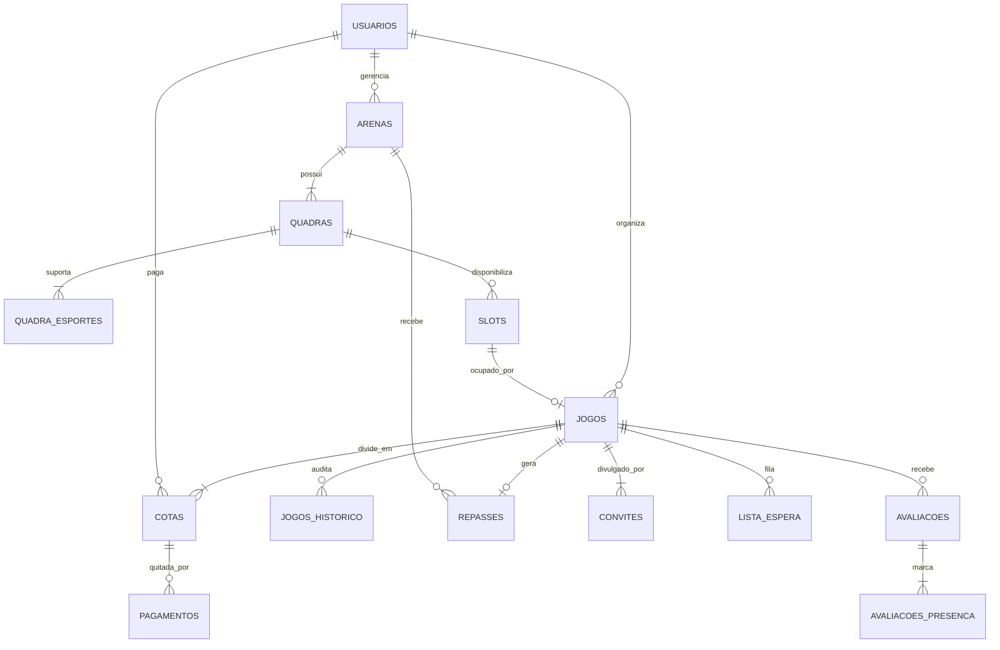

# 16 — Modelo de dados (banco) · SportConnect

> Revisão de 18/11/2026. Schema relacional (PostgreSQL) derivado três vezes de forma cruzada: do diagrama de domínio do [03 §10](03-product-design-prd.md#10-modelo-de-domínio), dos `@Serializable data class`/`enum` reais em `core/model/*.kt`, e do contrato já fechado no [15](15-contrato-api.md) — cada tabela existe para servir um endpoint real, nunca o contrário. Convenções técnicas (nomes de campo, concorrência, erro) estão fixadas no [14](14-arquitetura-backend.md); leia-o primeiro.

---

## 1. Convenções do schema

- **Nomes de coluna:** `snake_case`, mas **mesmo radical** do campo Kotlin/JSON (`valor_cota_centavos` para `valorCota`, não um nome novo) — mesma razão do [14 §3](14-arquitetura-backend.md#3-convenção-de-nomes-português-igual-ao-kotlin--de-propósito): tradução é onde erro de API nasce.
- **Identificadores:** `uuid` (v7 — ordenável por tempo, bom para índice). Isso substitui o gerador do fake (`"$prefixo-novo-${contador++}"`, um contador em memória — nunca usar em produção).
- **Dinheiro:** `bigint`, sempre centavos (RN-01) — nunca `numeric`/`float` para valor monetário.
- **Datas/horas:** `timestamptz`, sempre UTC. Data pura (sem hora) é `date` (só `repasses.data_prevista` usa isso — RN-30 trabalha em dia útil, não instante).
- **Enums:** tipo `ENUM` nativo do Postgres para os que são a própria máquina de estados (`status_reserva`, `status_cota`, `status_pagamento`, `status_slot`, `status_arena`) — ganha checagem em tempo de escrita; adicionar um valor novo exige migração, o que é aceitável (o cliente também precisa de build novo para reconhecer um estado novo).
- **Exclusão:** nenhuma tabela financeira ou de auditoria tem `DELETE` de verdade. "Excluir conta" (LGPD) é um job de anonimização sobre `usuarios`, não um `DELETE CASCADE`.
- **Extensão necessária:** `CREATE EXTENSION btree_gist;` — usada pela restrição de não-sobreposição de horário (RNF-04, §3).

---

## 2. Identidade e acesso

### `usuarios`
| Coluna | Tipo | Nulo? | Notas |
|---|---|---|---|
| `id` | uuid | não | PK |
| `nome` | text | não | |
| `celular` | text | não | único — é o identificador de login (E.164) |
| `email` | text | sim | |
| `cpf` | text | sim | exigido pelo Asaas (gateway escolhido) antes de qualquer cobrança — ver [03 Q-01](03-product-design-prd.md#15-questões-em-aberto) e [ADR — 17](17-adr-gateway-pagamento.md#resposta-à-q-01--cpf-obrigatório-é-regra-do-banco-central-ou-política-do-gateway) |
| `celular_verificado` | boolean | não | default `true` (verificado no próprio OTP de cadastro) |
| `papeis` | `papel_usuario[]` | não | enum `ATLETA, ORGANIZADOR, GESTOR_ARENA, OPERADOR_ARENA`; default `{ATLETA}` |
| `arena_id` | uuid → `arenas.id` | sim | só relevante para `GESTOR_ARENA`/`OPERADOR_ARENA` |
| `avatar_url` | text | sim | objeto storage, não bytes (14 §11) |
| `criado_em` | timestamptz | não | |

Índice: único em `celular`.

### `usuario_consentimentos`
| Coluna | Tipo | Nulo? | Notas |
|---|---|---|---|
| `id` | uuid | não | PK |
| `usuario_id` | uuid → `usuarios.id` | não | |
| `tipo` | text | não | ex. `"termos:2026-11"`, `"marketing"` — mesma convenção do fake (`FakeAuthRepository.registrarConsentimentos`) |
| `concedido` | boolean | não | |
| `em` | timestamptz | não | |

### `refresh_tokens`
| Coluna | Tipo | Nulo? | Notas |
|---|---|---|---|
| `id` | uuid | não | PK |
| `usuario_id` | uuid → `usuarios.id` | não | |
| `token_hash` | text | não | nunca o token puro — hash (ex. SHA-256) |
| `criado_em` | timestamptz | não | |
| `expira_em` | timestamptz | não | |
| `revogado_em` | timestamptz | sim | preenchido na rotação ou no `/auth/logout` |
| `substituido_por_id` | uuid → `refresh_tokens.id` | sim | encadeia a rotação (14 §4) |

> **Códigos OTP não são tabela deste banco.** Alta escrita, vida curta (10 min), exige lock de tentativa com TTL — recomenda-se **Redis** (chave `otp:{celular}`, TTL 10 min, contador de tentativas no mesmo registro) em vez de Postgres. Forma lógica equivalente: `{ celular, codigo_hash, enviado_em, tentativas, bloqueado_ate }` — mesmos campos que `AuthRules`/`FakeAuthRepository` já usam.

### `cartoes_salvos`
| Coluna | Tipo | Nulo? | Notas |
|---|---|---|---|
| `id` | uuid | não | PK |
| `usuario_id` | uuid → `usuarios.id` | não | |
| `gateway_token` | text | não | token opaco do PSP — **nunca** número/CVV (RNF-12, PCI-DSS SAQ-A) |
| `bandeira` | text | não | `VISA`, `MASTERCARD`, ... |
| `ultimos_digitos` | char(4) | não | |
| `validade` | char(5) | não | `"MM/AA"` |
| `criado_em` | timestamptz | não | |

---

## 3. Arenas, quadras e slots

### `arenas`
| Coluna | Tipo | Nulo? | Notas |
|---|---|---|---|
| `id` | uuid | não | PK |
| `nome` | text | não | |
| `documento` | text | não | CNPJ da arena — **não** o CPF de quem cadastra (14 §13.1/15 §4) |
| `logradouro`, `numero`, `bairro` | text | não | |
| `cidade` | text | não | default `'São Paulo'` |
| `uf` | char(2) | não | default `'SP'` |
| `cep` | text | não | |
| `latitude`, `longitude` | double precision | não | ou `geography(Point,4326)` se usar PostGIS para `distanciaKm` no banco em vez de aplicação |
| `fotos` | text[] | não | URLs, máx. 5 (regra de aplicação, `ArenaPhotoStore.MAX`) |
| `comodidades` | text[] | não | texto livre, ex. `{"Vestiário","Wi-Fi"}` |
| `plano` | enum `plano_arena` (`BASICO`,`PRO`) | não | default `BASICO` |
| `duracao_hold_horas` | smallint | não | default `4`; `CHECK (duracao_hold_horas BETWEEN 1 AND 48)` (RN-10) |
| `janela_cancelamento_horas` | smallint | não | default `24`; `CHECK (... BETWEEN 0 AND 72)` (RN-23) |
| `subconta_gateway_id` | text | sim | id da subconta no PSP (RN-30) |
| `status` | enum `status_arena` (`EM_CADASTRO`,`ATIVA`,`SUSPENSA`) | não | default `EM_CADASTRO` — só `ATIVA` aparece em `GET /arenas` |
| `gestor_id` | uuid → `usuarios.id` | sim | |
| `telefone` | text | sim | |
| `descricao` | text | não | default `''` |
| `avaliacao_media` | numeric(2,1) | sim | |
| `total_avaliacoes` | int | não | default `0` |
| `chave_pix` | text | sim | T9; validada em aplicação por `isValidPixKey` antes de gravar |
| `horario_funcionamento` | text | não | default `''`; texto livre (T9) |

Índice: `status` (filtro de busca); GIST em `(latitude,longitude)` ou `geography` se for fazer distância no banco.

### `esportes` (tabela de referência — RN-03/RN-05, não muda por cliente)
| Coluna | Tipo | Notas |
|---|---|---|
| `codigo` | text (PK) | `FUTEBOL_SOCIETY`, `FUTSAL`, ... (mesmos valores do enum `Sport`) |
| `nome_exibicao` | text | |
| `min_vagas`, `max_vagas`, `vagas_padrao` | smallint | tabela RN-05 do [03](03-product-design-prd.md#81-valores-e-rateio) |
| `duracao_padrao_minutos` | smallint | |

> Seed fixo (10 linhas, a tabela do RN-05) — muda por migração, não por escrita de usuário.

### `quadras`
| Coluna | Tipo | Nulo? | Notas |
|---|---|---|---|
| `id` | uuid | não | PK |
| `arena_id` | uuid → `arenas.id` | não | |
| `nome` | text | não | |
| `tipo` | enum `tipo_quadra` | não | `SOCIETY_SINTETICO, QUADRA_POLIESPORTIVA, AREIA, PADEL, SAIBRO, PISO_RAPIDO` |
| `piso` | text | não | |
| `coberta` | boolean | não | |
| `preco_hora_centavos` | bigint | não | fora de pico |
| `preco_hora_pico_centavos` | bigint | não | seg–sex 18h–23h, sáb/dom 8h–20h (regra de aplicação, não de banco) |
| `ativa` | boolean | não | default `true` |

### `quadra_esportes`
| Coluna | Tipo | Notas |
|---|---|---|
| `quadra_id` | uuid → `quadras.id` | PK composta |
| `esporte` | text → `esportes.codigo` | PK composta |
| `capacidade_max` | smallint | `CHECK (capacidade_max <= (SELECT max_vagas FROM esportes WHERE codigo = esporte))` — teto por quadra nunca acima do teto da plataforma (RN-05) |

### `slots`
| Coluna | Tipo | Nulo? | Notas |
|---|---|---|---|
| `id` | uuid | não | PK |
| `arena_id` | uuid → `arenas.id` | não | |
| `quadra_id` | uuid → `quadras.id` | não | |
| `inicio`, `fim` | timestamptz | não | |
| `preco_centavos` | bigint | não | congelado no slot — preço da quadra na hora da **oferta**, não no checkout (o congelamento de V acontece no `jogo`, RN-02) |
| `status` | enum `status_slot` (`LIVRE,EM_CHECKOUT,PRE_RESERVADO,RESERVADO,BLOQUEADO`) | não | default `LIVRE` |
| `checkout_ate` | timestamptz | sim | trava de 10 min (RN-08) |
| `motivo_bloqueio` | text | sim | |
| `jogo_id` | uuid → `jogos.id` | sim | reserva não-terminal que ocupa o slot |
| `reserva_externa` | text | sim | bloqueio manual por telefone/balcão, sem `Jogo` |

Índice/constraint:
```sql
CREATE UNIQUE INDEX slots_jogo_ativo_unico ON slots (jogo_id) WHERE jogo_id IS NOT NULL;
```

---

## 4. Jogos e reservas

> `Jogo` e `Reserva` são 1:1 no cliente (o 03 já anota isso: "o estado é da Reserva; o Jogo o expõe") — uma única tabela, sem necessidade de junção.

### `jogos`
| Coluna | Tipo | Nulo? | Notas |
|---|---|---|---|
| `id` | uuid | não | PK |
| `titulo` | text | não | |
| `organizador_id` | uuid → `usuarios.id` | não | |
| `esporte` | text → `esportes.codigo` | não | |
| `arena_id` | uuid → `arenas.id` | não | |
| `quadra_id` | uuid → `quadras.id` | não | |
| `slot_id` | uuid → `slots.id` | não | |
| `inicio`, `fim` | timestamptz | não | denormalizado do slot (histórico sobrevive mesmo se o slot mudar) |
| `numero_vagas` | smallint | não | imutável após ativação (RN-03) |
| `politica` | enum `politica_nao_pagamento` (`ORGANIZADOR_COBRE,CANCELAR_E_REEMBOLSAR,RERRATEAR_ENTRE_PAGANTES`) | não | default `ORGANIZADOR_COBRE` |
| `garantia` | enum `garantia_cobertura` (`PIX,CARTAO,NAO_SE_APLICA`) | não | |
| `teto_complemento_pct` | smallint | não | default `50`; `CHECK (BETWEEN 0 AND 100)` (RN-16) |
| `visibilidade` | enum `visibilidade_jogo` (`PRIVADO,VAGAS_ABERTAS`) | não | default `PRIVADO` |
| `observacoes` | text | sim | |
| `codigo_convite` | text | não | único; gerado por ULID/nanoid truncado, nunca determinístico (14 §13.4) |
| `criado_em` | timestamptz | não | |
| `valor_total_centavos` | bigint | não | "V", congelado na ativação (RN-02) |
| `status` | enum `status_reserva` (`RASCUNHO,AGUARDANDO_PAGAMENTOS,CONFIRMADO,EM_ANDAMENTO,CONCLUIDO,CANCELADO,EXPIRADO`) | não | default `RASCUNHO` |
| `etapa_prazo` | enum `etapa_prazo` (`COLETANDO_COTAS,JANELA_RESOLUCAO`) | sim | só durante `AGUARDANDO_PAGAMENTOS` |
| `ativada_em` | timestamptz | sim | |
| `prazo_cotas` | timestamptz | sim | "P", RN-11 |
| `prazo_hold` | timestamptz | sim | "H", RN-10 |
| `motivo_cancelamento` | text | sim | obrigatório em aplicação quando `cancelado_por = ARENA` (RN-24) |
| `cancelado_por` | enum `ator` (`ORGANIZADOR,ATLETA,ARENA,SUPORTE,SISTEMA`) | sim | |
| `motivo_confirmacao` | enum `motivo_confirmacao` (`TODAS_PAGAS,COBERTURA,RERRATEIO,INTEGRAL`) | sim | |
| `motivo_expiracao` | enum `motivo_expiracao` (`POLITICA_B,COBERTURA_NAO_PAGA,RERRATEIO_FALHOU`) | sim | |
| `confirmada_em` | timestamptz | sim | |
| `version` | bigint | não | default `0`; incrementa em toda transição — **controle de concorrência otimista** (14 §7), substitui o `Mutex` do fake |

Restrições:
```sql
-- No máximo uma reserva não-terminal por slot.
CREATE UNIQUE INDEX jogos_slot_ativo_unico ON jogos (slot_id)
  WHERE status NOT IN ('CANCELADO', 'EXPIRADO');

-- Zero overlap de horário por quadra entre reservas não-terminais (RNF-04).
ALTER TABLE jogos ADD CONSTRAINT jogos_sem_sobreposicao
  EXCLUDE USING gist (quadra_id WITH =, tstzrange(inicio, fim) WITH &&)
  WHERE (status NOT IN ('CANCELADO', 'EXPIRADO'));

CREATE UNIQUE INDEX jogos_codigo_convite_unico ON jogos (codigo_convite);
CREATE INDEX jogos_organizador_idx ON jogos (organizador_id);
CREATE INDEX jogos_arena_status_idx ON jogos (arena_id, status);
```

### `jogos_historico` (auditoria imutável, RN-34)
| Coluna | Tipo | Nulo? | Notas |
|---|---|---|---|
| `id` | uuid | não | PK |
| `jogo_id` | uuid → `jogos.id` | não | |
| `de` | enum `status_reserva` | não | |
| `para` | enum `status_reserva` | não | |
| `em` | timestamptz | não | |
| `ator` | enum `ator` | não | |
| `motivo` | text | sim | |

Só `INSERT` — nunca `UPDATE`/`DELETE` (é o log de auditoria que RNF-28 exige).

### `cotas`
| Coluna | Tipo | Nulo? | Notas |
|---|---|---|---|
| `id` | uuid | não | PK |
| `jogo_id` | uuid → `jogos.id` | não | |
| `valor_centavos` | bigint | não | |
| `taxa_conveniencia_centavos` | bigint | não | default `0` (RN-07; zero enquanto pendente, em `COMPLEMENTO` e cobertura) |
| `tipo` | enum `tipo_cota` (`PADRAO,COMPLEMENTO`) | não | default `PADRAO` |
| `origem` | enum `origem_pagamento` (`ATLETA,COBERTURA`) | sim | |
| `status` | enum `status_cota` (`PENDENTE,PAGA,REEMBOLSADA,EXPIRADA`) | não | default `PENDENTE` |
| `atleta_id` | uuid → `usuarios.id` | sim | nasce sem atleta, atribuída no checkout |
| `organizador` | boolean | não | default `false` — recebe a sobra de centavos (RN-04), paga primeiro (RN-09) |
| `checkout_ate` | timestamptz | sim | trava de 10 min (RN-19) |
| `paga_em` | timestamptz | sim | |
| `metodo` | enum `metodo_pagamento` (`PIX,CARTAO`) | sim | |
| `pagamento_id` | uuid → `pagamentos.id` | sim | o pagamento `CONFIRMADO` que quitou esta cota |
| `cota_original_id` | uuid → `cotas.id` | sim | auto-referência — só para `COMPLEMENTO` (RN-16) |
| `pre_aceite_rerrateio` | boolean | não | default `false` |
| `offered_for_substitution` | boolean | não | default `false` — T8/RN-26 |

Índices: `(jogo_id, status)`, `(atleta_id)`; `CHECK` de uma cota `PAGA` por `(jogo_id, atleta_id)` quando `tipo='PADRAO'` (RN-20, "uma cota por pessoa") é melhor como regra de aplicação (a troca via substituição legitimamente cria uma segunda linha histórica) — não forçar unicidade rígida no banco aqui.

---

## 5. Pagamentos e repasses

### `pagamentos`
| Coluna | Tipo | Nulo? | Notas |
|---|---|---|---|
| `id` | uuid | não | PK |
| `jogo_id` | uuid → `jogos.id` | não | |
| `cota_id` | uuid → `cotas.id` | não | |
| `pagador_id` | uuid → `usuarios.id` | não | |
| `metodo` | enum `metodo_pagamento` | não | |
| `valor_centavos` | bigint | não | cota + taxa |
| `taxa_conveniencia_centavos` | bigint | não | default `0` |
| `status` | enum `status_pagamento` (`CRIADO,AGUARDANDO_CONFIRMACAO,CONFIRMADO,FALHOU,EXPIRADO,ESTORNO_EM_PROCESSAMENTO,ESTORNADO,ESTORNO_FALHOU`) | não | default `CRIADO` — `ESTORNO_FALHOU` é novo (T6) |
| `gateway_charge_id` | text | não | referência opaca do PSP |
| `idempotency_key` | text | não | **único** — RNF-06, chave enviada pelo cliente em `Idempotency-Key` |
| `criado_em` | timestamptz | não | |
| `expira_em` | timestamptz | sim | |
| `pix_copia_cola` | text | sim | payload do BR Code |
| `confirmado_em` | timestamptz | sim | |
| `estornado_em` | timestamptz | sim | |

```sql
CREATE UNIQUE INDEX pagamentos_idempotency_key_unico ON pagamentos (idempotency_key);
CREATE INDEX pagamentos_cota_idx ON pagamentos (cota_id);
```

> Hoje o cliente **deriva** o histórico de pagamentos a partir das cotas de cada jogo (não existe tabela própria lá). Esta tabela é a versão real — `GET /me/pagamentos` ([15 §2](15-contrato-api.md#2-perfil-me)) deve consultar isto, não recalcular de `cotas` a cada chamada.

### `repasses`
| Coluna | Tipo | Nulo? | Notas |
|---|---|---|---|
| `id` | uuid | não | PK |
| `arena_id` | uuid → `arenas.id` | não | |
| `jogo_id` | uuid → `jogos.id` | não | |
| `valor_bruto_centavos` | bigint | não | = `valor_total_centavos` do jogo |
| `comissao_centavos` | bigint | não | RN-07a: 8% Básico / 4% Pro, arredondamento `(bruto*pct+50)/100` |
| `valor_liquido_centavos` | bigint | não | bruto − comissão |
| `data_prevista` | date | não | D+1 útil após `CONCLUIDO` (próximo dia que não é sáb/dom — sem calendário de feriados no MVP) |
| `status` | enum `status_repasse` (`AGENDADO,LIQUIDADO,RETIDO`) | não | default `AGENDADO` |
| `liquidado_em` | timestamptz | sim | |
| `descricao` | text | não | default `''` |

---

## 6. Convite, lista de espera, avaliação

### `convites`
| Coluna | Tipo | Nulo? | Notas |
|---|---|---|---|
| `id` | uuid | não | PK |
| `jogo_id` | uuid → `jogos.id` | não | |
| `codigo_curto` | text | não | único — mesmo valor de `jogos.codigo_convite` (mantidos como tabelas separadas porque um jogo pode, no futuro, ter mais de um canal de convite) |
| `url` | text | não | |
| `canal` | enum `canal_convite` (`WHATSAPP,COPIADO,NATIVO,OUTRO`) | não | default `WHATSAPP` |
| `status` | enum `status_convite` (`ATIVO,ENCERRADO`) | não | default `ATIVO` |
| `aberturas` | int | não | default `0` |

### `lista_espera`

> **Esta é a única fila de espera do sistema** — resolve a dívida #1 do [14 §13](14-arquitetura-backend.md#13-dívidas-a-resolver-antes-de-desenhar-a-api): o cliente hoje tem duas implementações divergentes (uma em memória, outra contra o repositório); o servidor só reconhece esta forma.

| Coluna | Tipo | Nulo? | Notas |
|---|---|---|---|
| `id` | uuid | não | PK |
| `jogo_id` | uuid → `jogos.id` | não | |
| `usuario_id` | uuid → `usuarios.id` | não | |
| `usuario_nome` | text | não | snapshot do nome no momento da entrada (igual ao cliente) |
| `posicao` | smallint | não | recalculada a cada saída (FIFO) |
| `entrou_em` | timestamptz | não | |
| `status` | enum `status_lista_espera` (`AGUARDANDO,NOTIFICADO,CONVERTIDO,EXPIRADO,SAIU`) | não | default `AGUARDANDO` |
| `notificado_em` | timestamptz | sim | |
| `exclusividade_ate` | timestamptz | sim | 15 min de exclusividade (RN-27) |

```sql
CREATE UNIQUE INDEX lista_espera_ativa_unica ON lista_espera (jogo_id, usuario_id)
  WHERE status IN ('AGUARDANDO', 'NOTIFICADO');
```
Limite de 10 pessoas por jogo (RN-27) é melhor como regra de aplicação (contagem antes do `INSERT`) do que `CHECK` de banco.

### `avaliacoes`

> Resolve as dívidas #2 e #3 do [14 §13](14-arquitetura-backend.md#13-dívidas-a-resolver-antes-de-desenhar-a-api): a forma real é a de `GameRating`/`Attendance` (o que o cliente de fato envia), **não** a classe `Avaliacao` de `core/model/Social.kt`, que nunca é usada. `court_stars`/`comentario` existem como colunas próprias porque devem ser persistidos — hoje o cliente os descarta.

| Coluna | Tipo | Nulo? | Notas |
|---|---|---|---|
| `id` | uuid | não | PK |
| `jogo_id` | uuid → `jogos.id` | não | |
| `autor_id` | uuid → `usuarios.id` | não | quem enviou a avaliação (precisa ter `participa(usuarioId)` e `jogo.status = CONCLUIDO`) |
| `court_stars` | smallint | sim | 1–5 |
| `comentario` | text | sim | |
| `criada_em` | timestamptz | não | |

```sql
CREATE UNIQUE INDEX avaliacoes_autor_unico ON avaliacoes (jogo_id, autor_id);
```

### `avaliacoes_presenca` (filha de `avaliacoes` — um registro por pessoa marcada)
| Coluna | Tipo | Nulo? | Notas |
|---|---|---|---|
| `avaliacao_id` | uuid → `avaliacoes.id` | não | PK composta |
| `usuario_id` | uuid → `usuarios.id` | não | PK composta — quem foi marcado |
| `attendance` | enum `attendance` (`ATTENDED,NO_SHOW,LATE`) | não | |

A consulta "Presença: 9/10 dos jogos" do perfil (T7, `GET /me/presenca`, [15 §7](15-contrato-api.md#7-avaliação-pós-jogo-e-presença)) é:
```sql
SELECT count(*) FILTER (WHERE attendance IN ('ATTENDED','LATE')) AS presente, count(*) AS total
FROM avaliacoes_presenca
WHERE usuario_id = $1;
```

---

## 7. Fora deste banco (de propósito)

| O que | Por quê |
|---|---|
| Eventos de analytics (`AnalyticsEvents`, 60 nomes) | *Fire-and-forget*, sem necessidade de join relacional — vai para um serviço de eventos (provedor terceiro ou fila própria), não para o Postgres operacional (14 §12). |
| Códigos OTP | Vida curta, alta escrita, precisa de TTL — Redis, não Postgres (ver §2). |
| Fotos (bytes) | Object storage (S3-compatível) + CDN; o banco só guarda a URL (`arenas.fotos`, `usuarios.avatar_url`). |
| Dados de cartão (número, CVV) | Nunca tocam este banco nem o backend — tokenizados no PSP (RNF-12). |

---

## 8. Diagrama de relacionamento (resumo)



---

*Depende de: [14 — Arquitetura técnica](14-arquitetura-backend.md), [15 — Contrato de API](15-contrato-api.md), [03 §10](03-product-design-prd.md#10-modelo-de-domínio). Este é o último documento da cadeia 14→15→16 — qualquer mudança de modelo a partir daqui deve atualizar os três, nessa ordem.*
